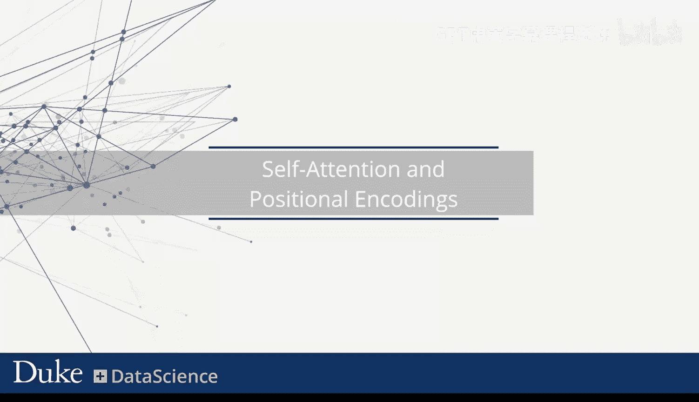
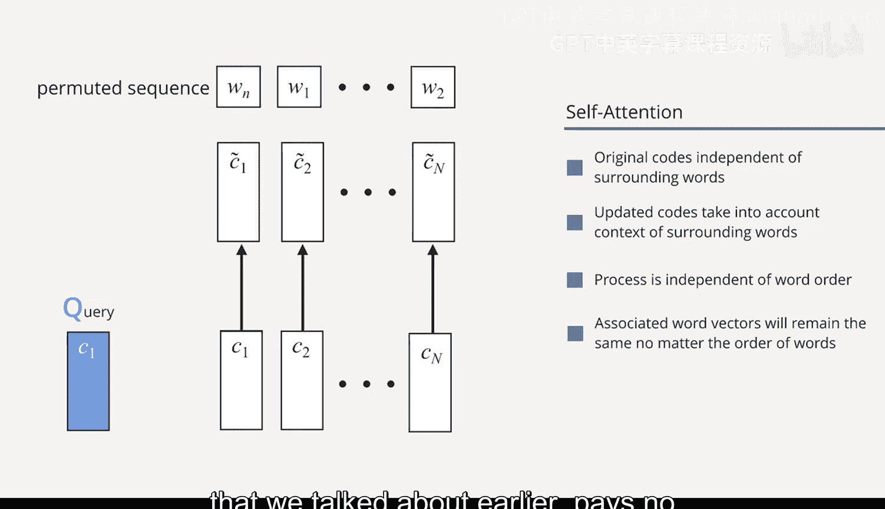
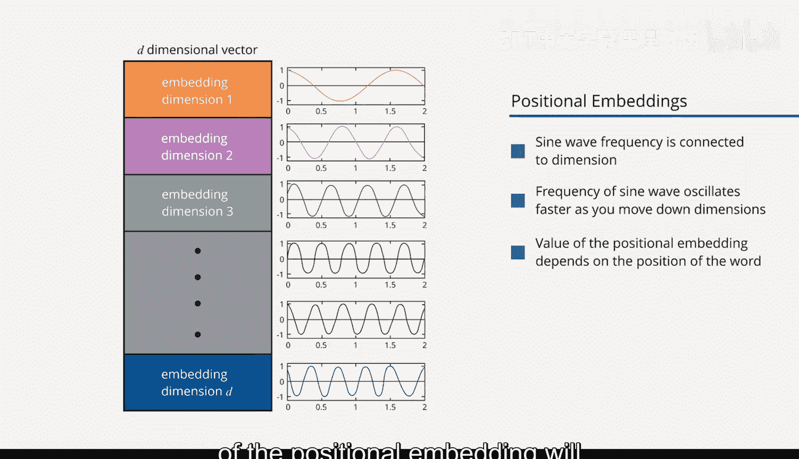
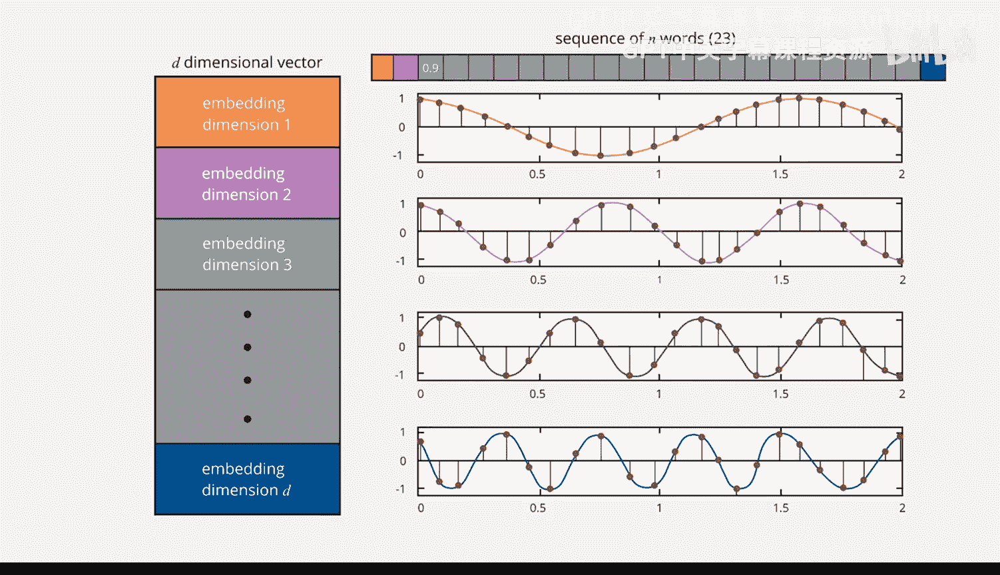
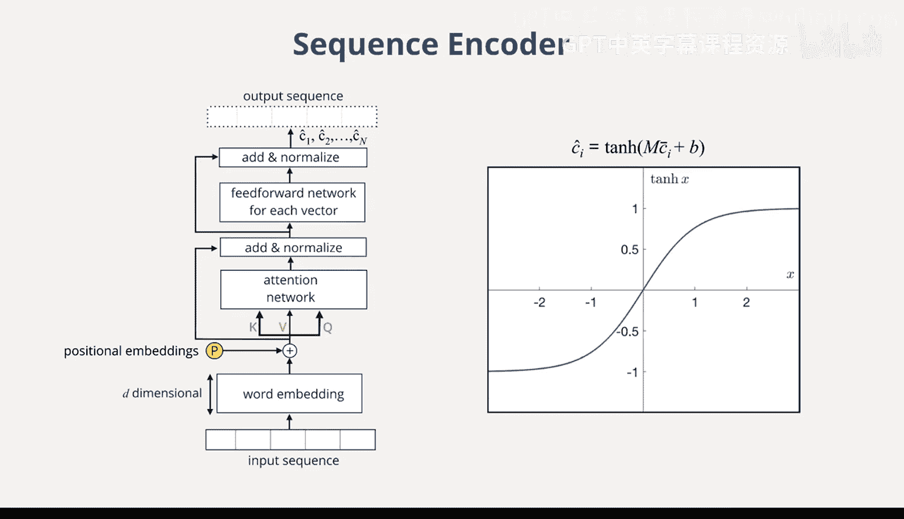
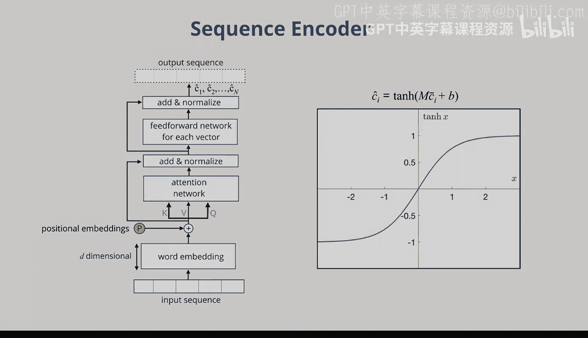

# 机器学习：57：自注意力与位置编码

在本节课中，我们将学习自注意力机制如何为序列中的每个单词生成包含上下文信息的向量表示，并探讨如何通过位置编码来解决自注意力机制忽略单词顺序的问题。

## 概述

我们从一个由N个单词组成的序列开始：`W1, W2, ..., WN`。首先，我们将每个单词映射为一个独立的向量，称为**编码**（Code），记作 `C1, C2, ..., CN`。然而，这些初始编码存在一个问题：它们没有考虑单词在句子中的上下文关系。例如，“bank”一词在“river bank”和“bank account”中含义不同，但初始编码无法体现这种差异。

为了解决这个问题，我们引入了**自注意力机制**。该机制能够将每个单词的初始编码 `Ck`，转换成一个新的编码 `C̃k`。这个新编码不仅保留了单词本身的含义，还融合了它与序列中所有其他单词的关系信息。

上一节我们介绍了自注意力的基本概念，本节中我们来看看其具体工作原理以及一个关键的改进——位置编码。

## 自注意力机制的工作原理

自注意力机制的核心思想是：为序列中的每个单词计算一个新的表示，该表示是序列中所有单词原始表示的加权和。权重由单词之间的“相关性”决定。

具体步骤如下：
1.  对于目标单词 `k`，我们将其编码 `Ck` 作为**查询**（Query）。
2.  将序列中所有单词的编码 `C1, C2, ..., CN` 既作为**键**（Key），也作为**值**（Value）。
3.  计算查询 `Ck` 与每个键 `Cj` 的**点积**（Dot Product），得到一个相关性分数。这个分数衡量了单词 `k` 与单词 `j` 的关联程度。
    *   公式：`score(k, j) = Ck · Cj`
4.  对所有相关性分数应用 **Softmax** 函数，将其转换为和为1的正数权重 `Rk1, Rk2, ..., RkN`。
    *   公式：`Rkj = softmax(score(k, j))`
5.  新的编码 `C̃k` 是所有权重 `Rkj` 与对应值 `Cj` 的加权和。
    *   公式：`C̃k = Σ (Rkj * Cj)`， 其中 `j` 从1到 `N`。

这个过程确保了 `C̃k` 是原始编码 `C1` 到 `CN` 的一个**凸组合**。我们可以对序列中的每一个单词（`k=1, 2, ..., N`）重复此过程，从而得到一组全新的、包含上下文信息的编码序列：`C̃1, C̃2, ..., C̃N`。

## 自注意力机制的局限性：忽略词序

然而，上述自注意力机制存在一个显著缺陷：**它对单词的顺序不敏感**。

这意味着，如果我们打乱输入序列 `W1, W2, ..., WN` 的顺序（例如进行排列置换），经过自注意力机制处理后，输出的新编码序列 `C̃1, C̃2, ..., C̃N` 在内容上将是相同的，只是顺序相应地被打乱。单词的向量表示不会因为它在句子中的位置不同而改变。

这显然不符合语言的实际规律。单词的顺序至关重要。例如，“猫追老鼠”和“老鼠追猫”表达了完全不同的意思。因此，我们需要对模型进行改进，使其能够**感知单词的位置信息**。

## 引入位置编码

为了解决词序问题，我们引入**位置编码**（Positional Embedding）。其核心思想是：为序列中的每个位置（第1个词，第2个词...）生成一个独特的、固定维度的向量，然后将这个向量加到该位置单词的初始编码上。

这样，模型在计算注意力时，使用的输入就变成了“单词含义 + 位置信息”。

以下是构建位置编码 `P` 的一种常用方法（使用正弦和余弦函数）：

对于位置为 `pos` 的单词，其位置编码向量的第 `i` 个维度（`i` 为偶数或奇数）的值由以下公式给出：
*   `P(pos, 2i) = sin(pos / 10000^(2i/d))`
*   `P(pos, 2i+1) = cos(pos / 10000^(2i/d))`

其中，`d` 是编码向量的总维度。

这种设计具有以下特点：
*   **每个位置有唯一编码**：不同 `pos` 值会产生不同的正弦/余弦波形组合，从而生成独特的向量。
*   **模型能感知相对位置**：由于正弦函数的性质，对于固定的偏移量 `k`，`P(pos + k)` 可以表示为 `P(pos)` 的线性函数，这有助于模型学习单词间的相对距离。
*   **能处理任意长度序列**：公式是确定性的，可以计算训练时未见过的序列位置。

## 完整的序列编码器架构

结合自注意力、位置编码和其他优化技术，我们得到了一个强大的**序列编码器**（Sequence Encoder）模块。以下是其核心组件和数据流：

1.  **输入与词嵌入**：输入是一个单词序列。首先通过**词嵌入层**将每个单词映射为一个 `d` 维向量。
2.  **添加位置编码**：为序列中的每个位置生成一个 `d` 维的位置编码向量 `P`。将词嵌入向量与对应的位置编码向量**相加**，得到融合了语义和位置信息的输入表示。
3.  **自注意力层**：将上一步的结果同时作为**查询**、**键**和**值**，输入到自注意力网络中。该层输出包含全局上下文信息的新向量序列。
4.  **残差连接与层归一化**：将自注意力层的输出与它的输入（即步骤2的结果）进行**相加**（这就是**残差连接**或**跳跃连接**），然后进行**层归一化**。这有助于缓解梯度消失问题，稳定训练过程。
5.  **前馈神经网络**：将归一化后的每个向量独立地通过一个简单的**前馈神经网络**（通常是两层线性变换加一个激活函数，如ReLU或tanh）。这为模型增加了非线性变换能力。
6.  **再次残差连接与层归一化**：将前馈网络的输出与它的输入（即步骤4的结果）再次进行**相加**和**层归一化**，得到该编码器模块的最终输出。

这个编码器模块是Transformer等现代自然语言处理模型的基础构件。通过堆叠多个这样的模块，模型能够学习到非常复杂和深层的语言表示。

## 总结

本节课中我们一起学习了：
1.  **自注意力机制**：它通过计算序列内部单词间的相关性，为每个单词生成包含上下文信息的向量表示。其核心公式是 `C̃k = Σ (softmax(Ck · Cj) * Cj)`。
2.  **自注意力的局限性**：该机制本身是**排列等变**的，无法区分单词的顺序，而词序在语言中至关重要。
3.  **位置编码的解决方案**：我们通过为每个位置生成一个独特的向量（例如使用正弦/余弦函数），并将其加到单词的初始嵌入上，从而将位置信息注入模型。公式为 `P(pos, 2i)=sin(pos/10000^(2i/d))` 和 `P(pos, 2i+1)=cos(pos/10000^(2i/d))`。
4.  **完整的序列编码器**：结合词嵌入、位置编码、自注意力层、残差连接、层归一化和前馈网络，构成了一个强大的序列编码基础模块。这个模块能够同时处理单词的语义、位置及其在全局上下文中的关系。

在下一节课中，我们将逐一深入剖析这个序列编码器的各个组件，从概念上理解它们的作用，并探讨为何这种架构能如此有效地处理自然语言任务。