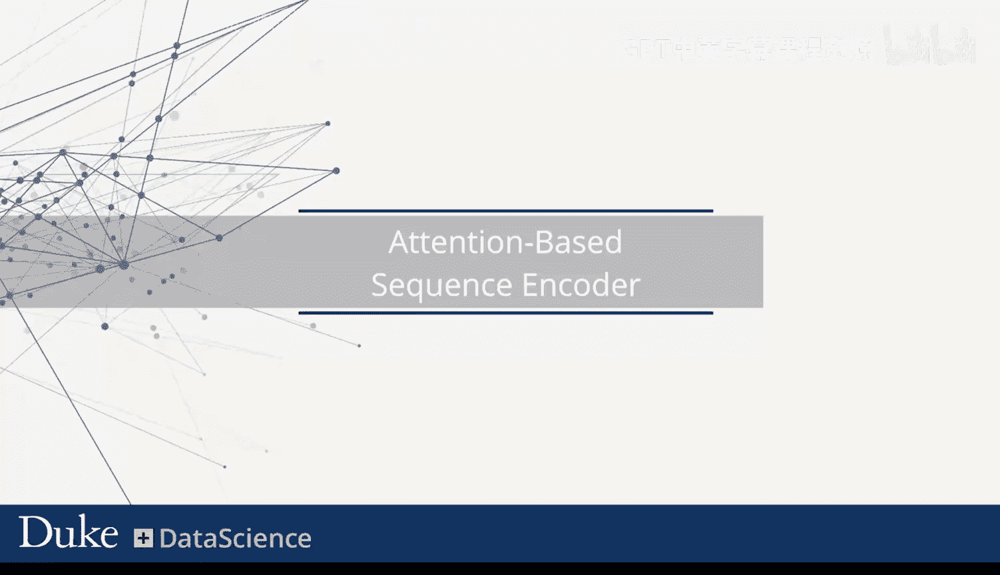
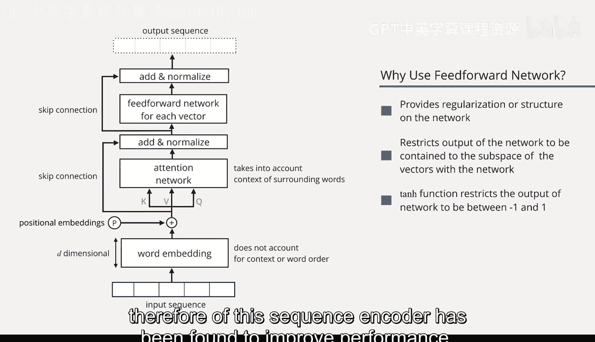
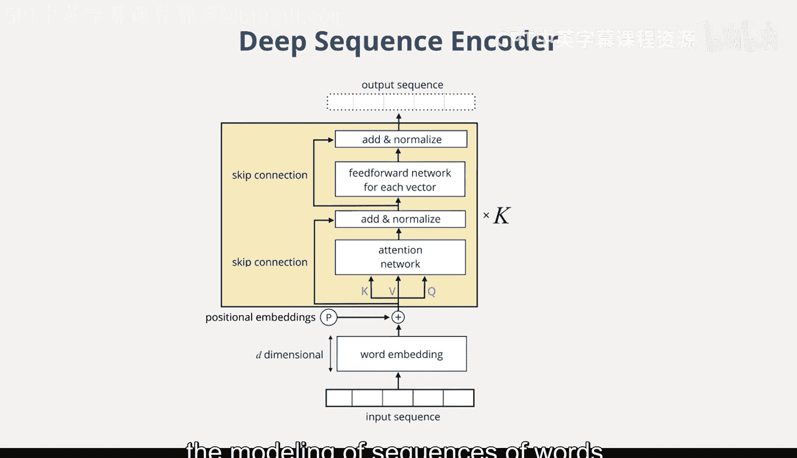
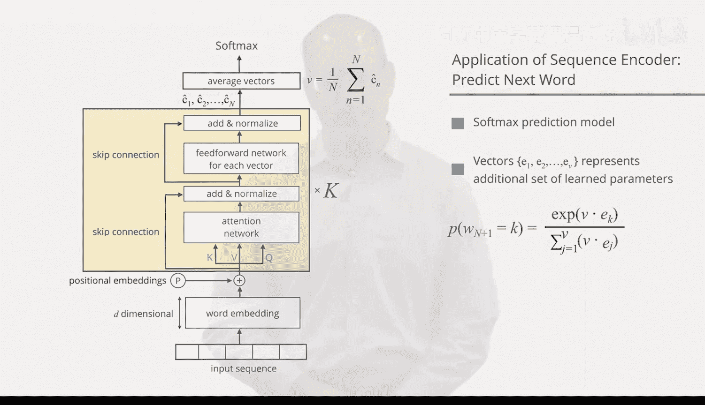
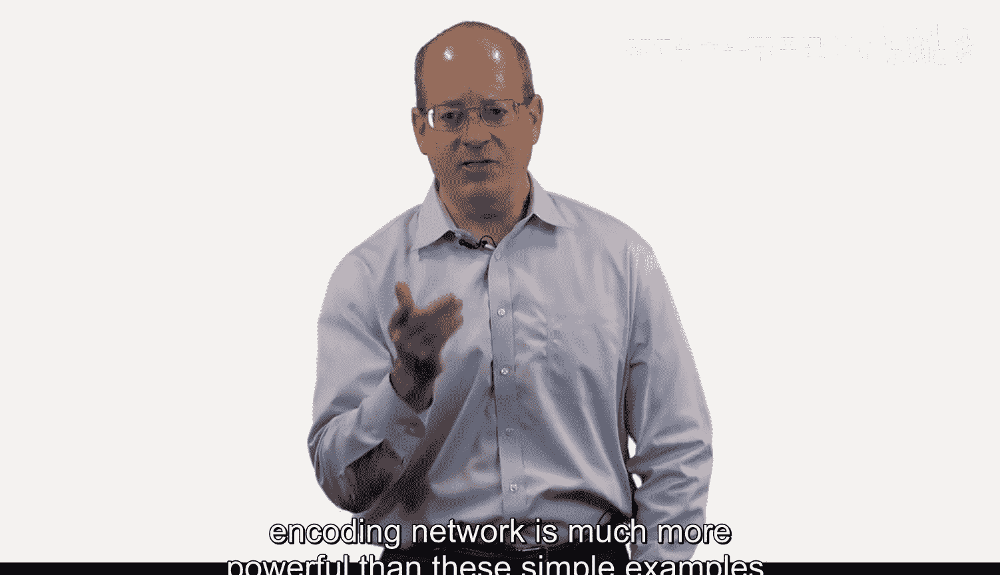

# 杜克大学《机器学习｜Introduction to Machine Learning》中英字幕 p58 58_05_01_基于注意力的序列编码器.zh_en -BV1yjvdBQEaU_p58-

Okay， so in the last lesson。We introduced this new framework。For modeling sequences of words。

 this framework is fundamental to what's called the transformer network。

 which is a modern way of doing neural network based modeling of sequences of words。

 very important that we understand each of its components because this is going to come up again and again。

 so let's walk through each of these components and review them and to think about what they mean。

So the first step of we're going to start at the bottom and work our way up to the top。

So the first idea is that we're going to take a sequence of words。W 1， W 2， W N。

 which correspond to the n words in a sequence。 We're going to map each of those words to a vector。

 a d dimensionmensional vector， those are called word embeddings in the way that we talked about at the very beginning。

 those word embeddings reflect meaning， meaning of the words， the components。

 those d components of the words reflect meaning of the associated word。 The very important concept。

 However， that word embedding in its simplest form does not take into account the contextual information of the surrounding words。

 The other thing is it does not take into account the order of the words。

So the next step is this positional embedding concept。

So now we're going to introduce new D dimensional vectors associated with every word。 However。

 these d dimensional vectors are not connected to the meaning of the word。

 They're connected to the position of the word。 And so depending upon the position of the word。Each。

Each word will have a different positionally dependent D dimensional vector。

 and now we're going to take each of the N。Vactctorors associated with the n words and each of the n positional vectors with each of which is dimension。

 D dimensional。 and we're going to add it。To the word embeddings at the bottom。 And so now。

 after this word embedding plus positional embedding， we have words。

That characterize the meaning of the word。 We have word vectors。

 which account for the meaning of the word， as well as the position of the word。 Now。

 if you look at this， this idea of word embedding plus positional embedding。

 It may be kind of counterintuitive that you could just do something as simple as this as something as just adding them together。

 And indeed， it is not obvious that this is a good idea。

 But what we find in practice is that this works quite effectively。 So at this point。

 it's not obvious that this would be a good thing to do。However。

 it is a relatively simple thing to do， and we always should favor simple models wherever we can。

 So what we're going to do is with this simple word embedding plus positional embedding。

 we hope that we can get a good natural language processing engine and what is found in practice is that you can。

 So this is a relatively simple idea Now after we take the word embedding plus positional embedding we've taken into account the meaning of the word as well as the position of the word。

 However， those word embeddings are done out of context。

 they do not take into to account the context of the words。

 So now each of those word vectors plays the role of the keys K the values V and the queries Q。

 So each of those word embeddings now plays the role of K V and Q。

And they go into an attention network that we talked about earlier。

Attention network takes into account the context of the words。

 so now we have the meaning of the word through the word embedding。

 we have positioned through the positional embedding and now we have context through the attention network and then it has been found convenient to not lose the original embedding vectors and so we have what's called a skip connection。

 what that means is it skips around the attention network and then we add it to the output of the attention network。

 This has been found。 these skip connections have been found to be effective。

 We then finally introduce a feed forward neural network through through which those vectors are sent this has attractive features you might ask why are we doing this with the neural network there are two reasons we do this through the through the process。

Of the neural network， we provide， if you will， regularization or structure on this network。

 and this is manifested two ways， one way is somewhat mathematical。

 which I'll just note for the mathematically inclined what it does is it restricts the output of the neural network to be constrained to the subspace of the vectors associated with the neural network。

 This is a mathematical concept which if you're not familiar with subspaces that's okay。

 but the key thing is it tends to improve the performance。

 the other thing is through the hyperbolic 10 the T and a T and H function。

 it restricts the output of that neural network to be between negative one in one and so this constraint on the values of the output of the neural network and therefore of this sequence encoder。

Has been found to improve performance Now this， this process of attention network， neural network。

 so we take the word embedding， we then do the positional embedding。

 we add that together and then those vectors， the sequence of N vectors is then sent into the intention network and then subsequently into the neural network with the attention with the skip connections。

 if we could do this one time。

There's no reason why we can't do it K times。 And so we can repeat this process。 K times。

 So K could be equal to3。 In practice， it's often K is often equal to6。

 And so this process of attention， neural network with skip connections in between。

 this can be done repeatedly。 And elsewhere in the class， we talked about deep neural networks。

 and it's been found in practice that the introduction of these deep networks is has yields good performance。

 And so this is our final deep sequence encoder。 This is the key module that we will be using in this form of what's called a transformer network for the modeling of sequences of words。

 Now， once we have this。

This sequence encoder。 There are many things we can do with it。

 One thing that we might want to do is to take a sequence of n words and quantify the sentiment of those words are are the n words in our sequence in our sentence or in our paragraph Are they reflecting something positive。

 perhaps a positive review of a movie or are they reflecting something negative， for example。

 a negative review of a restaurant。 So sentiment analysis is a very common problem here。

 we're going to say that the sentiment is binary， it is positive or negative。

 And so the equation that you see on the middle right is the sigmoid or logistic function that we have seen elsewhere in this class。

 And so one way that you might use this sequence encoder is you take the input sequence。

 you do the word embedding。 you do the positional embedding you do this attention。Neur network。

 you do this K times after you're done， you have a sequence of n vectors。Or end codes。

 which are reflected at the top。One very simple thing that you might do is just take the average of those codes and that's what the equation at the top is meant to reflect and we take the average of the sequence of codes and we represent that as V- remember this is a sequence of n codes。

 so the average is1 over n to time plus times the sum of the codes。

Ne vector v is a vector which is an encoding or representation of the original sequence of n words。

 we now introduce a new parameter which is the vector E and remember the dot product V dot E is an inner product between the final average code V and the vector E and then we can quantify the sentiment in this way and now the vector E is an additional set of parameters that we need to learn in the context in this case of sentiment analysis Another example that we have talked about elsewhere in the class is the idea of predicting the next word so you have a sequence of n words W1 through WN now what we would like to do is to predict the next word W n plus1 the n plus1 word in the sequence and so the question is what is the probability that the next word。

The n plus one word corresponds to the k word in our vocabulary and so one way that we can do this is we looking at the left。

 we have the sequence of n words， there're map two word embeddings。

 then we have positional embeddings add， then we'd go through this attention network plus neural network K times and then again at the top we have a sequence of n vectors。

 we take the average of those which we call V and then on the middle right。

 we have this equation we've talked about this elsewhere in the class， this is called the softm。

An E K， which is an additional vector， which is associated with the K word。

And so now we have a new set of parameters that we have to learn， which are the set of parameters E1。

 E2 through EV for a vocabulary of size V， and then through this softmax construct。

 we can quantify the probability of the next word， through this sentiment analysis and the predict the next word setup are very simple problems that we might want to solve with this this what we call transformer encoding network。

 however， this framework through this transformer encoding network is much more powerful than these simple examples。

 which is now going to lead us into the next part of the class。

 which is the next lesson which is going to address the key application of these transformer networks。

 which is not simply predicting the next word but predicting the next sequence of words。

