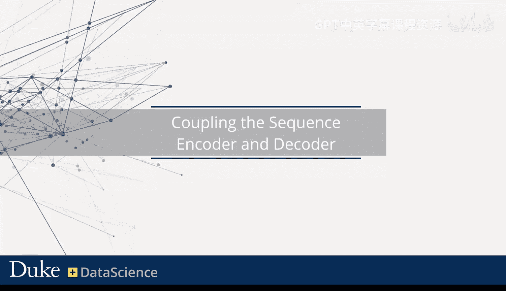
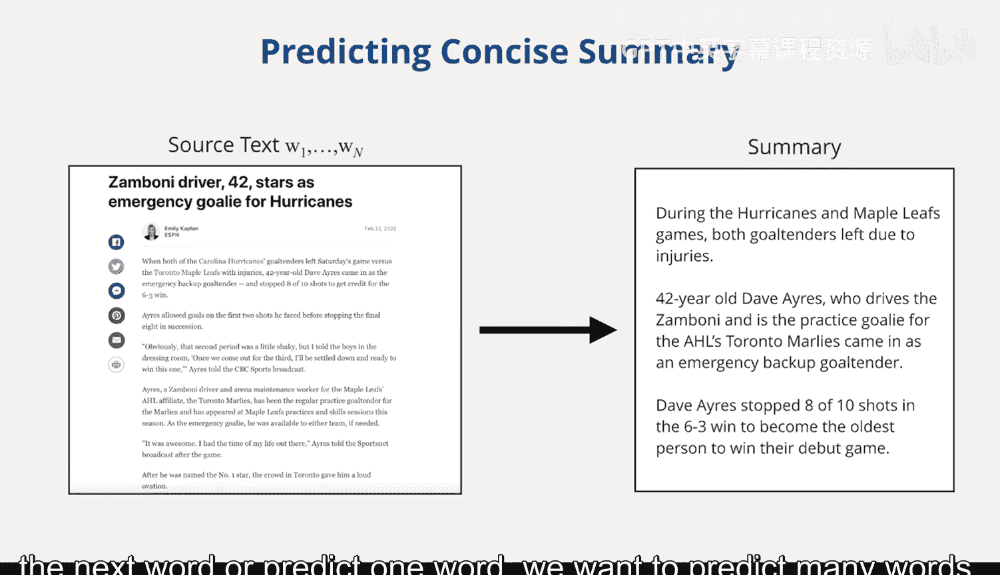
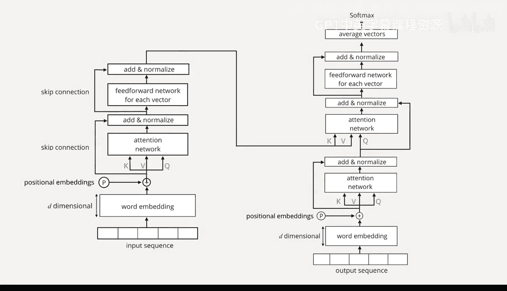
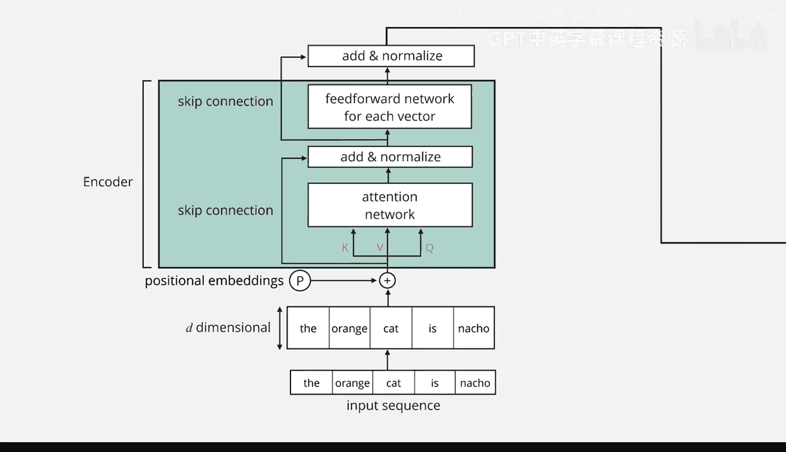
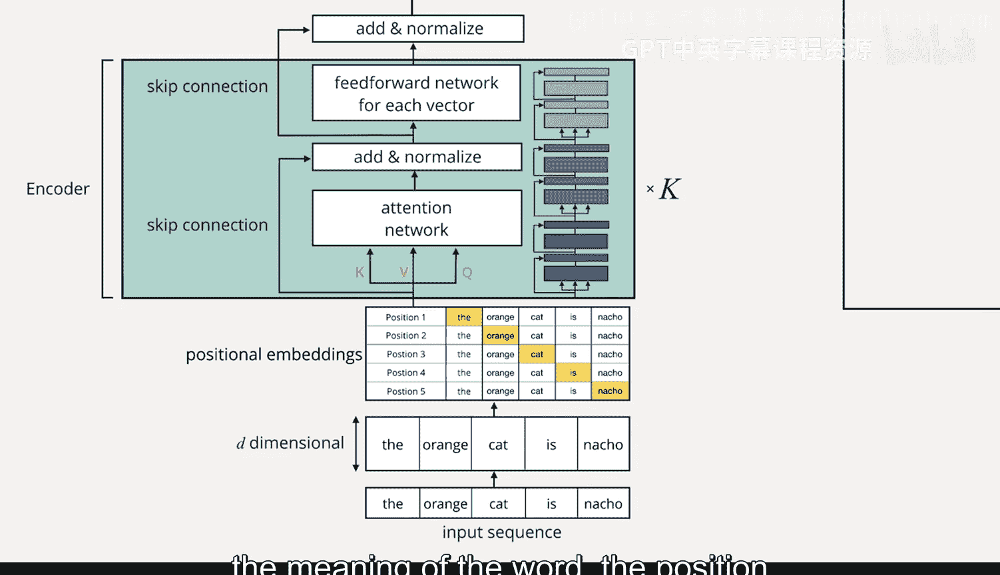
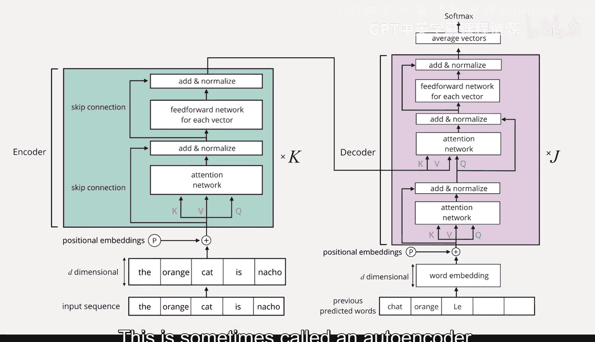
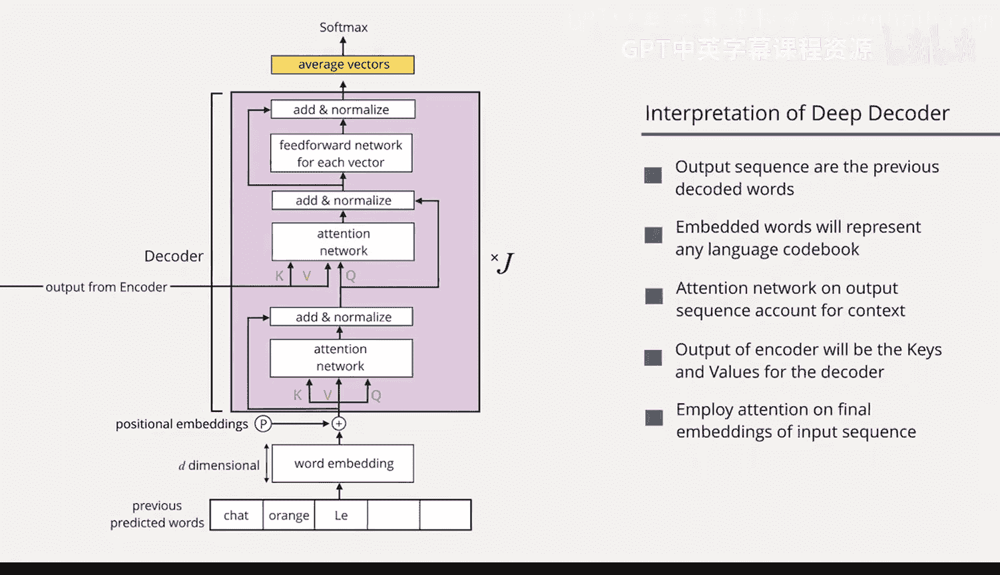
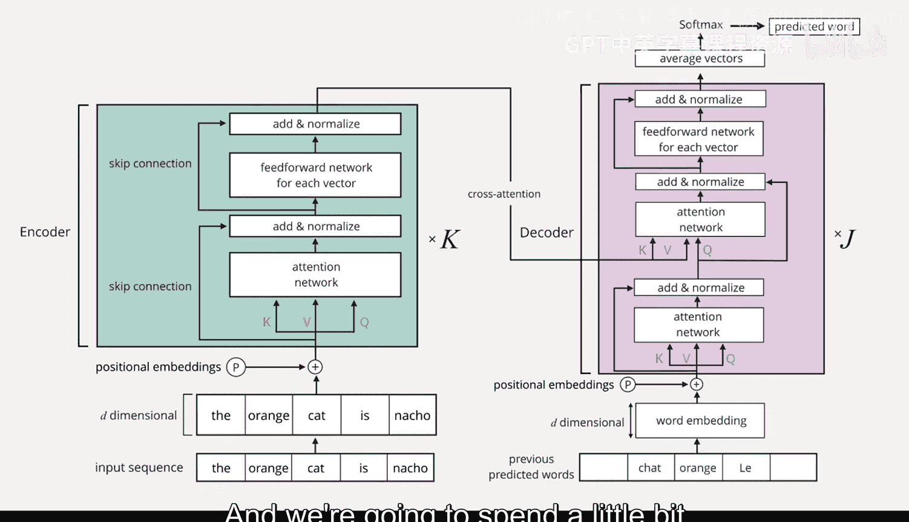

# 杜克大学《机器学习｜Introduction to Machine Learning》中英字幕 p59 59_05_02_序列编码器与解码器的耦合.zh_en -BV1yjvdBQEaU_p59-

So， in the last lesson。

We showed how we can use this sequence encoder， this transformer。

To encode a sequence of words and then use it to predict the next word。

 But a far more ambitious task is not simply to predict the next word but to predict the next sequence of words。

 And so there are several examples， problems that we might think about this might be used for。

 So imagine that the original sequence of n words corresponds to the n words in a sentence in English。

 and what we would like to do is to translate that to French。 And so in that context。

 what we would like to do is to encode the sequence of n words in English and not predict one word in French。

 but to to predict the entire sequence of words in French， which do the translation。

 So the applications that we talked about earlier， which just are predict the next word are inappropriate。

 Another example might be given a large block of。

Tt given a large sequence of words， W1 through W N。 where here the the sequence N is very large。

And imagine what we would like to do is to provide a concise summary of the meaning of that original sequence of n words。

 So we'd like to give a summary of set of words much less than n here again。

 we have a sequence of words in we have a sequence of words out。

 So we want to develop a methodology whereby we cannot simply predict the next word or predict one word。

 We want to predict many words。

And so the way that we do this is with what you see on the right。

 And so before we focus on the right， let's just remind ourselves of what we have on the left。

 So on the left is our input sequence encoder。 This is what we have talked about thus far。

 Let's just remind ourselves what we're doing here。 We have a sequence of words， W1 through WN。

 Those words， for example， could be English words。 What we would like to do is to convert them to the same meaning but in a different language。

 say French。 And so the first step is to encode the original input sequence。

 We take the original sequence of N words， say in English。

 we map them to word embeddings and the way we've talked about。

Those word embeddings take into account the meaning of the words。

 but they do not place that meaning in the context of all other words。

 They also do not take into account the position of the words。

 So now we introduce these positional embeddings。 The positional embeddings for every word we also have a d dimensional vector。

 but that d dimensional vector is connected not to the meaning of the word。

 but to the position of the word。 take those positional embeddings。

 We take the original word embeddings。 We simply add them。

 We take the first word embedding at the bottom， Add it to the first positional embedding。

 the second word embedding， add it to the second second positional embedding。

 We do that one by one for each of the N words in our sequence。

 We now have taken into account meaning and position。

 but that meaning of the word does not take into account context。

 We then go into our attention network。 The attention network is a framework by which。

We can now get word embedding vectors or word codes。

That take into account not simply the meaning of the word。

 but the meaning in the context of all surrounding words。

 We have the attention network and a neural network。

 We do that K times in the context of the of a deep network， a deep encoding network。

 And then at the top， we have a sequence of vectors， which take into account the meaning of the word。

 the position of the word the context of the word。 So now with that。

 let's say we now have encoded an input sequence of length N in English。

 Our objective now is to convert it into a sequence of words in French。 And， of course。

 that we can do this in French， German Spanish。

Any language you want。 So the way we're going to do that en codingding is not to predict just one word。

 We're going to predict the entire sequence。 We're going to do that with something that you see at the right。

 Now I'm going to go through this step by step。 But the thing I want you to notice about the thing on the right is it looks a lot like the thing on the left that we have spent a lot of time on。

 So now what we're going to do is we're going to go step by step through what you see at the right and try to understand what we're doing。

 Now at the bottom of what you see at the right is going to be the words that have been predicted thus far by the model。

 And so the idea is is that we have n words input on the left。 These are our words， let's say。

 in English。 Now we want to produce French。 So now what we're going to do is when we produce the French on the right。

 we're going to produce it one word。After another。 so imagine that we have predicted M words thus far。

 So we now have M words which have been predicted thus far in our translation from English to French at the bottom on the right are the M French words that have been predicted thus far。

 So on the left， the input is the original words on the right。

 the input are the words that have been predicted， for example， in the translation thus far。 Now。

 if in the same context as on the left， remember， we introduced。

Repetition K times to constitute a deep encoding network。 Well。

 there's no reason why we can't do the same thing on the right。So on the right now。

 we're going to do this J times J could be a number as1，2，5，6， a number that we choose。

 but the point is we repeat this process J times and so that we're going to have K repetitions on the left J repetitions on the right and this is called a deep network in the context in the same sense that we've talked about deep technology in other parts of this class。

 The first thing I just want to underscore。Is that the input。On the right。

 the input is at the bottom are the words that have been predicted thus far and the way that we do this is the most recently predicted word is to the left。

 the second most recently predicted word is the second word and then to the right and so the way it's done is the leftmost word is the most recently predicted word and the furthest to the right is a word that was predicted long a while ago。

 and so the idea is is that if we're going from English to French。

On the left we have a sequence of n words in English。 On the right。

 we are decoding in French at the bottom。On the right are the French words that we have predicted thus far where the leftmost word is the most recently predicted French word。

 This is the second most recently predicted French word， etc ceter。

 And so the idea is every time that we predict a new word。

 that input sequence on the bottom shifts to the right by one。One position。

 And then the new word goes in the leftmost position。

 So the the input on the bottom right is always shifting to the right as we predict new words。

I just want to briefly note that this model， the left hand side is called an encoder encoder。

 what we're doing is we have an input sequence of n words。

 we are encoding them through the leftmost and then what we want to do is take that encoding。

And then decode to a sequence of， for example， French words。

 so the right hand side is called a decoder， left is encoder， right is a decoder。

 this is sometimes called an autoencoder， this kind of construct。

Okay， so let's now walk through what we're doing。At the bottom， as I've said before。

 is the output word sequence that we have decoded thus far where the most recent word is to the left first step is we do the word embedding。

 we take every one of those words that we have decoded thus far。

And we map it to a word embedding if the translation is from English to French。

 those words are in French， those word embeddings are associated with French words， so English words。

 French words， Spanish words， Chinese words， they will all have their own word embedding codebook。

 and so here if we're doing English to French， the input sequence to our decoder are the French words decoded thus far。

 they are embedded with our French embedding codebook。

Now those embeddings and are ddimensional vectors in the sense that we've talked about before they capture meaning of the word。

 However， they do not take into account the context of the surrounding words that we've decoded thus far and they do not take into account the position of the words。

 So the next step is we introduce these positional embeddings。 these are also ddimensional vectors。

 but the vectors are now not connected to the meaning of the word。

 but are connected to the position of the word。 We take the word embedding at the bottom。

 Add it to the positional embedding。 Now we have the meaning of the word and the order of the word taken into account so through this word embedding and positional embedding。

 we have meaning of word， we have position of word but we don't have context of word so based upon the tools that we now have at our disposal。

 we know that this attention that word is good at modifying those。Acctors。

Such that it takes into account the the context of the surrounding words。

 and that context is is manifested now through the positional embeddings and through the original word embeddings two ways by the the position of the words and the meaning of the words are going to be reflected through the inner products which are at the heart of the attention network。

 So now we run our decoded sequence thus far through the attention network we do the skip connection for reasons that we have talked about。

 So now we have word embeddings that take into account。The， the meaning of the word。

 position of word and context of the word。 Now， what we would like to do now is decode。

 which takes into account this the encoder that we started with。 So remember。

 we have in a sequence of n words in English。 We have encoded that into a sequence of n vectors that was the left hand part of the original model。

 We want to account for that。In our decoder。The way that we're going to do that is that the output。

 the n vectors that we got at the output of our encoder are going to be the keys in the values of attention of an attention network。

 And then the output of the process at the bottom will be the query。 So remember， the query。The Q。

 the value， V and the keys， K in our retention network at the bottom， the keys， the values。

And the queries are all the same。 that's what the the picture is meant to denote。

 The thing I want you to notice here is that the queries。are coming bottom up here。

 but the keys and the values are coming from the output of the encoder， and then we take the keys。

 the values in the query through this process， the KVQ。

Those go into the very same type of attention network。That we have talked about before。

 We then do the skip connection because we have found that this tends to work well。 This now。

Employees attention。On the final embeddings of the input sequence and then we talked about the fact that this transformation manifested through the neural network at the top is convenient and found to be effective and then this is repeated J times The thing I want you to notice is this process from bottom to top of embedding positional attention positional embeddings and then attention is exactly the same kind of construct that we had before for our encoder。

 the thing that is different is that on the next step we're going to do what I'll call crossat where the cross attention is using queries Q from what we have decoded thus far。

 and it is taking the keys in the values K and V from the encodecodings that we got on our at the output of our。

And and we're going to talk about that in greater detail。 And then at the top。

 we have our neural network。 that is the same。 So this basic construct of our decoder looks very much like our encoder。

 except for this piece right here， which I'll call the cross attention between the encoding at the output of our encoder and the query that we have encoded from our output thus far。

 So we want what we want to do is to spend a little bit of time。

To think about what is going on there and so and then finally at the top we have the softmax that we've talked about before。

 and so now this is going to predict the next word through the softmax that next word will now become the leftmost input at the output of this bottle will be the leftmost input at the bottom of this network and then the output thus far will be shifted to the right。

 and so again， we have the softmax operation and so the key thing that is different relative to what we have talked about before is this concept of cross attention and we're going to spend a little bit of time to talk about that in the next lesson。

