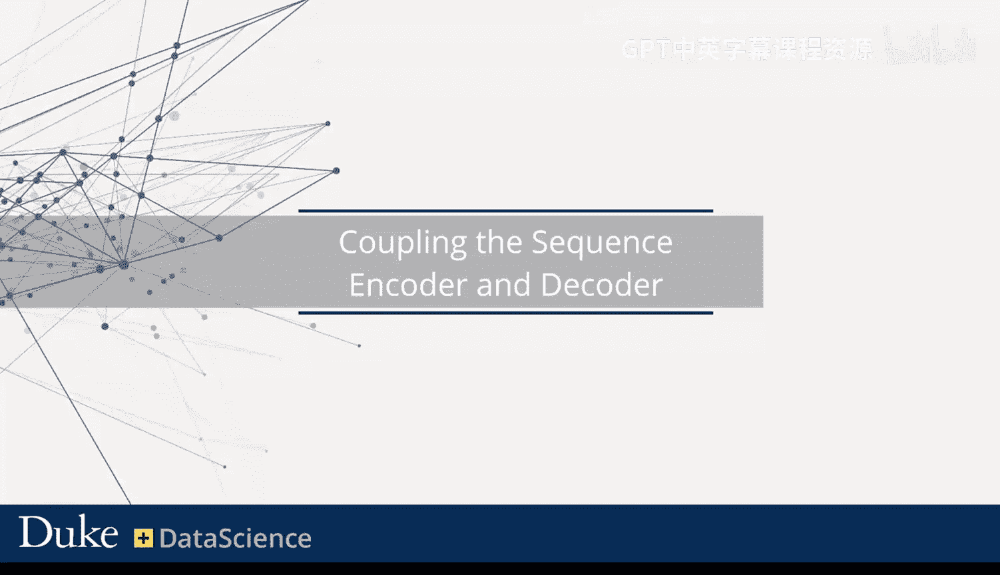
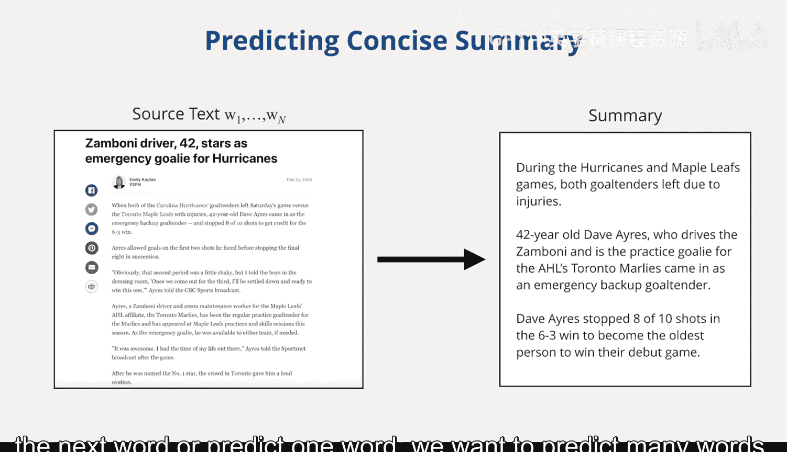
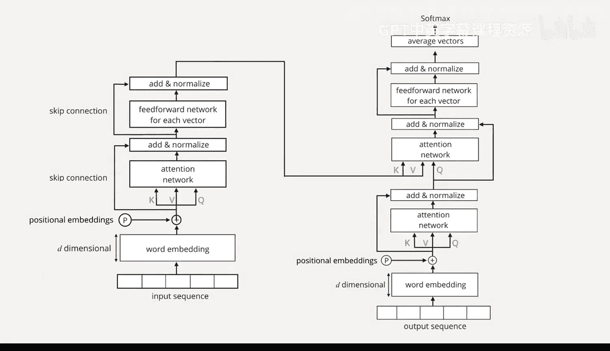
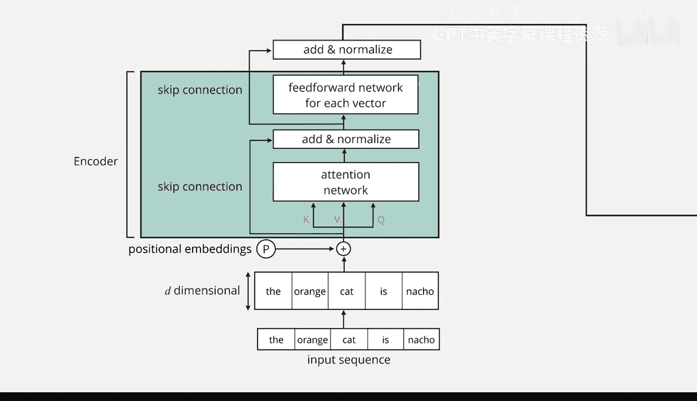
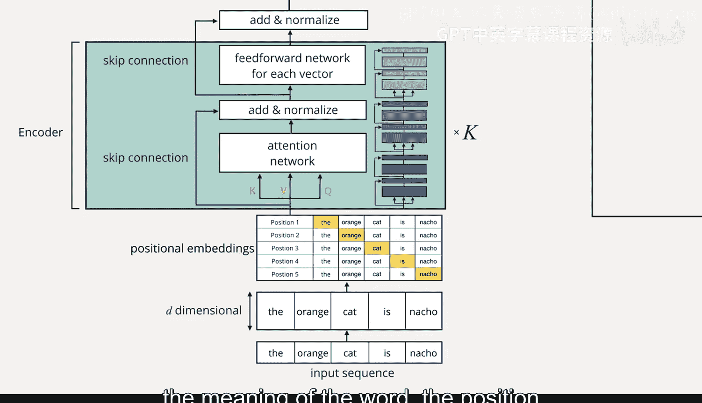
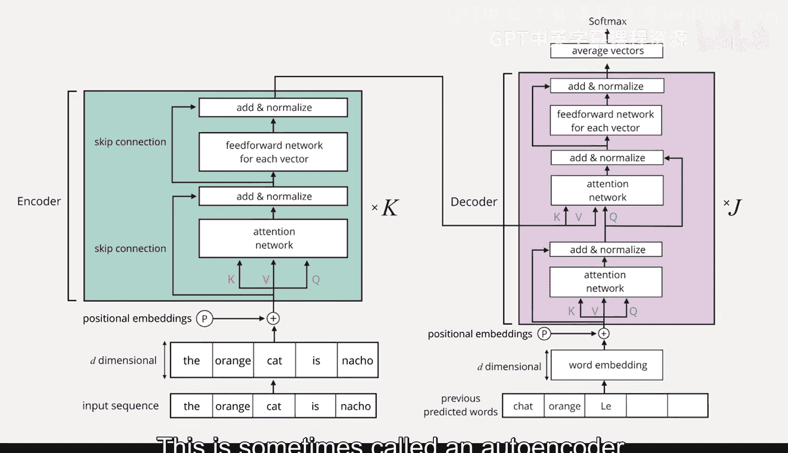
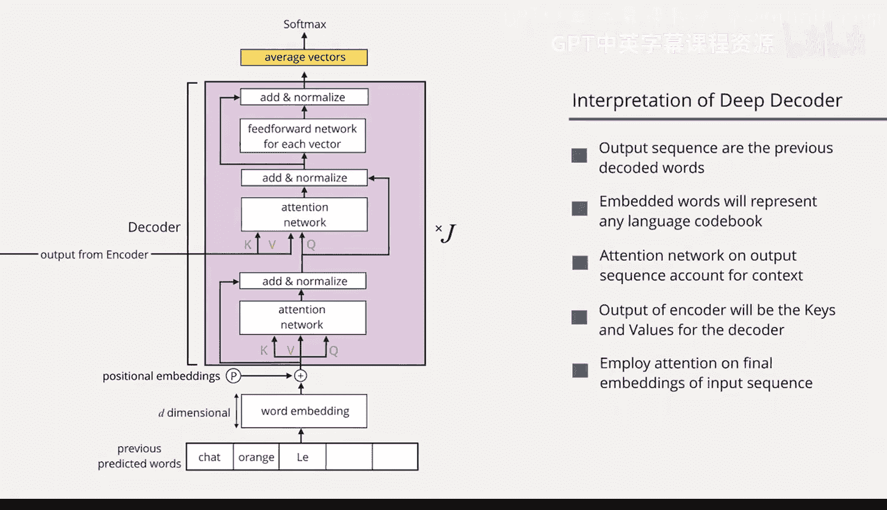
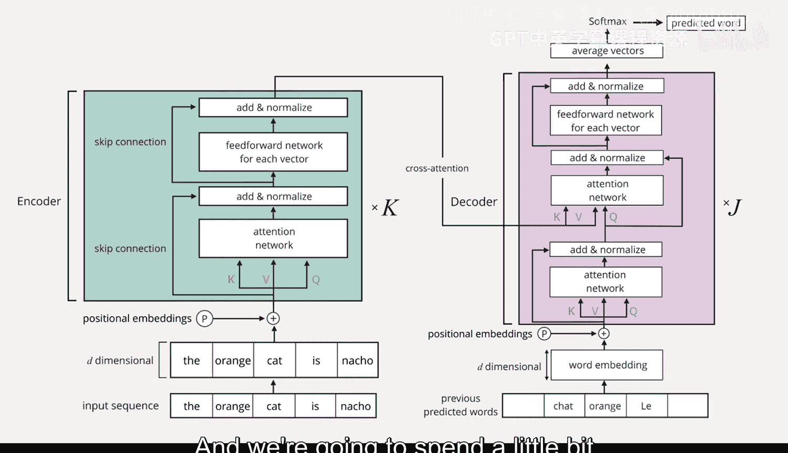

# 机器学习：59：序列编码器与解码器的耦合 🔄

在本节课中，我们将学习如何将序列编码器与解码器耦合，以完成更复杂的任务，如机器翻译或文本摘要。我们将深入探讨编码器-解码器架构的工作原理，特别是“交叉注意力”机制。

---

## 概述

上一节我们介绍了如何使用序列编码器（如Transformer）来编码一个词序列并预测下一个词。然而，许多任务的目标不仅仅是预测下一个词，而是预测下一个完整的词序列。例如，将一句英语翻译成法语，或者为一长段文本生成简洁的摘要。本节我们将探讨如何通过耦合编码器和解码器来实现这一目标。

## 编码器回顾

首先，让我们回顾一下左侧的输入序列编码器。这是我们之前讨论过的核心结构。

我们有一个词序列 `W1` 到 `WN`（例如，一个英语句子）。处理流程如下：

1.  **词嵌入**：将每个词映射为一个 `d` 维向量，捕捉其语义。
2.  **位置嵌入**：为每个位置生成一个 `d` 维向量，与词义无关，仅表示词在序列中的顺序。
3.  **相加**：将词嵌入向量与对应的位置嵌入向量相加，得到同时包含语义和位置信息的向量。
4.  **注意力网络**：通过自注意力机制，让每个词的表示能考虑到其上下文（周围所有词）的信息。
5.  **深度编码**：上述注意力过程会重复 `K` 次，构成一个深度编码网络。

最终，在编码器顶部，我们得到了一组向量。这组向量综合了每个词的**语义**、**位置**和**上下文**信息。

## 解码器架构

现在，假设我们已经用编码器处理了一个长度为 `N` 的英语序列。我们的目标是将它转换成一个法语词序列。这需要右侧的解码器来完成。

解码器的结构与编码器非常相似，但有几个关键区别。其输入是**已预测出的输出序列**。

以下是解码器的逐步工作流程：

1.  **输入序列**：解码器底部的输入是截至目前已预测出的 `M` 个法语词。**最重要的一点是**：最左边的词是**最近预测**的词，越往右的词预测得越早。每次预测一个新词后，整个输入序列会向右移动一位，新词插入最左端。
2.  **词嵌入与位置嵌入**：与编码器相同，我们将已预测的法语词通过法语词表映射为词嵌入，并加上对应的位置嵌入。
3.  **自注意力**：同样，通过注意力机制让每个已预测词的表示能考虑到其他已预测词的上下文。这个过程也会重复 `J` 次，构成解码器的深度网络。
4.  **交叉注意力**：这是解码器的核心不同之处。解码器需要利用编码器输出的信息。具体做法是：
    *   **查询**：来自解码器当前步骤处理后的向量。
    *   **键与值**：来自**编码器最终输出**的那组向量。
    *   我们将这三者输入到一个注意力网络中。这个网络让解码器在生成下一个词时，能够“关注”输入序列（英语）中最相关的部分。
5.  **前馈神经网络与Softmax**：经过交叉注意力后，向量会通过一个前馈神经网络进行进一步变换。最后，通过一个Softmax层，预测出**下一个最可能的词**。这个词随后被添加到解码器输入序列的最左端，过程重复，直到生成完整的输出序列。

## 核心概念：交叉注意力

交叉注意力是连接编码器和解码器的桥梁。它的公式与标准注意力机制相同：

`Attention(Q, K, V) = softmax(QK^T / sqrt(d_k)) V`

其中：
*   **Q** 来自解码器（已预测序列的表示）。
*   **K** 和 **V** 来自编码器（输入序列的编码表示）。

通过计算 `Q` 和 `K` 的相似度，模型可以决定在生成当前输出词时，应该对输入序列的哪些部分赋予更高的权重。

## 总结

本节课中，我们一起学习了序列到序列模型的核心——编码器-解码器架构。

*   我们回顾了**编码器**如何将输入序列（如英语句子）编码为富含语义、位置和上下文信息的向量表示。
*   我们详细探讨了**解码器**如何逐步生成输出序列（如法语句子）。它利用已生成的部分序列，通过自注意力整合自身上下文，并通过**交叉注意力**机制聚焦于编码器提供的输入信息，从而预测下一个词。
*   我们明确了**交叉注意力**是实现编码与解码信息流耦合的关键，它使得解码器在生成每一个词时都能动态地参考输入序列的相关内容。

这种编码器-解码器架构，特别是结合了注意力机制的Transformer模型，已成为机器翻译、文本摘要、对话生成等序列生成任务的基石。