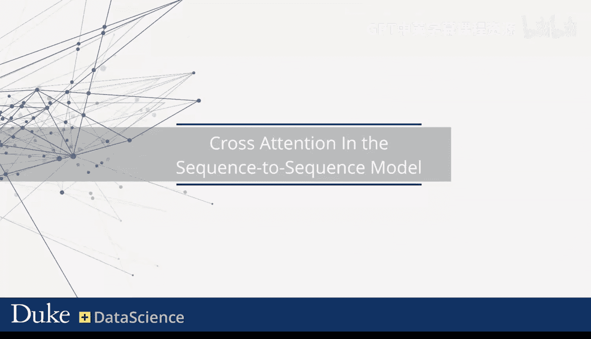
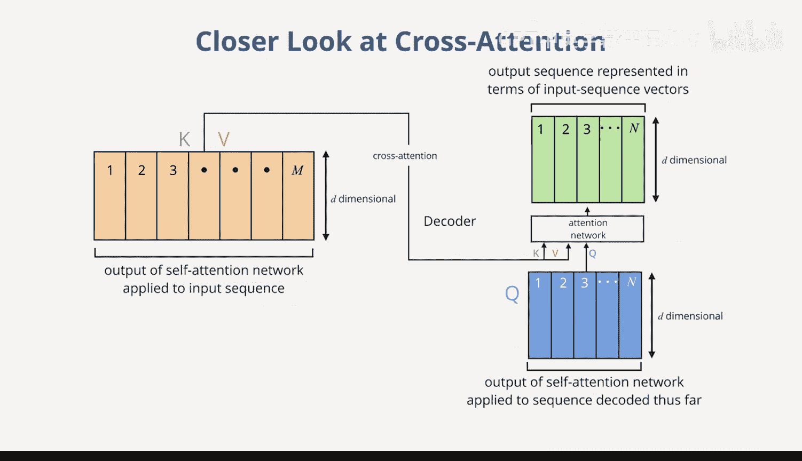
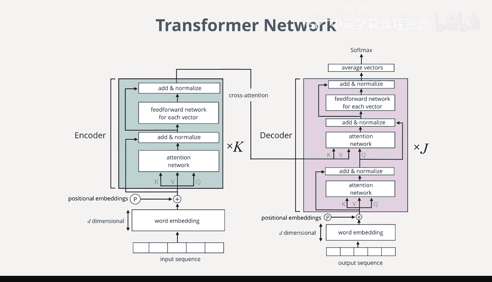
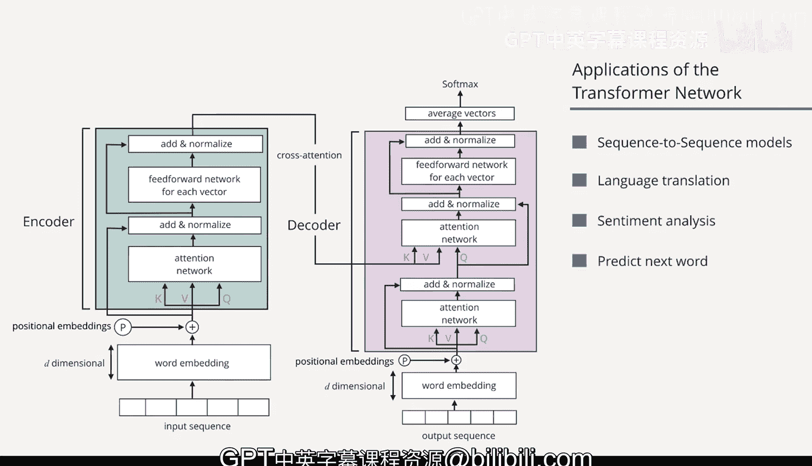

# 杜克大学《机器学习｜Introduction to Machine Learning》中英字幕 p60 60_05_03_序列到序列模型中的交叉注意力.zh_en -BV1yjvdBQEaU_p60-

We have developed this sequence to sequence model， which is called the transformformer。On the left。

 we have the input sequence， which is a sequence of vectors corresponding to the input words。

 and then after K layers of this deep network， we have the output， the output of the encoder network。

On the right。We have a decoder。Wwhich produces the output sequence。

 and so this is called a sequence to sequence model。 We have an input sequence of words。

 and then we have an output sequence of words。 an example of where this might be used is where we have an input sequence in one language。

 and then we have an output sequence in another language as part of this。

 we have what's called a cross attention component and what we're going to do is take a little bit of a closer look at that。

So at the top of our encoder， this is the encoding of the input sequence。

 We have an output of M vectors， and so if the input sequence is composed of say M words at the top of the encoding network。

 we have M vectors， each of which is of dimension D。

 these M vectors are the keys and values of our attention network。

And then the decoded sequence or the output sequence。Is at the bottom of this decoding network。

 And so these are these are representative of the queries。 and so if we have decoded n words so far。

 So up to this point we have decod n words， then we have n vectors。

 vector 1 vector 2 through vector capital n。 these are the vectors corresponding。

To the n words we have decoded thus far， each of these vectors is also d dimensional。

The the n factors corresponding to the n words decoded thus far are the queries of this attention network and the outputs of the encoding network at the top of the encoding network are the keys and the values of the attention network。

 and so the reason this is called cross attention is that the queries are coming from the n words that have been decod thus far。

And the keys and the values are coming from the input M words that are encoded at the top of our encoding network。

 and so this cross attention is manifested because the queries。

 the keys and the values are different。And so whenever we do this attention network with those queries。

 keys and values， we then get an encoding。Of the N。

Words at the N queries are now mapped to a new sequence of n words。N vectors。

 each of which is also D dimensional。 And so what's happening here is that the N words。

That have been decoded thus far， are represented。Via the attention mechanism。

In terms of the keys and the values， which are at the top of the encoding of the input sequence。

 So this is called cross attention。 And so this composite。

Model where on the left， we're encoding the input sequence。And on the right。

 we are decoding the output sequence。This network is called the Transformer network。

And there are many applications of this and so as I mentioned。

 one of the key applications is for what are called sequence to sequence model models where you have an input sequence of words。

 and then you want to have an output sequence of words。

 and so important application of this is translation， so you may have a sequence of words。

 input in English， and then you would have an output sequence sequence of words decoded， for example。

 in German or any other language。ThisThis transformer network can be used in many settings。

 it could also be used in sentiment analysis and also to do things like predicting the next one or two words that one might tighten。

