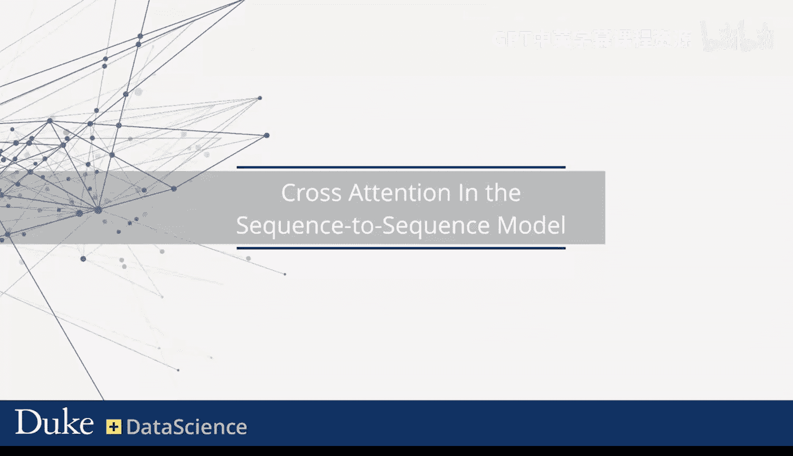
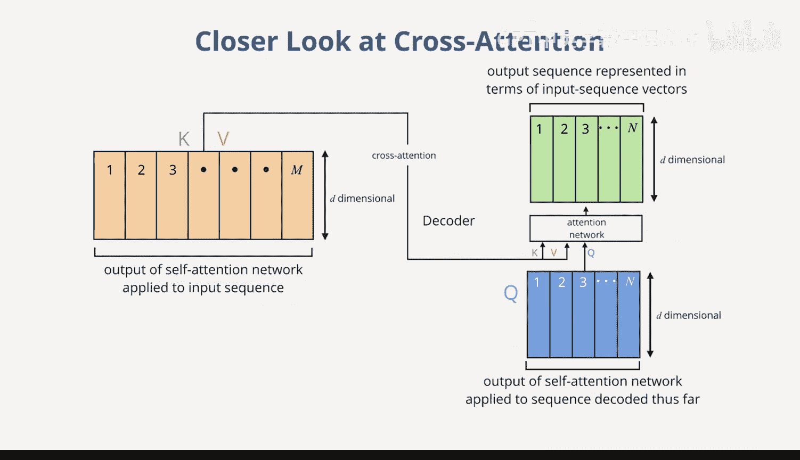
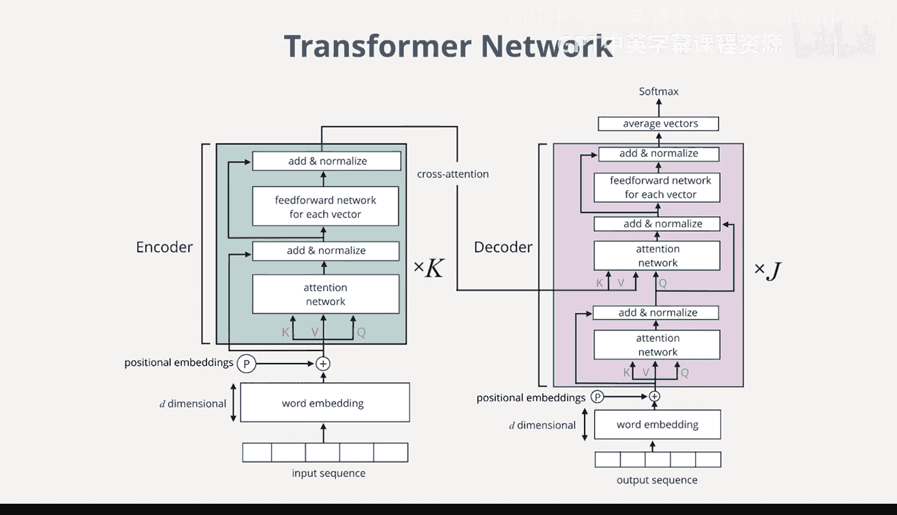
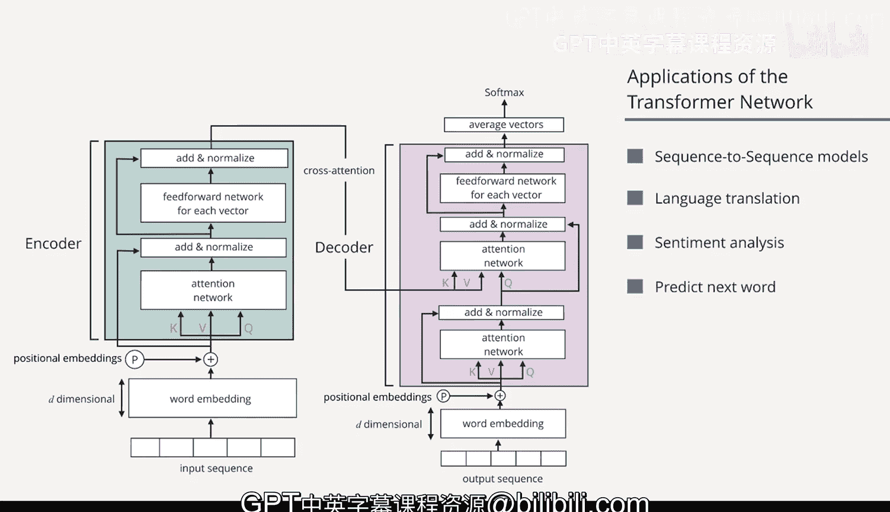

# 机器学习：60：序列到序列模型中的交叉注意力

在本节课中，我们将要学习序列到序列模型，特别是其中的一个核心组件——交叉注意力机制。我们将了解它如何连接编码器和解码器，并理解其在机器翻译等任务中的关键作用。

## 概述

我们之前已经构建了一个名为Transformer的序列到序列模型。该模型左侧是编码器，负责处理输入序列；右侧是解码器，负责生成输出序列。本节课，我们将深入探讨连接这两部分的关键机制：交叉注意力。

## 编码器输出：键与值

上一节我们介绍了Transformer的整体架构，本节中我们来看看编码器的输出如何为注意力机制提供信息。

在编码器的顶部，我们得到了输入序列的编码表示。如果输入序列由M个词组成，那么编码网络的输出就是M个向量，每个向量的维度为D。

以下是这些向量的作用：
*   这些M个向量构成了注意力机制中的**键**和**值**。

## 解码器状态：查询

理解了编码器的输出后，我们接下来看看解码器如何利用这些信息。

在解码网络的底部，是当前已生成输出序列的表示。如果我们到目前为止已经解码了N个词，那么就会有N个对应的向量，每个向量维度也是D。

以下是这些向量的作用：
*   这N个对应于已解码词的向量，构成了注意力机制中的**查询**。

## 交叉注意力机制

现在，我们已经有了查询、键和值，本节中我们将看看它们如何共同工作，形成交叉注意力。

编码器顶部输出的M个向量是注意力网络的键和值。解码器已生成的N个词对应的向量是注意力网络的查询。之所以称为“交叉”注意力，是因为查询来自解码器已生成的N个词，而键和值来自编码器编码的输入M个词。

当我们将这N个查询与M个键和值进行注意力计算时，会得到一个新的序列，包含N个新的D维向量。这个过程意味着，通过注意力机制，当前已解码的N个词被根据输入序列的编码信息（键和值）进行了重新表示。

## Transformer模型与应用

这种左侧编码输入序列、右侧解码输出序列的复合模型，被称为Transformer网络。

Transformer网络有许多应用。正如之前提到的，一个关键应用是序列到序列模型，例如机器翻译。你可以输入一个英语句子序列，然后解码器输出一个德语句子序列。此外，Transformer也可用于情感分析，或预测接下来可能输入的一两个词等任务。

## 总结

本节课中我们一起学习了序列到序列模型中的交叉注意力机制。我们了解到，编码器将输入序列编码为键和值，解码器将已生成序列作为查询，通过注意力机制，解码器能够动态地聚焦于输入序列的不同部分，从而生成更准确的输出。这种机制是Transformer模型实现高效翻译和理解任务的核心。