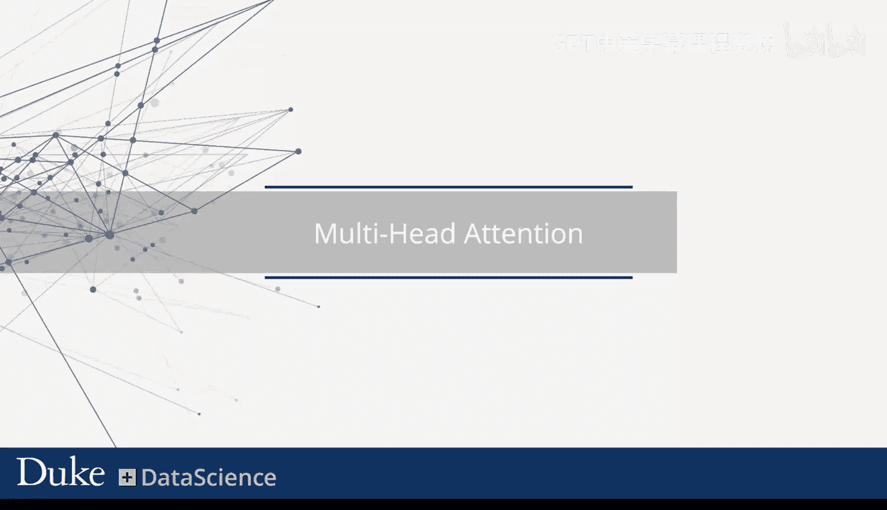
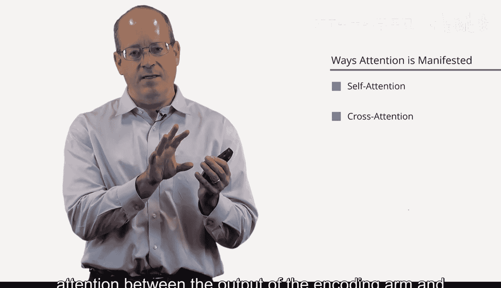
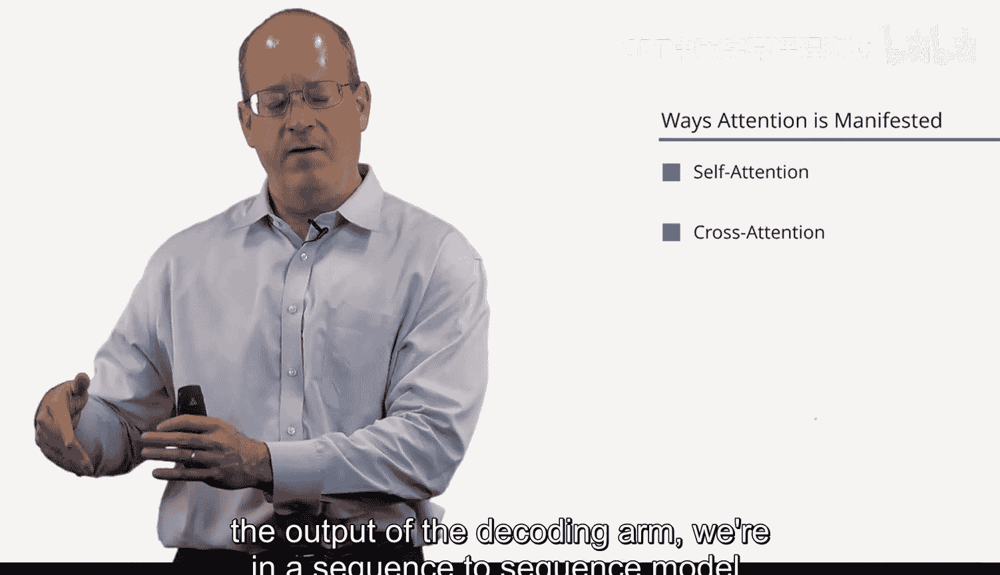
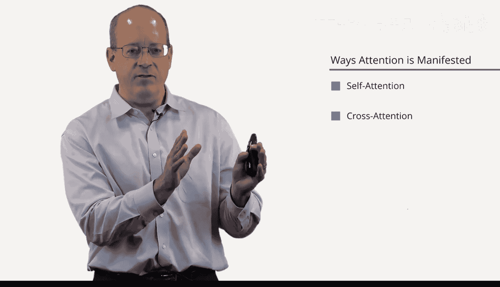
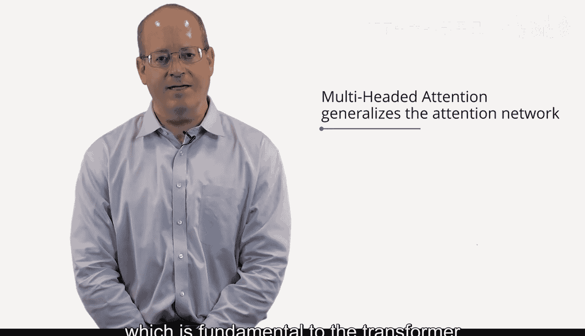
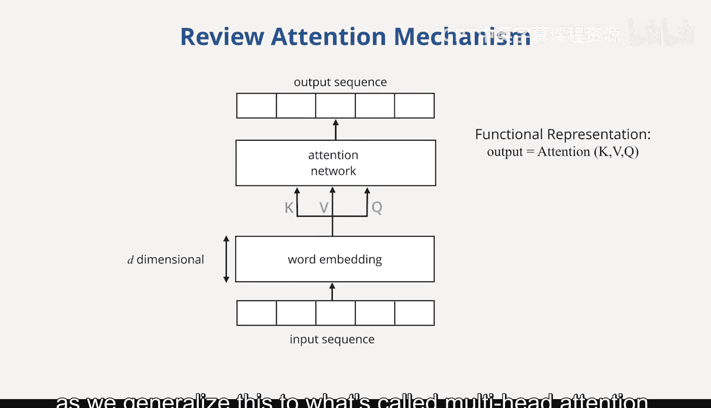
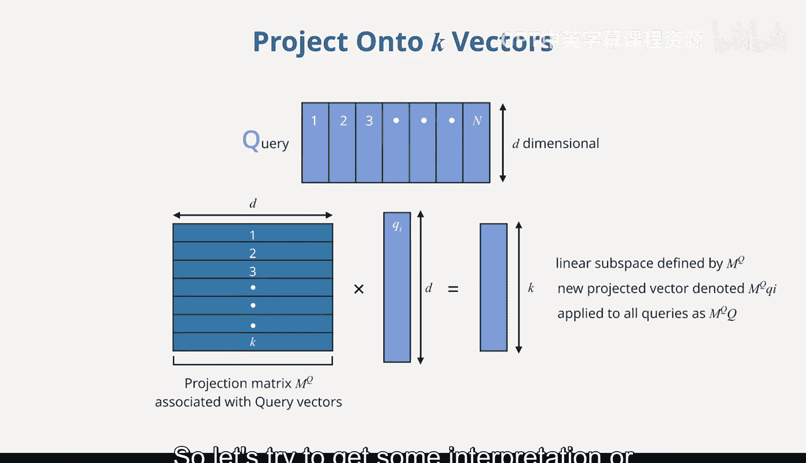
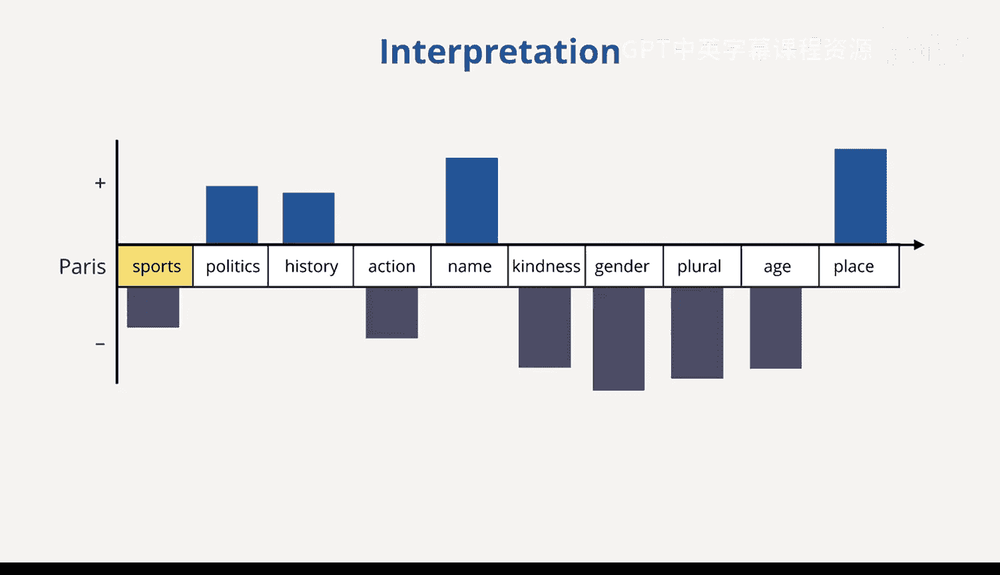
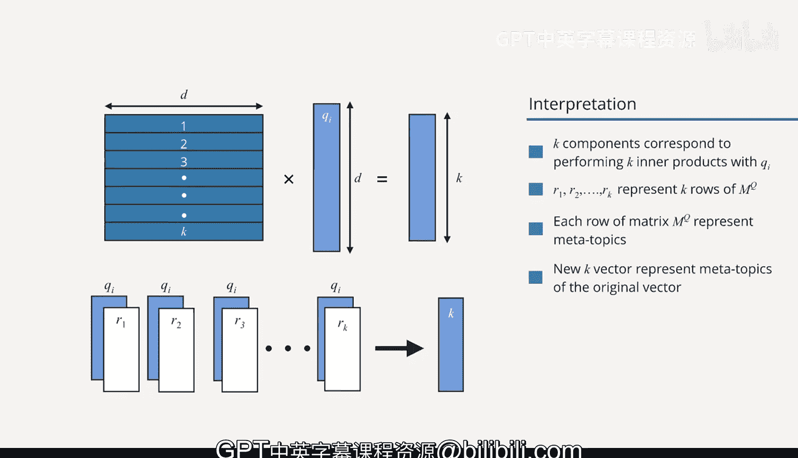

# 杜克大学《机器学习｜Introduction to Machine Learning》中英字幕 p61 61_05_01_多头注意力.zh_en -BV1yjvdBQEaU_p61-

。So in， in the context of the model。That we have developed thus far， the transformer network。

 this concept of attention。

Has been fundamental to what we have done and the attention is manifested in two ways， as we've seen。

 one is self-attention， where we have a sequence of say n words which are represented by n vectors and the attention is done between those n words and in doing this by using this attention mechanism。

 We basically are modifying the vector representation of each word to take into account the characteristics of surrounding words。

 We have also looked at cross attention where we are are evaluating attention between the output of the encoding arm。

And the output of the decoding arm in a sequence to sequence model， we have an input sequence。

 and we have an output sequence。

In the original transformer network， there's this concept。

That generalizes this attention mechanism to what's called multi head attention。

 And so what we'll do now is spend a little bit of time to try to understand this concept of multi head attention。

 which is fundamental to the transformer network that is actually used in practice。

 Before we do that， let us just recall。

The various components of the attention mechanism。And so in the attention mechanism。

 we have a sequence of words which are represented by codes 1。

 code 2 through code n that's at the bottom， we then have a query， a vector C K。

 which is query used to query relative to those n words， and so so recall the query mechanism。

 we also have keys the n vectors， C1， C2 through CN corresponding to the input sequence are our keys。

 and then finally。We have values where the values here are also C1 through CNN and by combining the queries。

 the keys and the values we manifest the attention mechanism which then transforms the query CK into a new vector C tillil decay which places the context of that query relative to the n word vector C1 through CNN so what we want to do now with this so-called multi-headed attention is to generalize this representation of the queries keys and values。

 and so the original attention mechanism that we have talked about it looks as shown here。

 so we have an input sequence input sequence of words。

 then each of those words is mapped to a word embedding and call that a word embedding。

This means a word vector or a vector for each word， those vectors are then used as the keys。

 values and queries， and then this manifests a self-attention mechanism and then finally an output sequence and recall that this output sequence take places each word vector in the context of all of the word vectors that surround it。

And so what we will do to make the subsequent discussion concrete。

 we will introduce a notation or a functional form which says that this is the attention mechanism。

 it is a function of the keys， the values in the queries。

 and then the output of this function is called the output itself。

 so we're going to use that notation as we generalize this to what's called multihead attention。

So now recognizing what we just talk about， we can look at the queries as a set of n vectors。

 the keys， as a set of n vectors， and the values V as a sequence of n vectors or a set of n vectors。

 each of these vectors is d dimensionsional， the queries。

 keys and values are fundamental to the attention network that we have talked about throughout these lectures。

So now if we consider the Ith query or the Ith one of these n vectors。

What we're going to do is do a projection， what we call a projection。Of that query， QI， so QI。

Is a vector。 It's d dimensionsal， and it corresponds to the Ih。One of those n vectors，1。

2 through capital N。 What we're going to do is we're going to multiply that vector。Q， I。

Which is D dimensional。Times a matrix where the matrix is composed of K rows。

Each one of the rows is also d dimensional。 So what we're doing is we're taking each。

Of the rows of the matrix Mq， so MQ is a matrix M which is operating on a query Q。

 so we call M superscript Q， this is a query matrix What we're doing is we're taking the query QI。

 and we're taking an inner product of Qi with K vectors each of which corresponds to the rows of the matrix that you see in blue。

And so what this。Can be viewed as doing is we're taking the query QI。

 and we're mapping it onto what we call a linear subspace。

 which is spanned by the K rows of the matrix M Q。So let's try to get some interpretation or intuition about what's going on here。

 so recall。

That the embedding vector。That is associated with each word has an underlying。

 let's say topical meaning， so this is notional， but we can again look at the word Paris and this is now for illustration purposes mapped to a 10dial embedding vector and then each of the component of that vector。

 each of the10 components of that vector represent a topic and then if the word here Paris is aligned with that topic。

 the associated component is positive， so for example， Paris is the capital of France。

 it has political significance， so the second component which notally is associated with politics is positive。

On the other hand， Paris doesn't have that much to do with sports。 So you see that the the component。

 the first component associated with sports is slightly negative。

 So we recall this is the intuition that underlies the。

The word vector is now， remember that each of the in this case。

 the queries corresponds to a vector associated with a particular word and remember that each of the components of that vector represent topics and so the way that we can think about this is that we're taking the query queue。

And we're taking an inner product。Of Q， I here with。Row R 1， row row 1。

 row 2 and row k of the matrix M Q。 and we represent those rows as R sub 1， R sub 2 in R sub K。

 And so what we're doing is we're taking the original query vector Q I。

And we're projecting it onto the rows or the K rows of this matrix Mq。

 and so a way that you can think about this is that the each of the K rows of the matrix Mq。

Represent。Overarching what we call metatopics and so what's happening is that each of the rows of that matrix is selecting or emphasizing some of the components of the vector QI。

 the query vector QI， and essentially what we're doing is by using this matrix we're highlighting certain topics or metatopics that are important。

And so this summarizes that and so this matrix Mq， which is represented in here in blue。

 which is composed of K rows。Each rows of d dimension is mapping the original query vector Qi。

 which was d dimensional， to a new vector， which is k dimensional those k dimensions of the new vector represent what we will call metatopics of the original of the original vector。

 so this is a general concept this idea of multiplying the query times a matrix in so doing highlighting k metatopics associated with that vector。

