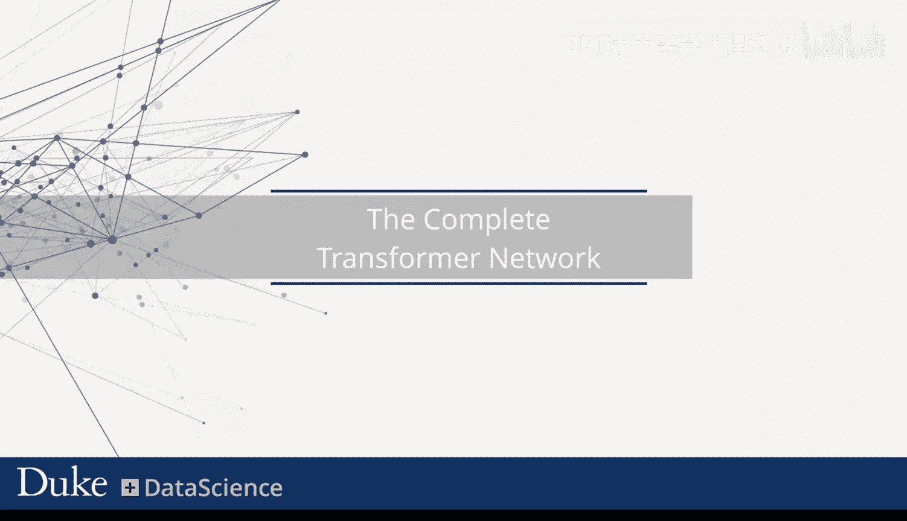
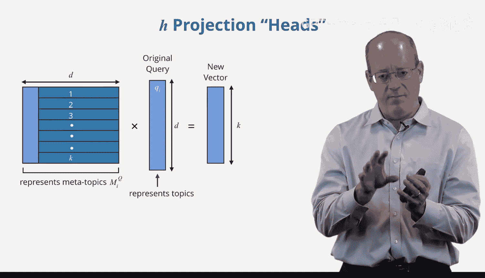
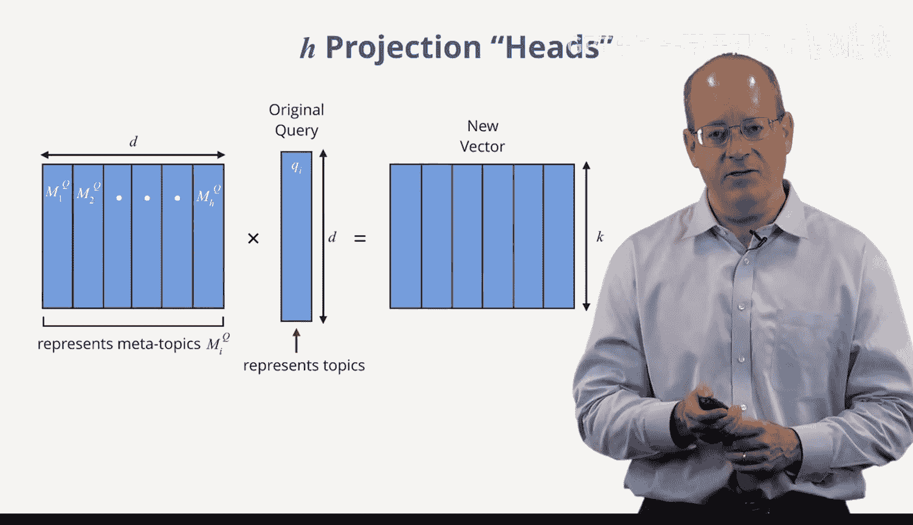
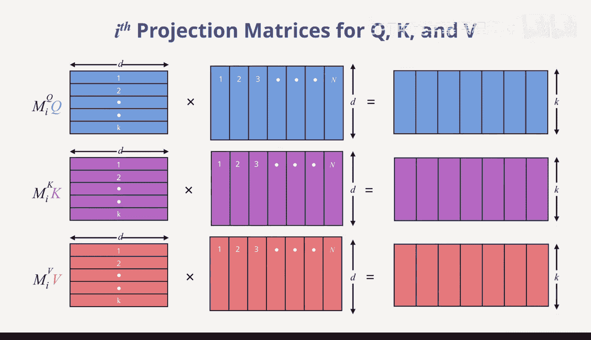
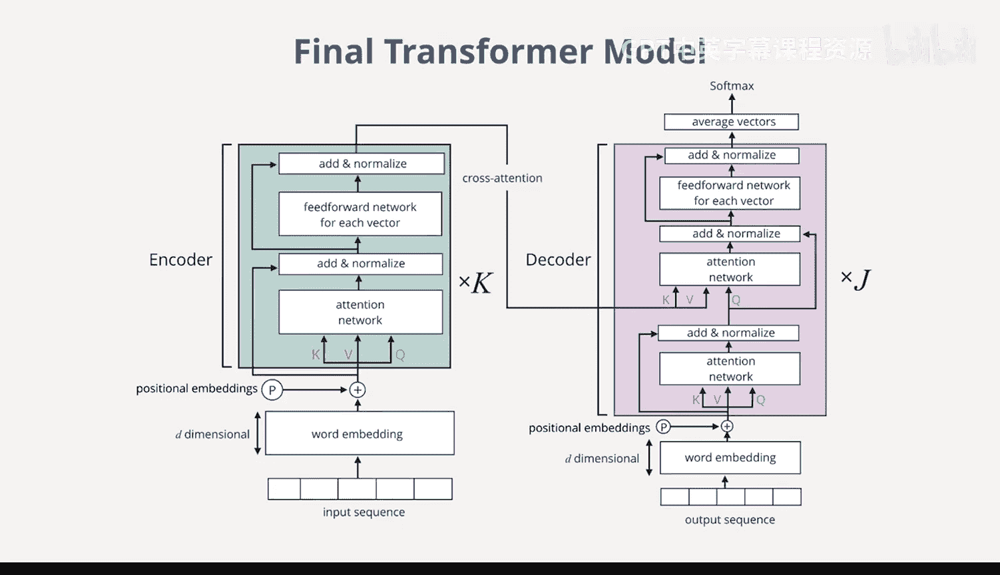
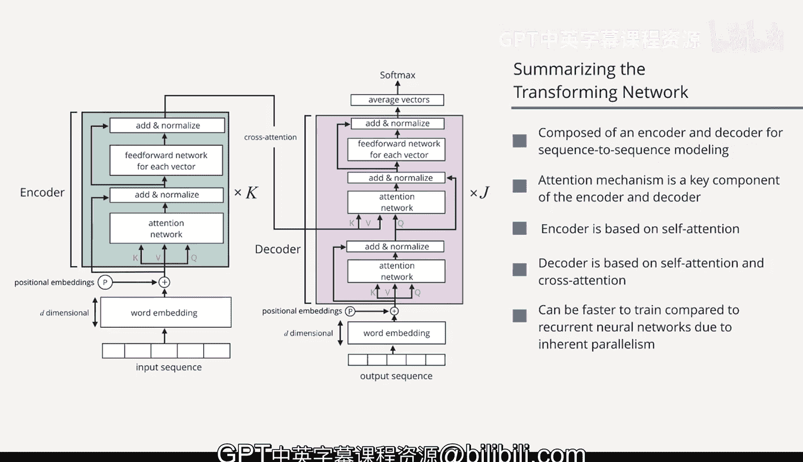

# 杜克大学《机器学习｜Introduction to Machine Learning》中英字幕 p62 62_05_02_完整的Transformer网络.zh_en -BV1yjvdBQEaU_p62-

嗯。So in the previous lecture。We introduced this idea that we can take the original。Query。The I query。

 Q I， which is of dimension D， and we can map it into a new vector of dimension K by multiplying。

That vector Q I times a matrix of K rows。Each row of which is of dimension D。

 where D is the dimension of the original word embedding。Now， as we've talked about。

 what this is basically doing is mapping the original factor QI， which is d dimensional。

 which corresponds to all of the D topics that can be characteristic of a word。

 we're mapping it into metatopics， where each metatopic is characterized by one of the rows of the matrix at the left in blue。

 where each row， the weighting of the components of each row highlight particular topics associated。

With the word embedding factor。 Now， if we can do this one time。With one particular matrix M sub I。

 So this is the I example of the projection matrix。 We can do this h times。

 So therefore instead of so what we can do is we can take the original vector。

 the original query Q I。 and we can multiply it times E M sub1 M sub2 and M through M sub H where we have H different types of projection matrices of this form。

 And so by doing this what we're doing is we're taking the original。

Vctor Q I in mapping it onto H different linear subspaces， which are defined by the corresponding。

Matrix， which is highlighted on the top in blue and so what this is doing is through these matrices。

 M sub1， M sub2 and through M sub H， we are highlighting by each of them individually。

 different subspaces， different sets of metatopics， associated with the original word vector here。

 QI。And so in this way， what we're doing is we're highlighting through these matrices， M1 through MH。

 we're highlighting particular aspects or topical characteristics of particular words now in the discussion that we have had to this point we've introduced these matrices。

 these projection matrices for the queries but we can do exactly the same thing for the keys and for the values。

 so M subq corresponds to a projection matrix for the queries。

 M S K corresponds to a projection matrix for the keys and M S V。

SM superscript V corresponds to a projection matrix for the values。 And we can do this。

Multiple times， so in other words， we can have H different matrices。

H different matrices for the queries and H different matrices for the keys and eight different matrices for the values here what we're showing is with the subscript I M subscript I。

 we're showing the Ithe example of them。And so what we're doing by this projection， in each case。

 for the queries， the keys and the values， we take the original。Sequence of vectors。Here n vectors。

 each one of which is d dimensional。 After this projection。

 we map those n vectors to a new sequence of n vectors， each of which is k dimensional。

And so now， if we come back to this attention model， we again have an input sequence at the bottom。

Each of the words in the input sequence is mapped to a vector each word is mapped to a vector。

 we call that a word embedding， we then take and then those word embeddings are the keys。

 the values in the queries， K V and Q， and then we multiply those vectors， times matrices。

 M superscript K M superscript V and M superscript， so we're taking the original keys。

 values and queries and projecting them onto linear subspaces defined by those respective matrices。

And then once we have done that， we again do attention and then we get an output sequence。

 So the key thing that I want to try to communicate is that through this process of projecting onto these matrices here the I set of matrices。

 what we are doing is we are highlighting particular aspects of words defined by the characteristics of the rows of those matrices and then recall that when we started the discussion。

Of the attention network we had as the input of the attention。We had the keys。

 the values and the queries， so now the modification is that the input to the attention network are the original keys。

 values and queries， but now multiplied by respective matrices M superscript K M superscript V M superscript Q on the keys values and queries respectively。

 and here we have the subscript I on each of those matrices。

 because here this is the I instantiation of those projection matrices。

 and so therefore we call this output I and output I is looking at a particular aspect of the words particular aspect of the word the word embedding vectors which are highlighted by the respective matrices。

 M K M V and M Q， and so this is the output。The Ih sequence。And we can do this。So now at the bottom。

 we recall that the output for the I instantiation of the matrices is repeated。

 we can do this H different times。For H， different manifestations of those matrices。

 And therefore we get， we get output 1， output 2 through output H。

Of these different attention mechanisms。We then take those outputs， those output vectors。

 We just stack them one after the other。 That's called concatenation。 So concate means concatenation。

 So what we're doing is we're taking output vector 1。We're stacking it。The next vector output 2。

 then output 3， through output H。 We just stack them all together。 That's called concatenation。

 And then we do what's called a linear transformation through the matrix W O。

 which corresponds to the output。 And then this is the final output of the multi head attention。

 So now to try to summarize in the original attention mechanism， we had input vectors。

Which corresponded to queries， keys and values。 and through the inner product mechanism。

 we did what we called attention。The multi headed attention。

 what this means is is that we do the attention multiple times Here we do it H times。

 And the reason we call it multi head is that the matrices M sub I。

Superscript K V and Q correspond to the I instantiation of this projection or this head。

 and so this is called multi head attention。 and so in the transformer network。

That that we have talked about。It has been found that this multihead attention provides value in the quantitative performance and so the reason that this works well is that each of these heads。

 the I head， M sub I， Kv and Q focuses on particular aspects。

 particular characteristics of the words， and therefore when the attention is imposed the words the attention mechanism is attending to particular characteristics of the words。

 and so if we have H heads through H very versions of these matrices， M subi， so we have M sub1。

 M sub2 through M sub H， these allow the attention mechanism to attend to H different。

Asspects or components， or characteristics。Of words or language。

And so this is the final transformer network。On the left， we have an input sequence of words。

On the right， we have an output sequence of words。On the left。

 we repeat this K times to manifest a deep network。

 and on the right we do it J times to also manifest a deep network。

And key to both the encoder and the decoder is this concept of attention。

And so now what we have done and what has been found to be effective is that we've generalized this attention to what's called multihead attention。

 And this is the final transformer network， which does sequence to sequence encoding。

For natural language processing and again， very important application of that might be translation where you have an input sequence in one language and you're trying to output a sequence in another language。

So to summarize the key components of the transformer network is that it's composed of an encoder in a decoder arm。

 this is for sequence to sequence modeling。The key component of both the encoder and the decoder is this attention mechanism。

The encoder is based upon self attention， and the decoder is based upon both self attention and cross attention。

Within the attention mechanisms， this concept of multi headed attention has been found to be very effective and is used in practice。

The training of the transformer is because of the fact because of the way that the transformer network is designed。

 there is significant opportunity for parallelism when doing the training when we talked about this earlier within the attention mechanism there are many computations that can be done in parallel and so with modern computing graphical processor units which can be used to exploit this parallelism。

 it has been found that in practice the transformer network is very efficient to train。

 This is to be contrasted with another tool that we've talked about for natural language processing。

 the long shortter memory， the LSTM and recall that the LSTM was a model it was a recurrent neural network。

for which the data are modeled sequentially one after the other through the recurrent neural network。

 and so the recurrent neural network relative to the transformer。

 has the disadvantage that it does not allow you to exploit parallelism whening training。

