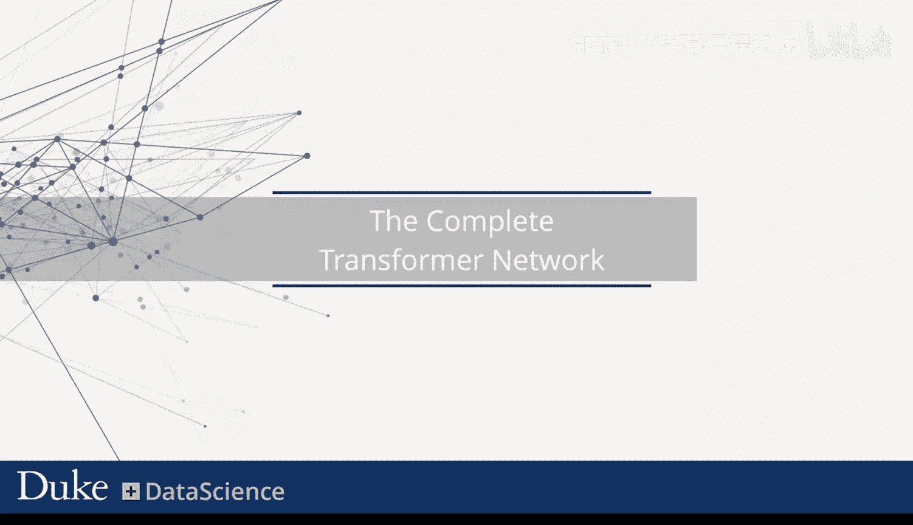
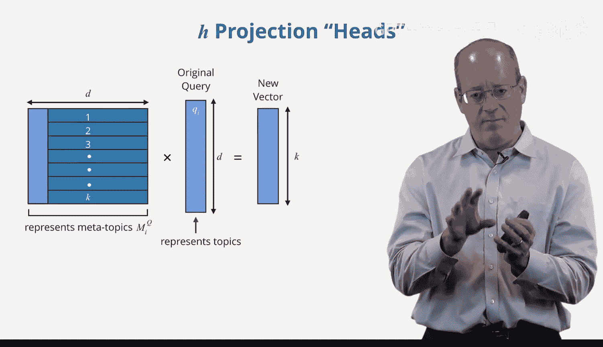
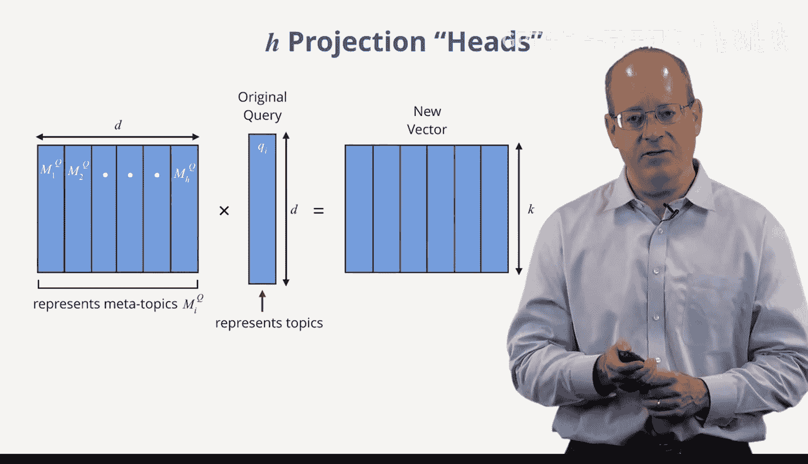
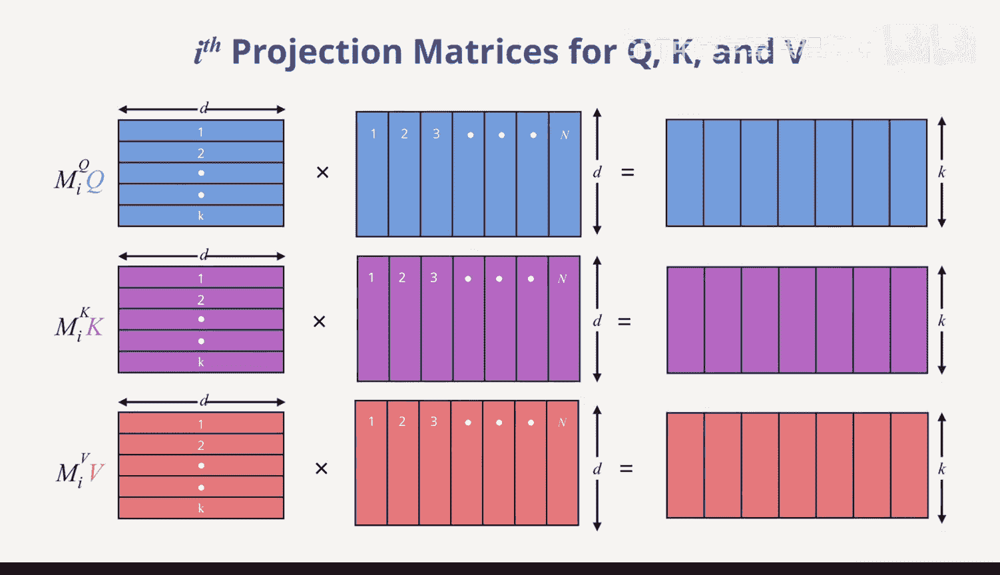
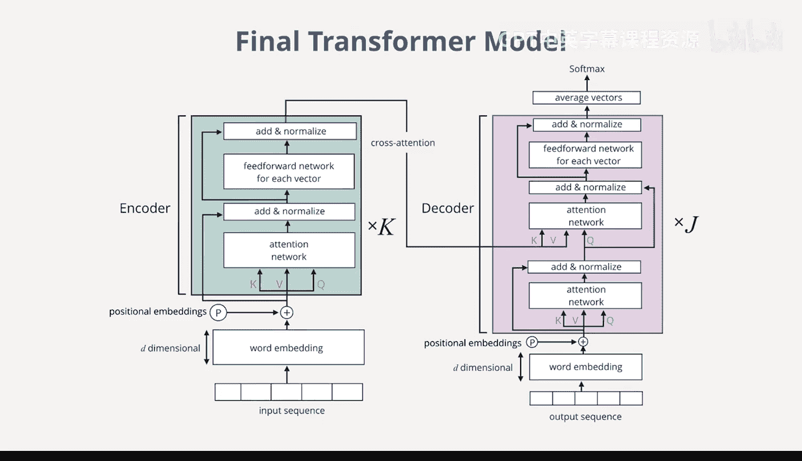
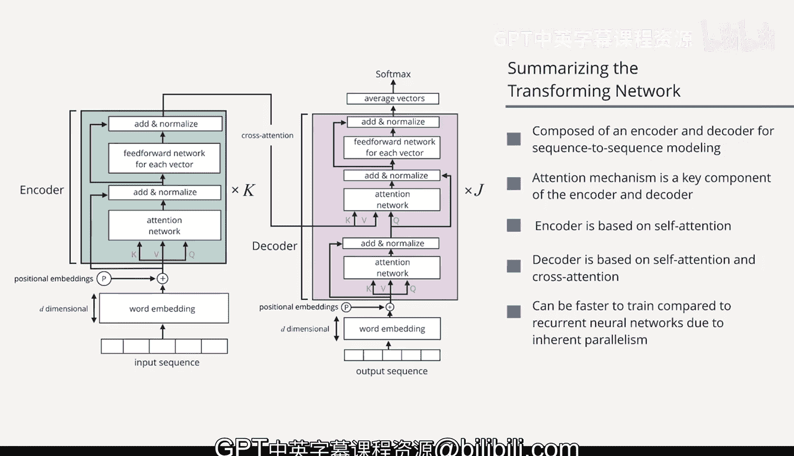

# 机器学习：62：完整的Transformer网络 🧠

在本节课中，我们将学习Transformer网络的完整架构，特别是其核心组件——多头注意力机制。我们将从回顾投影矩阵开始，逐步构建出完整的Transformer模型，并解释其为何在自然语言处理任务中如此高效。

## 概述

上一节我们介绍了如何通过投影矩阵将查询向量映射到新的线性子空间。本节中，我们将看看如何将这一概念扩展到键和值，并最终构建出完整的、包含多头注意力机制的Transformer网络。

## 从单头到多头注意力

我们之前介绍过，可以将原始的维度为 `D` 的查询向量 `Q_i`，通过乘以一个 `K` 行 `D` 列的矩阵 `M_i`，映射到一个新的 `K` 维向量。

**公式**：`Q_i' = Q_i * M_i`

这个过程本质上是将原始的、对应 `D` 个主题的词嵌入向量 `Q_i`，映射到由矩阵 `M_i` 的每一行所定义的“元主题”上。每个矩阵行的权重突出了与词嵌入因子相关的特定主题。

如果我们可以用一组特定的矩阵 `M_i` 做一次这样的映射，那么我们也可以做 `H` 次。因此，我们可以取原始查询向量 `Q_i`，并分别用 `H` 个不同的投影矩阵 `M_1, M_2, ..., M_H` 与之相乘。

**公式**：`Q_i^{(h)} = Q_i * M_h`，其中 `h = 1, 2, ..., H`

这样，我们就是将原始向量 `Q_i` 映射到了 `H` 个不同的线性子空间上，每个子空间由对应的蓝色矩阵定义。通过这些矩阵 `M_1` 到 `M_H`，我们分别突出了原始词向量 `Q_i` 的不同子空间或元主题集合。通过这种方式，我们利用这些矩阵强调了特定词的特定方面或主题特征。

到目前为止的讨论中，我们为查询引入了这些投影矩阵，但我们完全可以对键和值做完全相同的事情。

*   `M^Q` 对应查询的投影矩阵。
*   `M^K` 对应键的投影矩阵。
*   `M^V` 对应值的投影矩阵。

我们可以多次进行这个操作。换句话说，我们可以有 `H` 个不同的查询矩阵、`H` 个不同的键矩阵和 `H` 个不同的值矩阵。这里的下标 `i` 表示第 `i` 个实例。

通过每次投影，对于查询、键和值，我们取原始的 `N` 个 `D` 维向量序列。经过投影后，我们将这 `N` 个向量映射到一个新的、由 `N` 个 `K` 维向量组成的序列。

## 整合到注意力模型中

现在，让我们回到注意力模型。我们再次在底部有一个输入序列。输入序列中的每个词都被映射为一个向量（词嵌入），这些词嵌入就是键、值和查询。然后，我们将这些向量分别乘以矩阵 `M^K`、`M^V` 和 `M^Q`。也就是说，我们将原始的键、值和查询投影到由这些各自矩阵定义的线性子空间上。

完成这一步后，我们再次进行注意力计算，得到一个输出序列。这里我想要传达的关键点是，通过投影到这些矩阵（第 `i` 组矩阵）的过程，我们正在突出由这些矩阵行特征所定义的词的特定方面。

回顾我们开始讨论注意力网络时，注意力机制的输入是键、值和查询。现在的修改是，注意力网络的输入是原始的键、值和查询，但它们现在分别乘以了相应的矩阵 `M^K`、`M^V` 和 `M^Q`。这里我们在每个矩阵上都有下标 `i`，因为这是这些投影矩阵的第 `i` 个实例。

因此，我们称这个输出为 `output_i`。`output_i` 关注的是由相应矩阵 `M^K`、`M^V` 和 `M^Q` 突出的词嵌入向量的特定方面。这就是第 `i` 个序列的输出。

我们可以重复这个过程 `H` 次，对应 `H` 组不同的矩阵。因此，我们得到 `output_1`, `output_2`, ..., `output_H`，这些是不同的注意力机制的输出。

## 多头注意力的形成

然后，我们取这些输出向量，将它们一个接一个地堆叠起来。这被称为**拼接**。

**概念**：拼接（Concatenation）意味着将 `output_1`、`output_2` 直到 `output_H` 全部堆叠在一起。

接着，我们通过一个称为输出矩阵 `W^O` 进行线性变换，得到多头注意力的最终输出。

**公式**：`MultiHeadOutput = Concat(output_1, output_2, ..., output_H) * W^O`

现在来总结一下：在原始的注意力机制中，我们有对应于查询、键和值的输入向量，并通过内积机制进行“注意力”计算。多头注意力意味着我们进行多次注意力计算，这里是 `H` 次。

我们称之为“多头”的原因是，矩阵 `M_i^K`、`M_i^V` 和 `M_i^Q` 对应于这个投影或这个“头”的第 `i` 个实例。因此，这被称为**多头注意力**。

## 完整的Transformer网络

在Transformer网络中，人们发现这种多头注意力对量化性能很有价值。它运行良好的原因是，每个头（第 `i` 个头 `M_i`）都专注于词的特定方面或特征。因此，当施加注意力时，注意力机制关注的是词的特定特征。

如果我们有 `H` 个头，通过 `H` 个不同版本的矩阵 `M_i`（即 `M_1`, `M_2`, ..., `M_H`），这允许注意力机制关注词或语言的 `H` 个不同方面、成分或特征。

这就是最终的Transformer网络。
*   左侧，我们有一个输入词序列。
*   右侧，我们有一个输出词序列。
*   在左侧编码器中，我们重复这个过程 `K` 次以形成一个深度网络。
*   在右侧解码器中，我们重复 `J` 次以形成另一个深度网络。

编码器和解码器的关键都是注意力这个概念。我们现在所做的、并且已被证明有效的是，将这种注意力推广到所谓的**多头注意力**。这就是最终的Transformer网络，它用于自然语言处理的序列到序列编码。一个非常重要的应用是翻译，即输入一种语言的序列，输出另一种语言的序列。

## Transformer的优势与总结

以下是Transformer网络的关键组成部分总结：
1.  **编码器-解码器结构**：由编码器和解码器组成，用于序列到序列建模。
2.  **注意力机制核心**：编码器和解码器的关键组件都是注意力机制。编码器基于**自注意力**，解码器基于**自注意力和交叉注意力**。
3.  **多头注意力**：在注意力机制中，多头注意力的概念已被证明非常有效并在实践中使用。
4.  **训练并行性**：由于Transformer网络的设计方式，在训练时存在显著的并行化机会。在注意力机制内部，许多计算可以并行进行。利用现代图形处理器来开发这种并行性，人们发现Transformer网络在实践中训练效率非常高。

这与我们讨论过的另一种自然语言处理工具——**长短期记忆网络**形成了对比。LSTM是一种循环神经网络模型，数据通过RNN按顺序一个接一个地建模。因此，与Transformer相比，RNN的缺点是在训练时无法充分利用并行性。

---

本节课中我们一起学习了Transformer网络的完整架构，深入理解了多头注意力机制如何通过多个“头”来捕捉输入序列的不同特征，以及这种设计如何赋予Transformer强大的表达能力和高效的训练并行性。这使得Transformer成为当今自然语言处理领域最主流的模型架构之一。