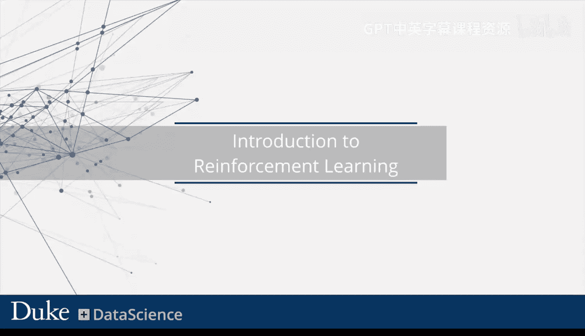
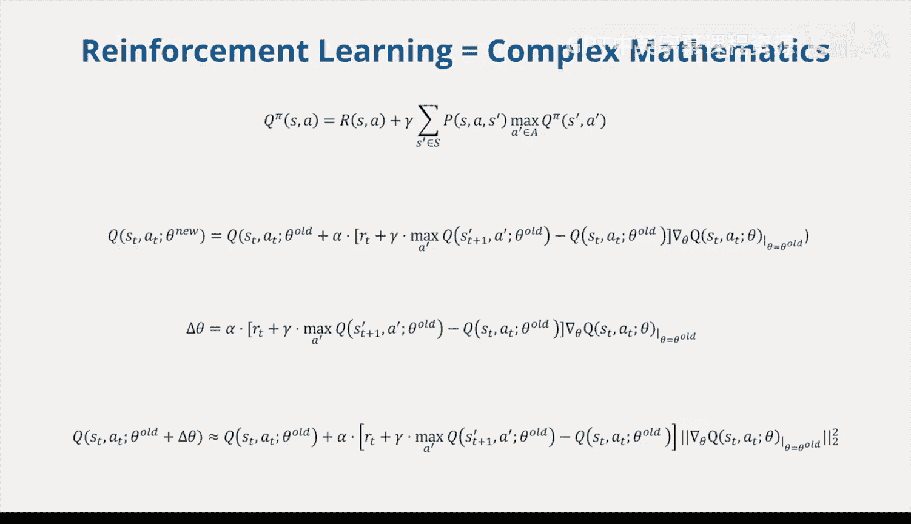
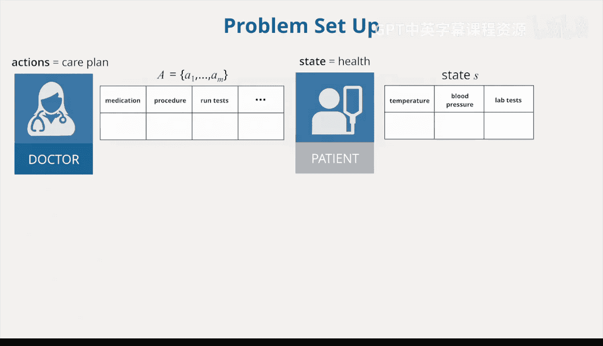
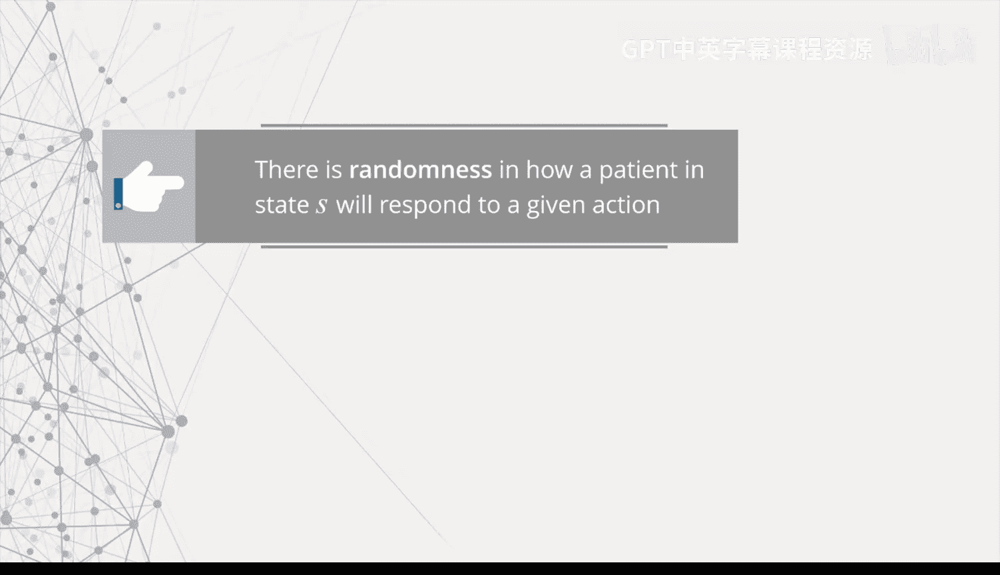
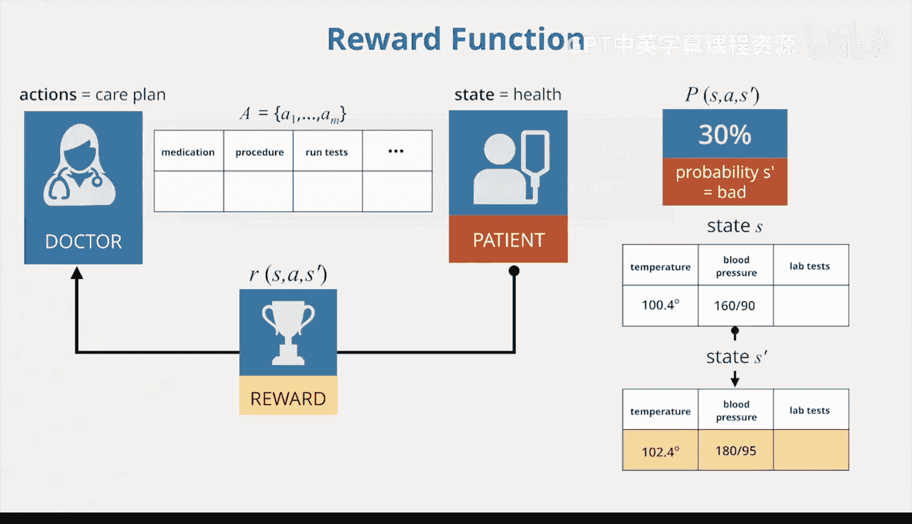
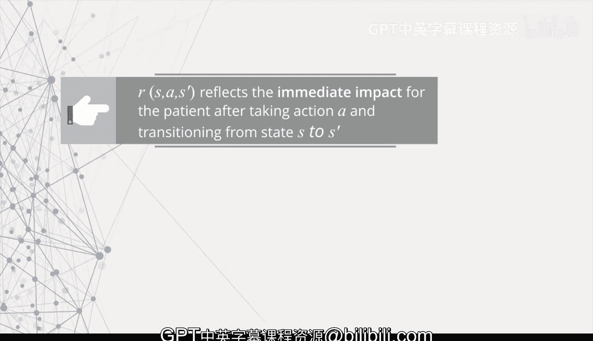

# 杜克大学《机器学习｜Introduction to Machine Learning》中英字幕 p63 63_06_01_强化学习介绍.zh_en -BV1yjvdBQEaU_p63-

We're going to talk about an area of machine learning called reinforcement learning This is an area of machine learning that recently has generated tremendous excitement in that it was one of the fundamental technologies in a machine learning solution for playing the game Go Go is an ancient game from Asia which consists of a very complex board of two colors you can see that on the cover of a nature article here。

So very complex board game and this is a game that previously was thought that there was no way that a machine could play this game as well as a human。

 what was demonstrated using reinforcement learning and deep learning was that indeed it is possible to develop a machine that can perform and play the game go with the proficiency which exceeds that of humans。

 so this was a fundamental breakthrough in machine learning and has generated a lot of the excitement that we now see in machine learning。

 interestingly it was based largely on reinforcement learning using techniques that we're going to now discuss。

 so this gives us hopefully some motivation for trying to understand reinforcement learning。

The problem， I guess， that one might realize real quick is if you try。

To study reinforcement learning。Is that it is a rather mathematical field and so you have some rather complex mathematical equations which you can see here and the point of this slide is not to scare you。

 it's just to show that if we attack the problem of reinforcement learning or try to study reinforcement learning let's say head on by trying to understand the mathematics。

 there's a danger that we may lose the opportunity to understand the underlying foundations of what reinforcement learning is doing。

 which actually is far simpler than these equations might imply and so what I'd like to do is to walk through an example that should hopefully be intuitive to most people which will give us a sense of what reinforcement learning is doing so let's consider a situation of a medical doctor or an MD。

who is tasked with trying to treat a patient and so the goal here is that the doctor would like to develop policy or a framework by which in this case she can optimally treat the patient and so what we mean by optimally is most effectively from the standpoint of improving the health of the patient。

 but also doing it in a costeffective manner， and so we assume in our setup that the doctor has a set of actions that they may perform and so you can think of actions in the case of the doctor might be medications that would be prescribed。

 procedures that might be performed， these are actions that a doctor may take。

And each of those actions will in general， impact the state of the patient。

 and here the state of the patient。Is characterized by the health or by the parameters or the data of health that is presented to the clinician。

And so what the doctor would like or desires is a policy that achieves a good balance between achieving good outcomes for the patient and then also doing this at low cost。

And then this could be applied in many medical settings， for example， in the control of diabetes。

 or also in procedures or optimal flow workflow in an operating room。

 so this is a very fundamental problem in medicine and as we'll see in many fields。

So the way that we're going to set this problem up is that our doctor is going to see or observe the patient and in particular will observe the state of the patient and that state is represented by a vector which we'll call S。

 the state of the patient are whatever variables we have to characterize their health。

 so for example their temperature， blood pressure， perhaps laboratory tests etc cetera。

 so the state S are whatever。Data that we have to characterize the health of the patient。

So that we'll call S and that is observable to the doctor and then we assume that the doctor has a set of actions that she may take。

 will represent that set by capital A and then there are a set of actions A1 through M that the doctor may take so these actions may be again prescribing a particular medication suggesting a particular procedure。

 et cetera， these are actions that a doctor may take。

Now there is randomness in how a patient。In state S。 so given a patient in state S。

 there is some uncertainty or randomness in how that patient will react to the to the action that is selected。

 The reason that that randomness is present is because there may be some randomness to the disease itself。

 but in addition。

The state S， which is a vector of some parameters that characterize the health of the patient。

 those parameters may not be sufficient to characterize every aspect of the health of the patient。

 and therefore there are some missing aspects of the health of the patient which are not captured by S。

 those missing aspects of the health manifest some randomness because those missing characteristics are different from patient to patient。

So we introduce a probability distribution which we represent by capital P。

 which is the probability of when the patient is in state S。

And the doctor takes action A that the patient will transition to state S prime and so S prime is a new state of health of the patient and so for example。

 the patient is presented to the doctor with certain with a certain state of health S which are characterized by the parameters。

 for example， again， the temperature， blood pressure。

 et cea of the patient the doctor then takes an action， for example， prescribes a medication。

 and then the doctor sees what happens and then in this case。

 the state of health of the patient changes to S prime which might be a change in the temperature change in the blood pressure or what other laboratory tests we have the problem so given this probability PS A S prime what we would like to do is to devise optimal actions。

For the doctor to take。And so here to define what we mean by optimal。

 we're going to define a reward function， RsS prime。Is the reward？

Provided whenever the patient is initially in state S。

The doctor suggests action A and then the patient goes to state S prime。

 this is what we call a reward， so for example， if the state of health improves， in other words。

 if S prime is better than S after taking action A， then the reward should be high。

 if the state S prime is worse for the patient than it was at state S， the reward should be low。

 this reward should take into account the state of health of the patient。

Initially state S， subsequently state S prime， it also should take into account the cost of the action。

 so this reward takes into account the reward to the patient from the standpoint of health。

 but also the cost of providing that care。And so the thing to note about this is that this reward function。

 RSS prime， reflects the immediate impact。To the patient of taking action A when the patient is in state S and then the patient transitions to state S prime。

