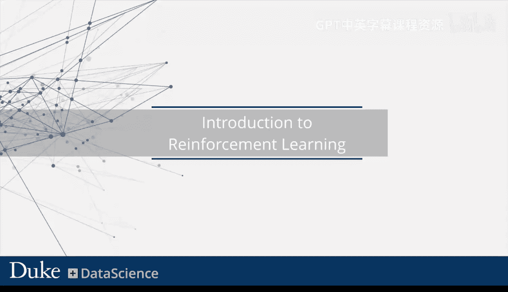
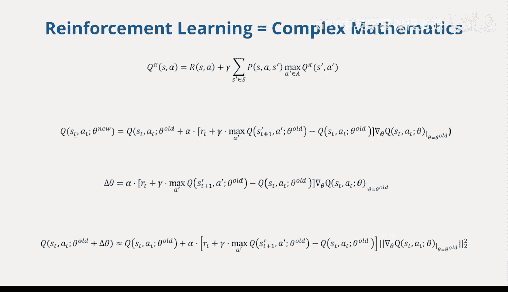
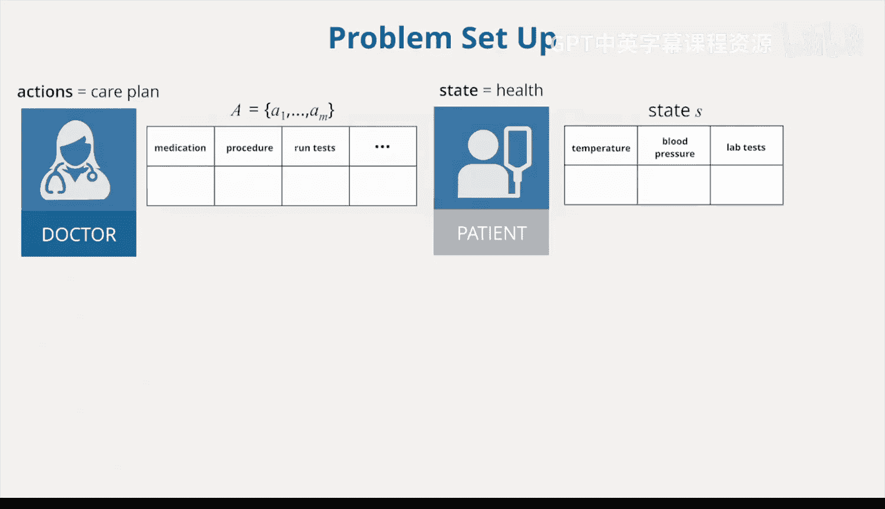
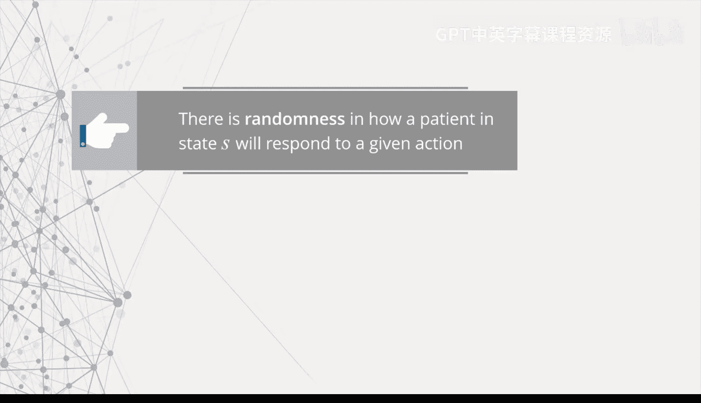
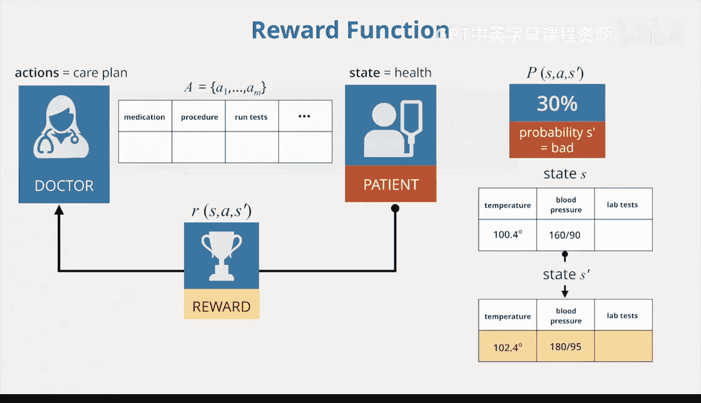
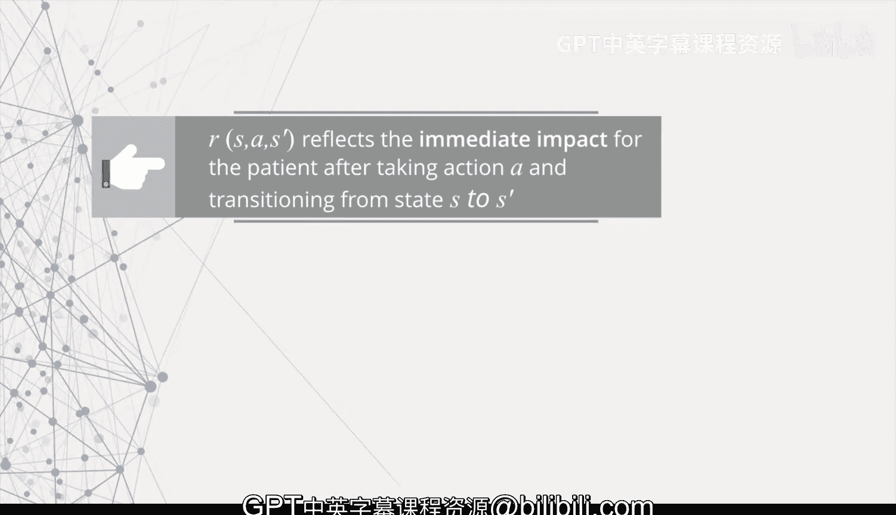

# 机器学习入门：06：强化学习介绍 🎮

在本节课中，我们将要学习一个名为“强化学习”的机器学习领域。强化学习近年来引发了巨大关注，尤其是在开发能够精通围棋的机器学习解决方案中起到了核心作用。围棋是一种源自亚洲的古老棋类游戏，其棋盘复杂，对弈策略深奥。过去人们认为机器不可能达到人类的下棋水平，但通过结合强化学习与深度学习技术，研究人员成功开发出了超越人类顶尖棋手的程序。这一突破是机器学习领域的里程碑，也极大地推动了当前对机器学习的热情。有趣的是，这一成就主要基于我们即将讨论的强化学习技术。希望这能为我们理解强化学习提供一些动力。

## 从直观例子理解强化学习

我们很快会发现，如果直接研究强化学习，它是一个相当数学化的领域，涉及一些复杂的数学方程。展示这些方程的目的并非为了吓退大家，而是想说明，如果我们直接试图从数学层面理解强化学习，可能会错失理解其背后更简单、更基础原理的机会。这些原理实际上远比方程本身更直观。

因此，我想通过一个对大多数人来说都易于理解的例子，来让大家感受强化学习在做什么。让我们考虑一位医生治疗病人的情境。

这位医生的目标是制定一个策略或框架，以便能够最优地治疗病人。这里“最优”意味着从改善病人健康的角度最有效，同时也要考虑成本效益。我们假设医生有一系列可以采取的行动，例如开具处方药、执行特定医疗程序等。

## 强化学习的基本要素

上一节我们介绍了医生治疗的场景，本节中我们来看看如何用强化学习的术语来形式化描述这个问题。

以下是描述此问题的核心要素：

*   **状态 (State)**：医生观察病人，特别是观察病人的“状态”。这个状态用一个向量 **S** 表示，它包含了表征病人健康的所有变量，例如体温、血压、实验室检测结果等。**S** 就是我们所掌握的、描述病人健康的所有数据。

*   **行动 (Action)**：我们假设医生有一系列可以采取的行动，用大写字母 **A** 表示这个集合。具体行动可以是 **A₁, A₂, ..., Aₘ**，例如开具某种特定药物、建议某项检查等。

*   **状态转移概率 (Transition Probability)**：当病人处于状态 **S** 时，对于医生选择的行动 **A**，病人如何反应存在不确定性或随机性。这种随机性可能源于疾病本身，也可能因为状态向量 **S** 并未捕捉到病人健康状况的所有方面，那些未被捕捉的方面在不同病人间存在差异，从而表现为随机性。我们用概率分布 **P** 来表示这种不确定性，具体地，**P(S‘ | S, A)** 表示当病人处于状态 **S** 且医生采取行动 **A** 时，病人转移到新状态 **S‘** 的概率。

*   **奖励函数 (Reward Function)**：为了定义什么是“最优”行动，我们需要一个“奖励函数” **R(S, A, S‘)**。它表示当病人初始状态为 **S**，医生采取行动 **A**，然后病人转移到状态 **S‘** 时所获得的即时奖励。例如，如果病人的健康状况改善（即 **S‘** 优于 **S**），奖励应该较高；如果健康状况恶化，奖励应该较低。这个奖励函数应同时考虑病人的健康收益和提供该医疗行动的成本。

需要注意，奖励函数 **R(S, A, S‘)** 反映的是采取行动 **A** 后对病人产生的**即时**影响。

## 总结

本节课中我们一起学习了强化学习的基本介绍。我们首先通过围棋AI的突破性成果了解了强化学习的重要性。然后，为了避开复杂的数学公式，我们通过一个医生治疗病人的直观例子，逐步引入了强化学习的核心概念：**状态(S)**、**行动(A)**、**状态转移概率(P)** 和**奖励函数(R)**。这个框架描述了智能体（医生）如何通过与环境（病人）的交互（采取行动），根据获得的奖励来学习最优策略，以达到长期目标（最优治疗）。这为我们后续深入探讨强化学习算法奠定了坚实的基础。