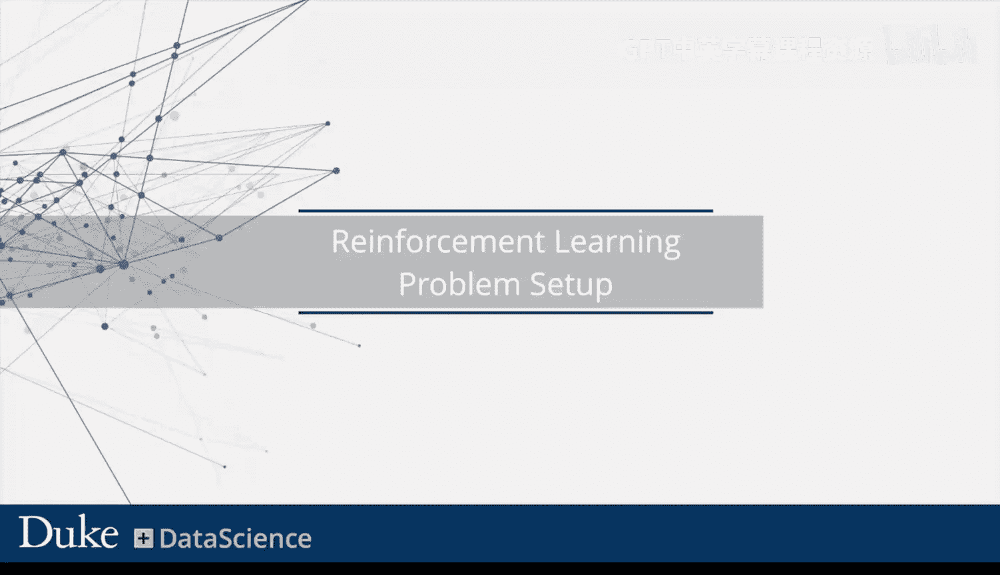
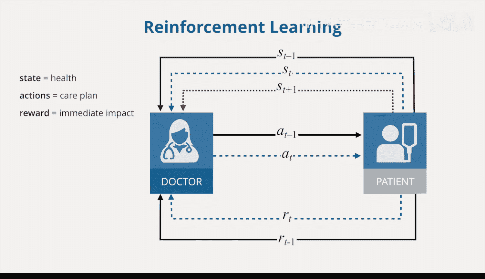
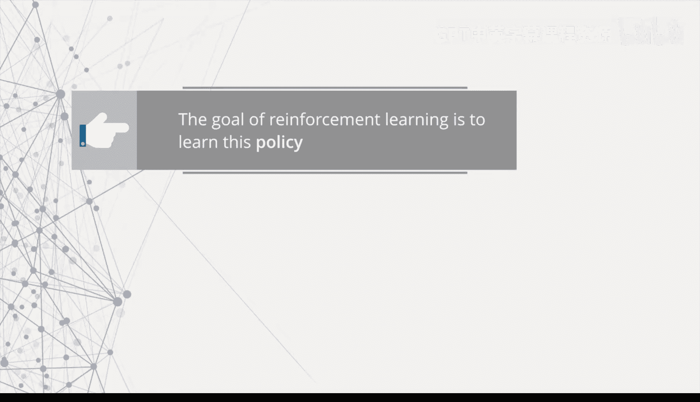
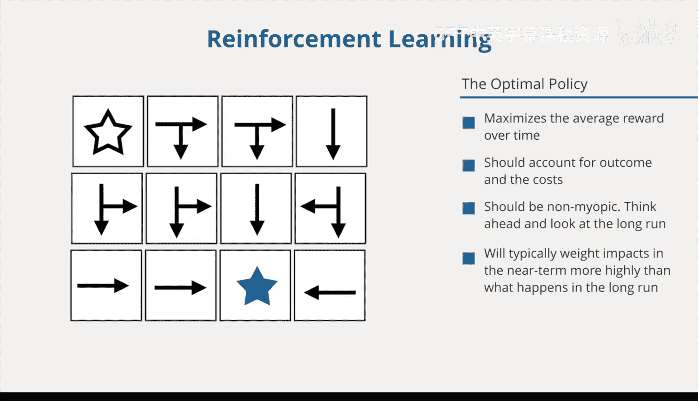
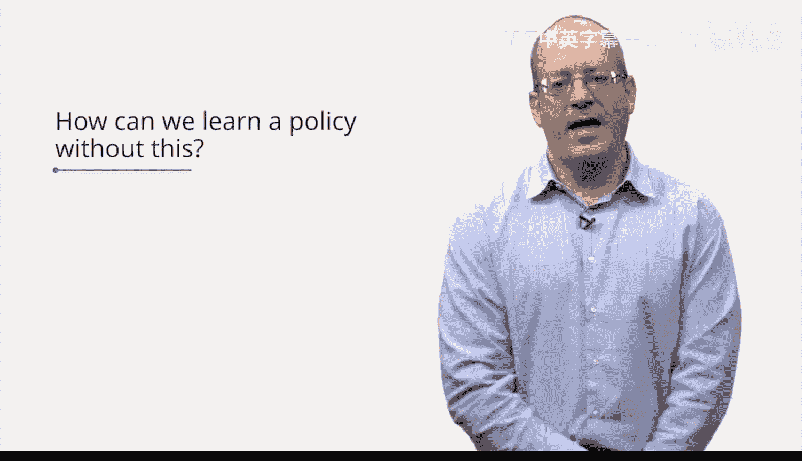
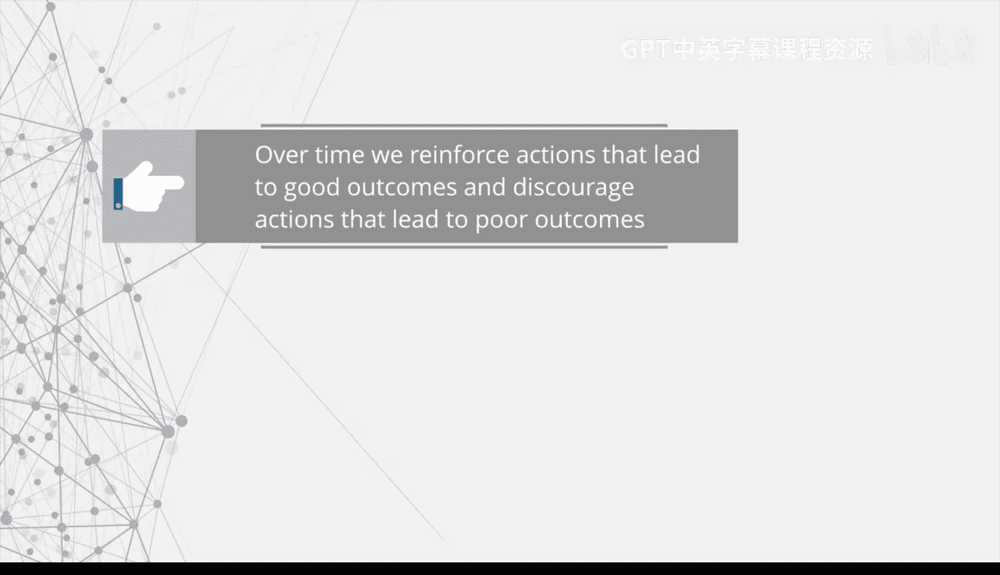
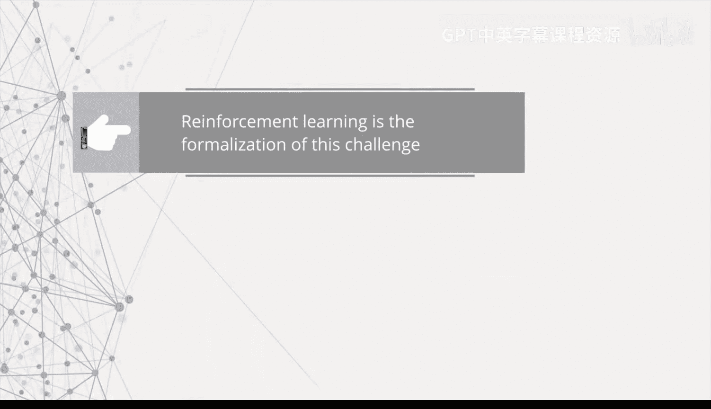
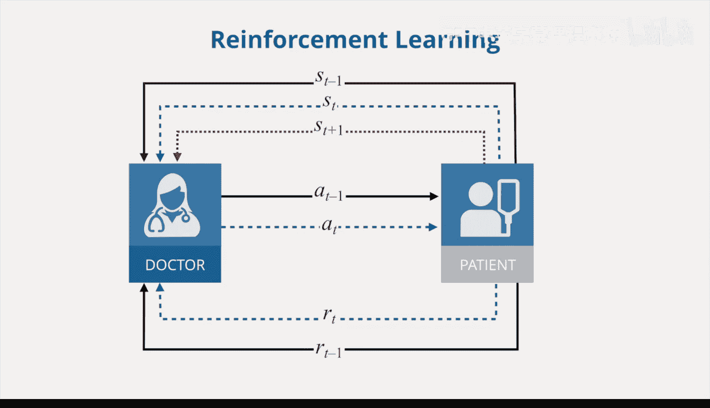
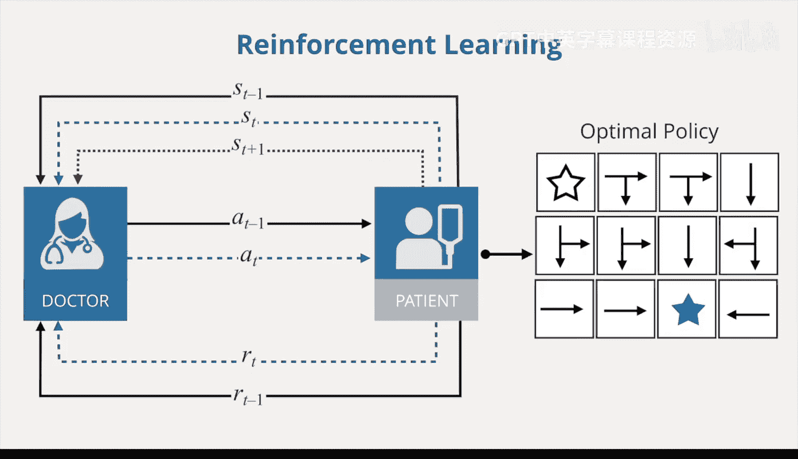

# 杜克大学《机器学习｜Introduction to Machine Learning》中英字幕 p64 64_06_02_强化学习问题设置.zh_en -BV1yjvdBQEaU_p64-

Let's continue describing the way in which we set up or solve reinforcement learning problems。

So the MD who is in this case is our example to try to introduce the concept of machine learning。

the concept of reinforcement learning， the MD interacts with the patient through a series。Of actions。

And rewards and observations。 so here the state of health of the patient at time t minus1 is s sub t minus1。

The doctor。Takes an action。Prescribes a medication， looks considers a procedure， et cetera。

 takes an action at time t minus1。Then a reward is manifested。

Because the state of health has changed to S sub T。Then an action is again taken by the doctor。

 we get a reward RT and then the health changes to ST plus1 and so the thing to notice about reinforcement learning is that the interaction in this case of the doctor with the patient is characterized by a sequence of states。

Actions， rewards。Then new states。And then a new action reward， and then a new state。

 so it's sequence action reward， series state action reward followed sequentially。

The goal。Of the goal of the doctor and the goal of reinforcement learning。

Is to develop a policy that defines for the doctor the optimal action to take when presented by a patient in state S。

So the goal of reinforcement learning is to learn this policy。

And the policy will effectively define the standard of care， how a doctor should care for a patient。

The optimal policy。Should maximize the average reward over time。

And it should account for the patient outcome and for the patient costs or the cost of delivering of care。

The policy should be non myopic， which means that it should think ahead。

 not only consider the most immediate impact to the patient。

 but also look at the long run impact to the patient。And in particular。

 in the context of this non-myopic characteristic， we would typically like to weight the impact in the near term more importantly or more highly than what happens in the long run。

 but nevertheless， with a nonmyopic policy， we want to think about the reward immediately as well as into the future。

So the challenge that we have when we solve a reinforcement learning problem。

Is that we typically do not know。That underlying distribution。

 PA S prime recall that PA S prime corresponds to the probability。

That when we're given a patient in state S。

And we take an action A。That the patient will transition to state as prime。

 that underlying probability is typically unknown， so the question then is how can we learn a policy that is optimal without having access to that underlying probability PSA as prime？

So conceptually， what we can do is we can just experience。

experience the world and then try things and record what happens。

 and then the idea is to try to adapt a policy such that over time we reinforce actions that were good or that led to good outcomes and we discouraged and we discourage actions that lead to poor outcomes。

So this is， in fact， the heart。Of the term reinforcement learning。 So in reinforcement learning。

 we're going to just experience the world。 We're going to see the state of the world。

 We're going to take actions， and we're going to see the new state。

 and we're going to see the reward。 and we're going to do that repetitively。

And the idea is is that through experiencing states and actions and rewards in new states。

 we hope to learn a policy which is optimal， optimal in the sense of achieving an outcome for the patient or reward that is on average。

Very good， good for the patient and also good from the health system。

 from the standpoint of keeping costs under control。

So reinforcement learning is the formulation of this fundamental challenge。

 so the fundamental challenge is that we're going to experience the world by a series of states。

Actions， rewards in new states， and then new action， new reward， new state。

 we're going to do that repeatedly， and then what we would like to do based upon that experience。

Is to learn an optimal policy This is a very fundamental problem。

 This is what reinforcement learning is and the reinforcement methodology that we're going to talk about is going to is going to address this challenge the thing that is important to recognize is that while we have used health and medicine as our underlying thematic example largely because it's understandable to most people intuitively understandable this construct of trying to develop an optimal policy over time is manifested in other settings so for example。

 consider the case in which you are operating the machine floor of some factory and what you would like to do is monitor the health of the machines and also determine your maintenance schedule so for example。

 when should you take a particular machine offline and repair it or tune it up it would probably be not a good idea to wait for。

ToAnd so therefore， what is the optimal way to monitor the health of machines and what is the optimal way to maintain that health。

 This is also a reinforcement learning problem。Another example。Is investing。

 So if you look at the price of companies over time， you would like to make good investments。

 it's very difficult to understand the underlying statistics of the stock market。

 So what you might try to do is to develop a policy。

 a policy that guides which stocks you buy which stocks you sell。

 you would like to do this in a way that over time， you develop a policy， which on average。

 yields a positive outcome in your investing。 And so the thing that I just want to highlight from this slide is that while we're going to use medicine。

As our underlying theme we move as in the past and as we move forward in these lectures。

This construct reinforcement learning is very general。

 we also talked about it in the context of the game go and a machine playing a human in a game like Go。

These are likeThese are all sequential decision type problems and reinforcement learning。

 which we're going to now start to dive into in greater detail。

 is a fundamental machine learning framework for solving each of these problems。

