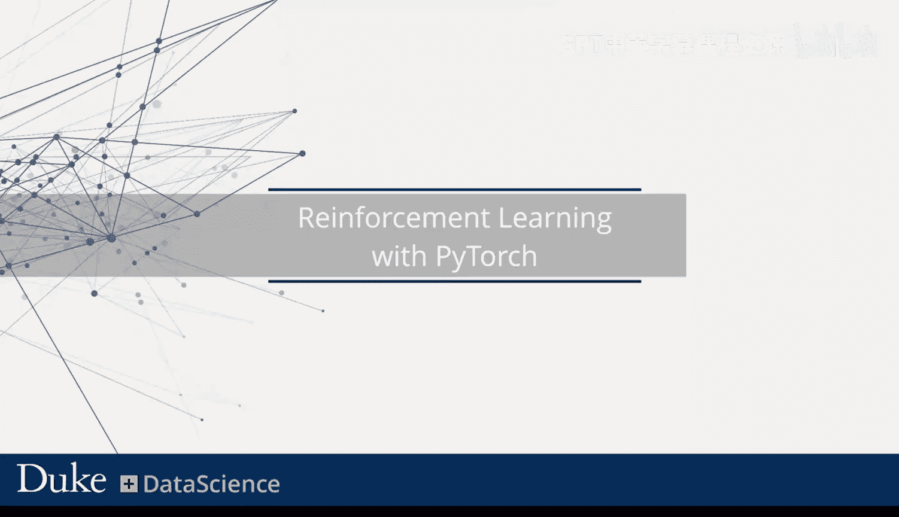
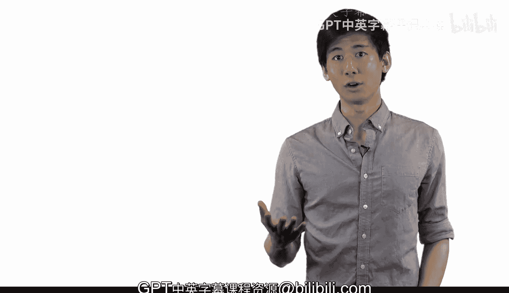
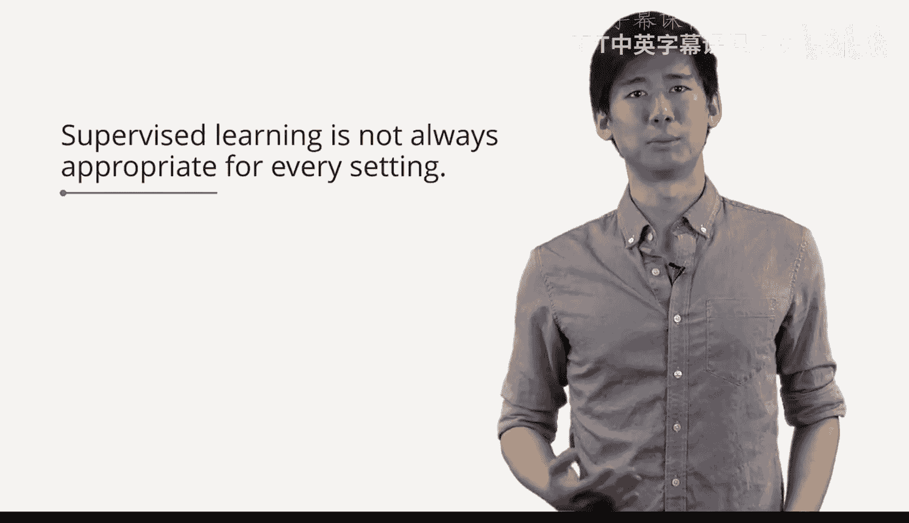
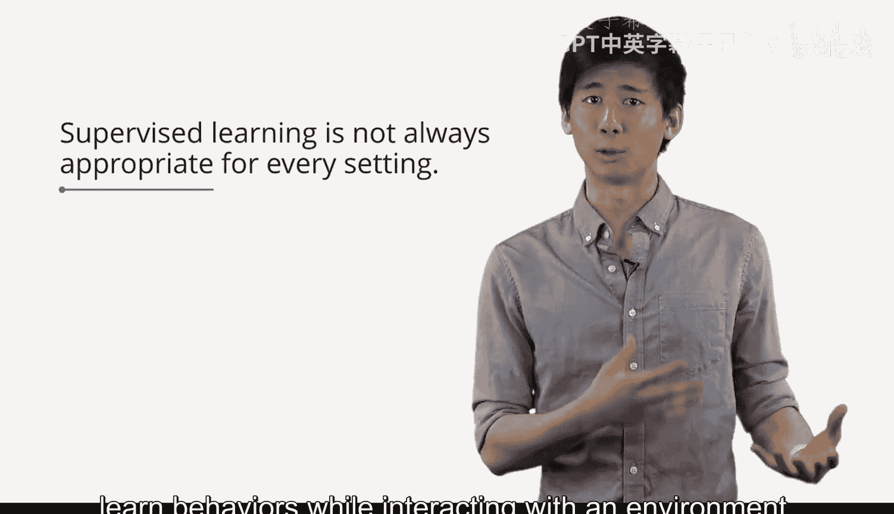
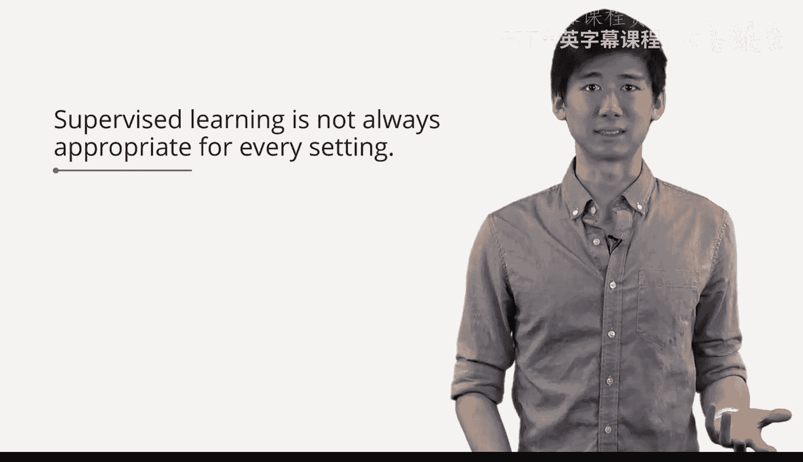
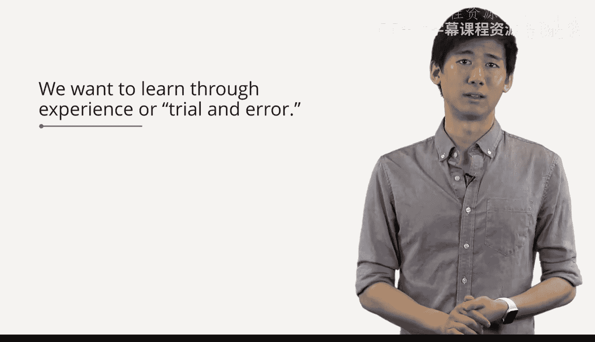
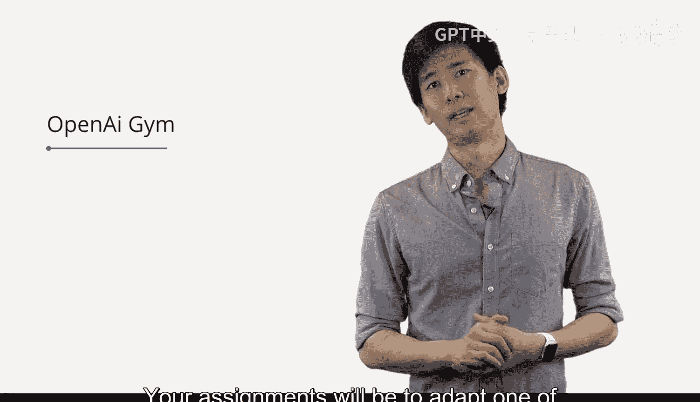

# 杜克大学《机器学习｜Introduction to Machine Learning》中英字幕 p66 66_06_04_使用PyTorch进行强化学习.zh_en -BV1yjvdBQEaU_p66-

So far throughout this course， we've mostly focused on supervised learning。

 which means we're learning from a data set of input and output pairs。

While supervised learning is a powerful framework， it's not always appropriate for every setting。

 For example， when our goal is for an agent to learn behaviors while interacting within an environment。

 a data sets of the optimal behavior often doesn't exist。

Instead， we want to be able to learn through experience or a trial and error。

The field of reinforcement learning tackles exactly this problem。

Like in in language， deep learning has made a big impact on reinforcement learning as well。

In these notebooks， we'll introduce some basic reinforcement learning concepts with Open AIG。

We'll see a couple of the environments implemented in gym and how we might try to learn to solve them。

Your assignments will be to adapt one of these agents to learn with a new algorithm。

