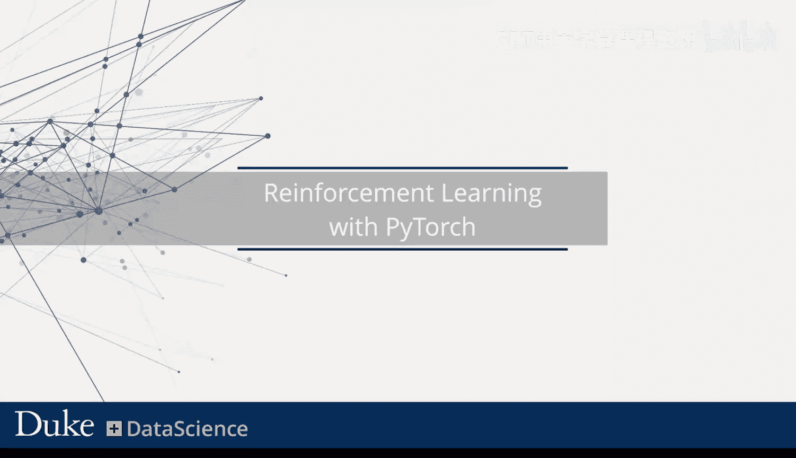
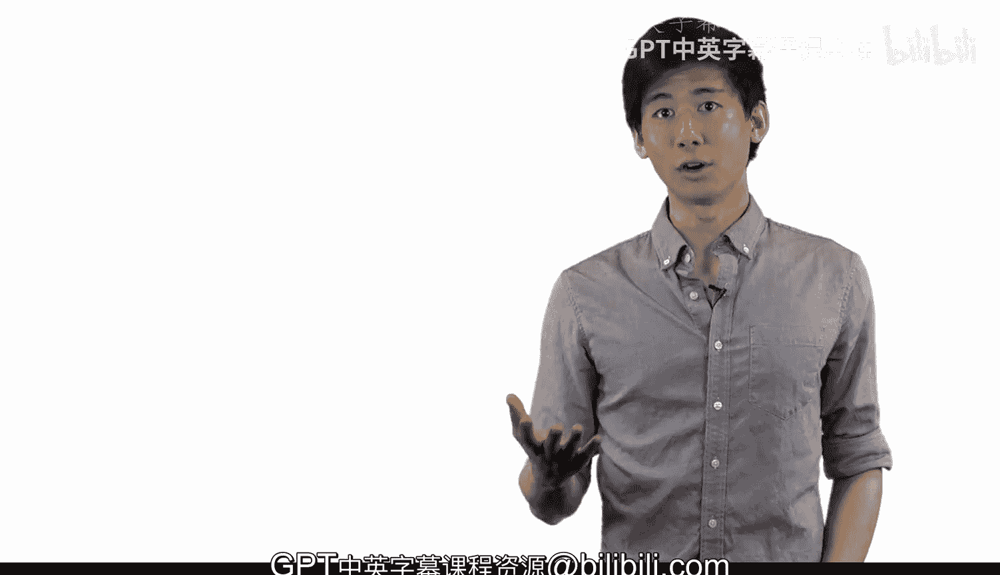
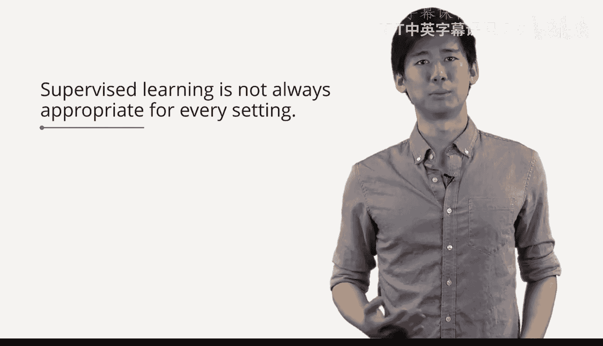
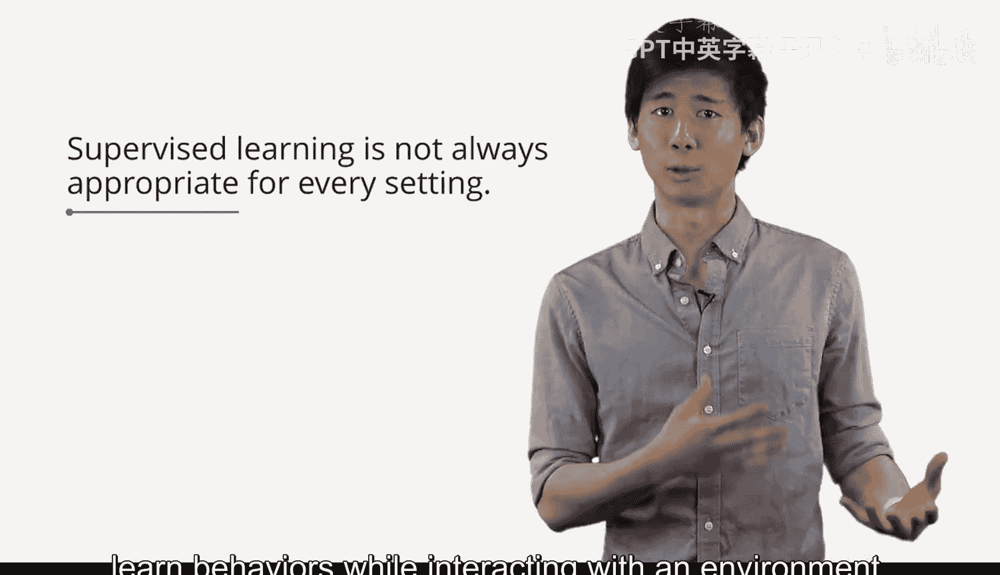
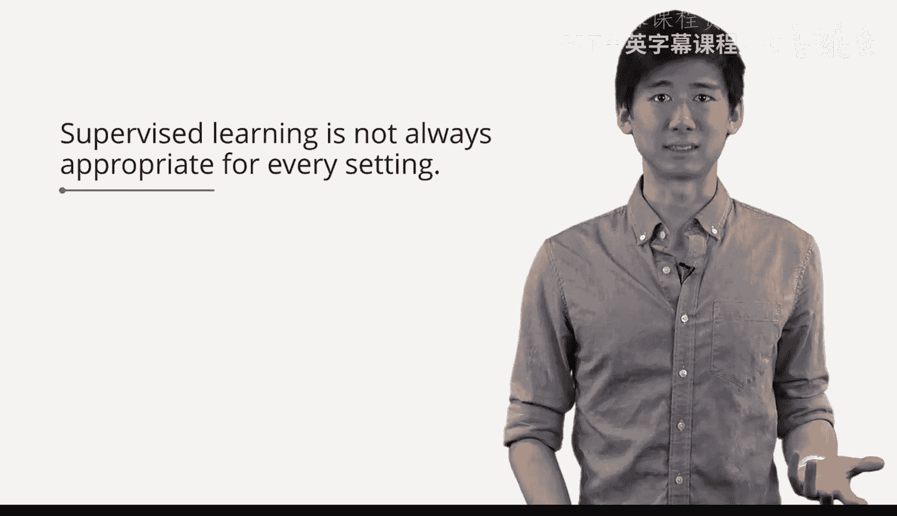
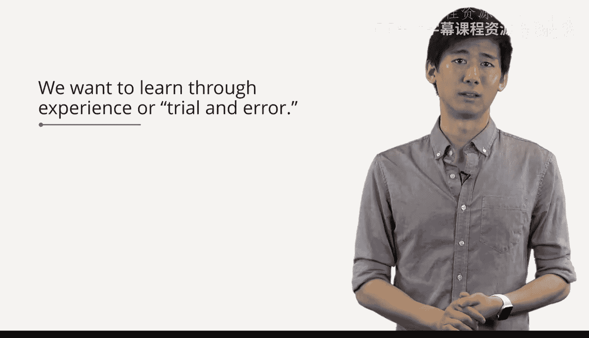
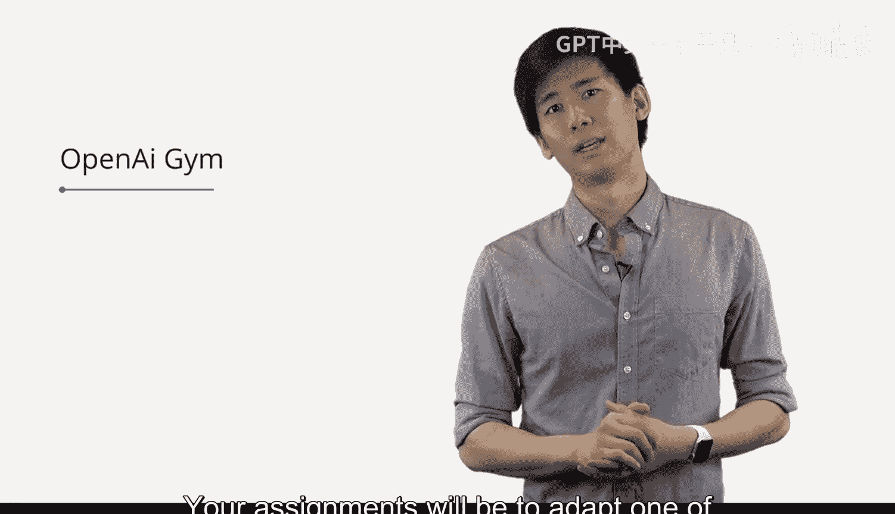

# 机器学习：66：使用PyTorch进行强化学习 🎮

在本节课中，我们将学习强化学习的基本概念，了解它与监督学习的区别，并探索如何使用OpenAI Gym环境和PyTorch来构建一个简单的强化学习智能体。



---

到目前为止，在本课程中，我们主要关注的是**监督学习**。这意味着我们从一个包含输入和输出对的数据集中进行学习。

虽然监督学习是一个强大的框架，但它并不适用于所有场景。例如，当我们的目标是让一个智能体在与环境的交互中学习行为时，通常不存在关于最优行为的数据集。

相反，我们希望智能体能够通过**经验**或**试错**来学习。**强化学习**领域正是为了解决这个问题而存在的。



与在自然语言处理领域一样，深度学习对强化学习也产生了巨大影响。在这些笔记中，我们将结合OpenAI Gym介绍一些基本的强化学习概念。我们将看到Gym中实现的几个环境，并探讨如何尝试学习解决它们。你的作业将是调整其中一个智能体，使其能够使用一种新算法进行学习。

---

## 强化学习基础概念

上一节我们介绍了强化学习的目标。本节中，我们来看看强化学习中的几个核心组成部分。

强化学习问题通常被建模为一个**马尔可夫决策过程**。它包含以下几个关键元素：

*   **智能体**：进行学习和决策的主体。
*   **环境**：智能体与之交互的外部世界。
*   **状态**：环境在某一时刻的状况，记为 **`s`**。
*   **动作**：智能体在某个状态下可以执行的操作，记为 **`a`**。
*   **奖励**：智能体执行动作后，环境给出的即时反馈信号，记为 **`r`**。
*   **策略**：智能体根据当前状态选择动作的规则，可以表示为函数 **`π(a|s)`**。



智能体的目标是学习一个最优策略 **`π*`**，以最大化从环境中获得的**累计奖励**（通常考虑折扣因子 **`γ`**）。



## OpenAI Gym 环境介绍



了解了基本概念后，我们来看看实践工具。OpenAI Gym 是一个用于开发和比较强化学习算法的工具包，它提供了多种标准化的测试环境。

以下是Gym中一些经典环境的示例：

*   **CartPole**：控制一个小车，使其顶部的杆子保持直立不倒。
*   **MountainCar**：控制一辆动力不足的小车，使其驶上山坡。
*   **Atari 游戏**：如 `Pong`， `Breakout` 等，提供像素级别的观察输入。

## 使用PyTorch构建一个简单智能体



现在，让我们动手使用PyTorch构建一个解决`CartPole`问题的简单智能体。我们将采用基于策略梯度的方法。

首先，我们需要定义神经网络策略。这个网络将环境状态作为输入，并输出每个动作的概率。

```python
import torch
import torch.nn as nn
import torch.optim as optim
import gym

class PolicyNetwork(nn.Module):
    def __init__(self, state_size, action_size):
        super(PolicyNetwork, self).__init__()
        self.fc1 = nn.Linear(state_size, 128)
        self.fc2 = nn.Linear(128, action_size)

    def forward(self, x):
        x = torch.relu(self.fc1(x))
        x = self.fc2(x)
        return torch.softmax(x, dim=-1)  # 输出动作概率分布
```

接下来是智能体的核心学习循环。智能体将与环境交互，收集轨迹（状态、动作、奖励序列），然后使用这些数据来更新策略网络，目标是增加带来高奖励的动作的概率。

```python
def train_agent(env_name='CartPole-v1', episodes=1000):
    env = gym.make(env_name)
    policy_net = PolicyNetwork(env.observation_space.shape[0], env.action_space.n)
    optimizer = optim.Adam(policy_net.parameters(), lr=0.01)

    for episode in range(episodes):
        state = env.reset()
        log_probs = []
        rewards = []
        done = False

        # 1. 收集轨迹数据
        while not done:
            state_tensor = torch.FloatTensor(state).unsqueeze(0)
            action_probs = policy_net(state_tensor)
            action = torch.multinomial(action_probs, 1).item()

            next_state, reward, done, _ = env.step(action)

            log_probs.append(torch.log(action_probs.squeeze(0)[action]))
            rewards.append(reward)
            state = next_state

        # 2. 计算折扣回报
        returns = []
        R = 0
        for r in reversed(rewards):
            R = r + 0.99 * R  # 折扣因子 gamma=0.99
            returns.insert(0, R)
        returns = torch.FloatTensor(returns)

        # 3. 策略梯度更新
        policy_loss = []
        for log_prob, R in zip(log_probs, returns):
            policy_loss.append(-log_prob * R)  # 损失 = -log(概率) * 回报
        policy_loss = torch.stack(policy_loss).sum()

        optimizer.zero_grad()
        policy_loss.backward()
        optimizer.step()

        if episode % 50 == 0:
            print(f'Episode {episode}, Total Reward: {sum(rewards)}')

    env.close()
```

## 总结与展望

本节课中，我们一起学习了强化学习的基础。我们了解了它与监督学习的区别，认识了MDP的核心要素，并实际使用PyTorch和OpenAI Gym实现了一个简单的策略梯度智能体来解决`CartPole`环境。

这只是强化学习的入门。要构建更强大、更稳定的智能体，你还需要探索更多内容，例如：
*   **价值函数**：评估状态或状态-动作对的好坏。
*   **Actor-Critic方法**：结合策略和价值函数。
*   **深度Q网络**：使用深度神经网络来近似Q值函数。
*   **更复杂的探索策略**：如噪声注入或内在好奇心驱动。



希望本教程为你打开了强化学习的大门，并激发你继续探索这个令人兴奋的领域。