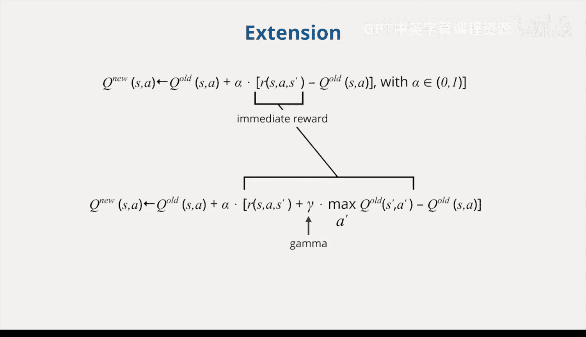
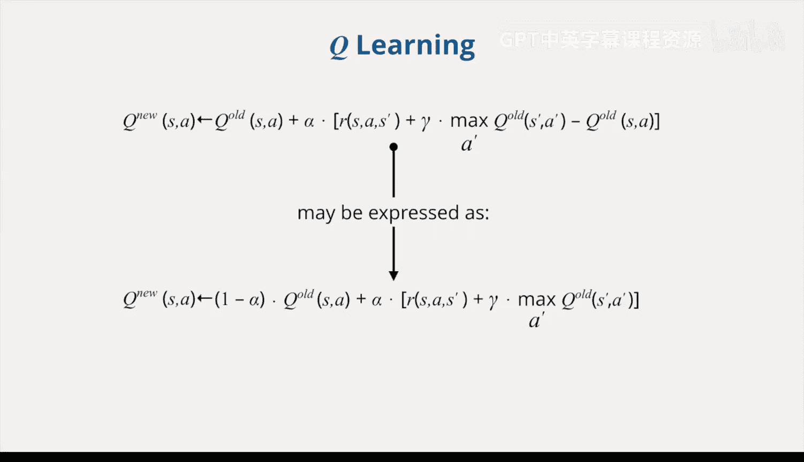
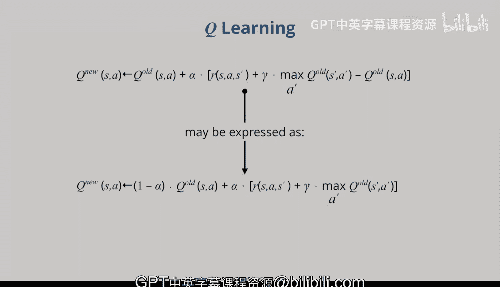

# 杜克大学《机器学习｜Introduction to Machine Learning》中英字幕 p67 67_06_01_转向非短视策略.zh_en -BV1yjvdBQEaU_p67-

So now what we would like to do。

Is to take this setup。That we've developed to this point。

Which while attractive and hopefully intuitive。That previous solution is myopic in the sense that it only takes into account the immediate reward that the patient in our example achieves。

 and so what we would like to do is to extend it to develop a non-myopic policy。

 and so what we mean by non- myopic， is that the policy which evaluate or the Q function。

 which evaluates the value of taking action A and state S。

 it takes into account not just the immediate reward， but also rewards to come down the road。

 subsequent rewards。

And so we recall our example。And we would call the equation。

 so this is the same equation that I showed previously， and again。

 the problem with this equation is that we're learning a Q function using this equation that only learns to predict the immediate reward to the patient and therefore does not take into account what might happen subsequently。

And so what we would like to do is to try to extend this to a framework which is non myopic。

And so again， this is the same equation， just I'm repeating it hopefully for you to remember also to hopefully it becomes more familiar or it becomes familiar the more you see it。

 what we would like to do is to extend this in a rather straightforward way。

 so if we look at the first equation， which is the way that we updated the Q function previously。

 so previously what we said was is that if the immediate reward。

Was larger than our previous estimation of the Q function then make the Q function larger。

s that's what the top equation is doing。 and if the immediate reward R is less than the old representation of Q。

 then let's diminish the Q function。 That's what the first equation is doing。

 but the problem is is that it's only based upon the immediate reward R。

 So now what we're going to do is we're going to do a rather small。

But very important modification to the top equation。 So the second equation is exactly the same。

the second equation is exactly the same as the first equation， except for one change。

 So if you look at the bracket on the top。That is the immediate reward。

 what we're going to do is we're going to replace that immediate reward plus replace that immediate reward by the immediate reward。

Plus。Gamma times the action that so what's going to happen is is that the patient。Was in state S？

Action A was taken， and then the patient transitioned to state S prime。

 so the new state of health of the patient is S prime。

What we would like to do is to evaluate what is the value。

For the patient of being in state as prime and so let's think back to the example that that I talked about earlier。

 so imagine that you're a doctor and you have a young woman as your patient and you have an action that you can take。

 which may improve the immediate health of the patient。

So S prime is now a very is an improved health for the patient and therefore the immediate reward R S prime is low sorry that reward is high。

 There's a high reward for the patient。 but now let's assume that that medication taking that medication increases the significantly increases the likelihood that that the patient or that young woman will not be able to have children。

 so now the the patient the patient is in a new state S prime so we have to evaluate。

How good is that new stain for the patient， So in the case of our young woman。

If she's now in a new state where she could not have children， this may be a very bad state for her。

 So what we're going to do is if you look at this modification。

 if we look at the top equation and look at the bottom equation。

 what we're doing is we're taking in the bottom equation。 We're taking the sum。

 we're replacing the immediate reward R by a sum of two terms。

 The first term is the immediate reward R。

And then we're taking an estimate of the value to the patient of being in state S prime。

 so now the patient， after taking action A is in state S prime and what is the value of that to the patient and so what we're going to do is we're going to use our old estimate of the Q function and we're going to assume that subsequently we're going to take the best possible action we can take。

The best action， a prime。For the patient in state as prime。

And so the thing to notice is that we're looking at the immediate reward。

Plus a discounted version of the subsequent reward and the subsequent reward is the maximum value。

To the patient of being in state S prime。 so that is max over a prime。

 so maximum action to take then maximum next action to take when the patient is in state S prime that is parameterized by the old Q function and gamma is a discount factor。

 So gamma is is a way for us to weight the importance of subsequent subsequent actions in subsequent states of health to the patient relative to to the immediate situation。

 So if we if we come back to our young woman。We wanted to take an action that increases our immediate reward R。

 and then we also are interested in what happens subsequently。

 but you know we you know bearing children， that's something down the road and maybe not quite as important as surviving right now and so this parameter gamma is a discount factor。

 so now if we look at each of the terms we have the R which is the immediate reward to the patient。

We have this max over a prime of the Q function for our patient in state S prime。

 this is the expected future reward for the patient whenever they are in state S prime。

And gamma is a discount factor， which is a number between zero and1。

 which weights how important we value the immediate reward R relative to subsequent rewards that we might get in the future。

 so this is is a temporal difference， so we look at this equation it is also a temporal difference。

 but it is a non-myopic temporal difference， and so if we look at this equation。

The the new Q function is updated by a combination of the old Q function and then the difference。

 the temporal difference， between the non myopic reward。

 which is the immediate reward plus a discounted version of the subsequent reward。

 that composite reward is compared to the old Q function。

 if that composite reward is larger then our old estimate of the Q function。

 then that means that taking action A in state s is more valuable than we thought。

 and then we increase the value of the Q function， if that composite reward R plus gamma times the expected future reward。

 if that is less than。Our old estimate of the Q function。

 then we might have overvalued the value of taking action A in state S and therefore through this equation and through the temporal difference。

 we diminish the Q function in our estimate of Q nu so this learning rule is pretty much exactly the same as what we had before。

 except that by adding this second term。In the reward。

 so again we have the immediate reward R and then discounted gamma plus so with the immediate reward plus gamma or discount factor times future reward。

 that composite reward is now replacing what we previously had in our our original setup and this is the fundamental foundation of reinforcement learning Now if we take that top equation and we do just some manipulation。

 we can rewrite or reexpressed。The top equation in the form of the bottom equation。

 and so the bottom equation is just a different way of writing it for some people。

 this is a more common way of writing it， but these two equations are equivalent。

So this framework that we have derived which is hopefully relatively intuitive or relatively easy to understand you now see that at the end。

 we get some rather complicated looking equations， but we arrived at these equations through I think some relatively simple intuition。

 these equations are at the heart of reinforcement learning。

 in particular something called Q learning， the reason it's called Q learning is because we're trying to learn this Q function or this Q table。

And so as we move forward， we will now try to understand this framework and Q learning in greater detail。

