# 杜克大学《机器学习｜Introduction to Machine Learning》中英字幕 p68 68_06_02_Q学习.zh_en -BV1yjvdBQEaU_p68-

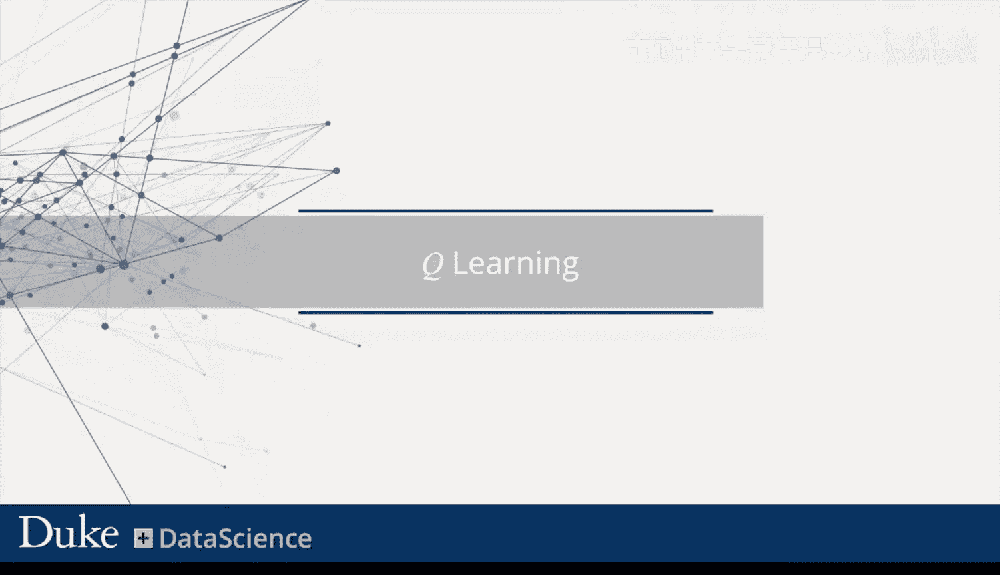

So this framework that we have developed。To this point。It's called Q learning。

 The reason it's called Q learning is because our goal is to learn this Q function， which is a table。

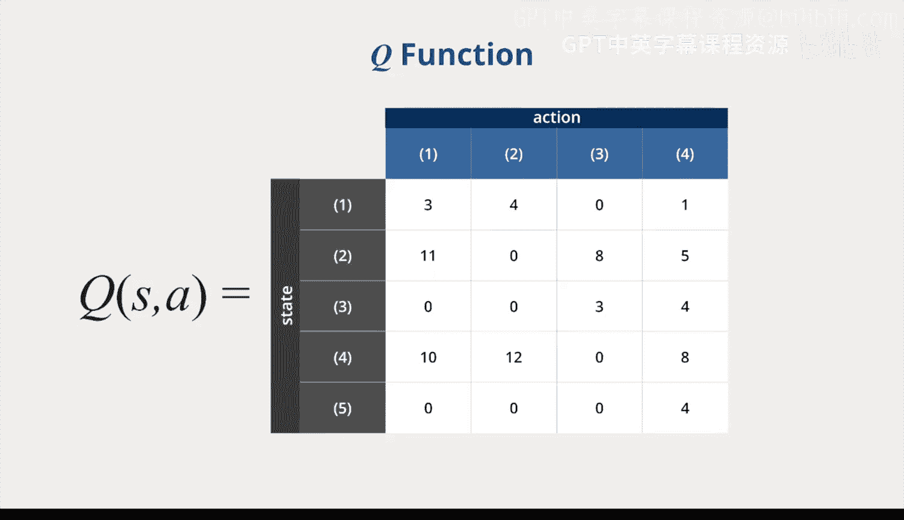

That describes the value of taking action A。In state S。 And so the heart of reinforcement learning。

In many applications is trying to learn this Q function through a series of states， action。

 new state， and reward。New action， new state reward， etc cetera， state action， state reward。

 state action， state reward， a series of these， and then the goal through that experience is to learn the Q function and so now what we'd like to do is to try to understand this in a little bit more detail since this is at the heart of reinforcement learning。

 recall at the beginning of of this discussion of reinforcement learning， we talked about Algo。

 the capacity of a machine to play the game go with performance that exceeded that of the best go players in the world。

 interestingly， the solution methodology as we'll see later， was really based upon Q learning。

 So this Q learning is a very， very fundamental construct。

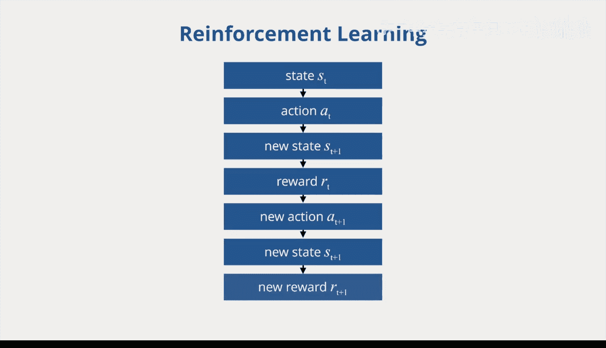

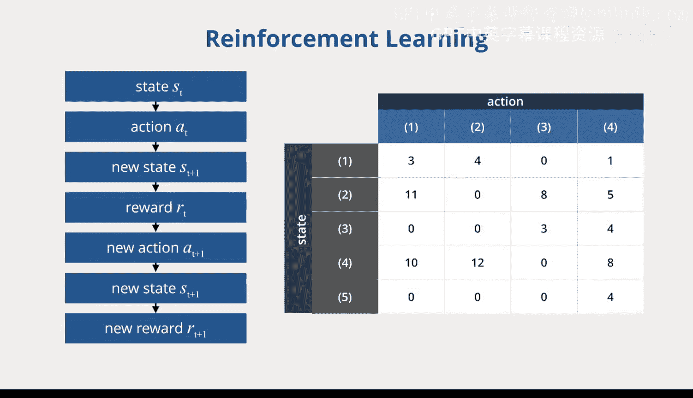

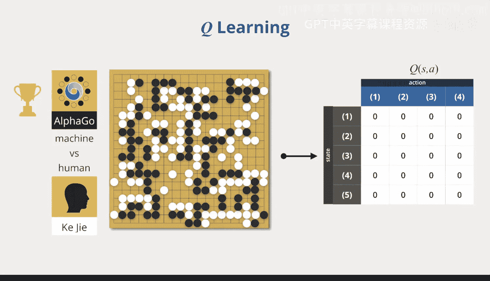

And so it is characterized by this equation at the top。

 and so what we're again doing is sequentially updating the Q function by making observations of the state。

 taking actions， observing new states， getting reward， and then doing that， repeatedly。

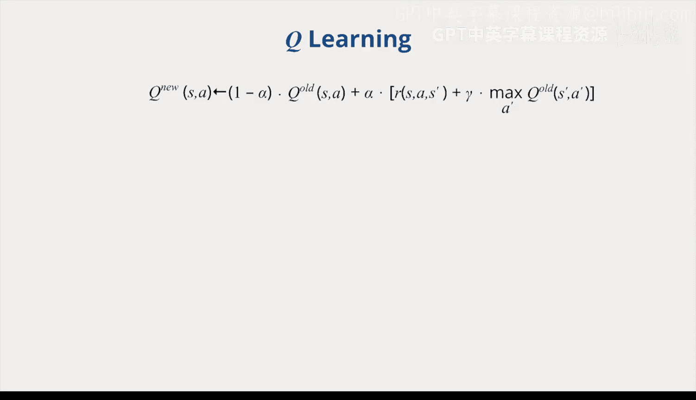

And so after we learn this Q function， so after a series of state action state reward and doing that for a very long time。

 we estimate a Q function， so let's say that we have done that for a very long time and in fact。

 we think about our medical application， this in fact is what medicine is about。

 we the doctors interact with patients， they prescribe actions given states of health of the patient。

 they see what happens， they do this again， and over time we get a good or medicine。

 gets a good understanding of the value of taking action A in state S。

 after learning the Q function through that long series of interaction with patients in the case of medicine。

We now can constitute a policy。

And that policy is represented as a function pi， which is it tells us which action to take。

When the patient in this case is in state A is in state S。

 and so what is done here is we have our table。

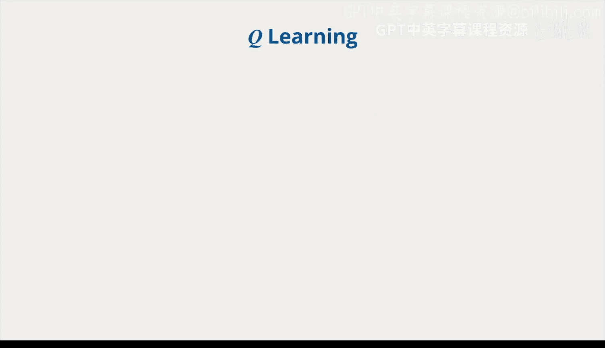

QS comma A， that table reflects the value of taking action A in state S and so now if we're a doctor。

 what we're going to do is we're going to say， okay， what is the state of health of the patient。

 what is S？

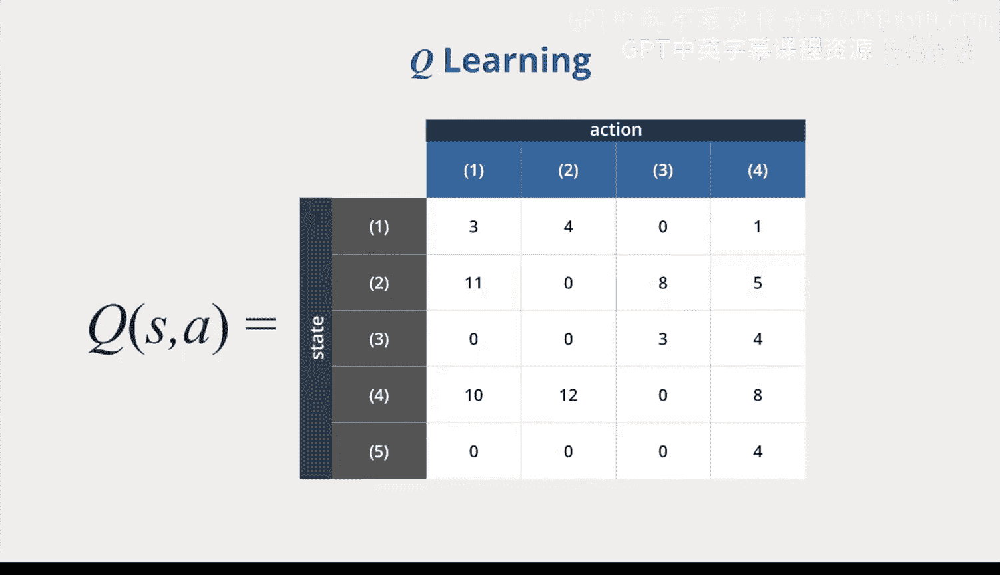

Let's choose the action that maximizes the value to the patient and so therefore what we're going to do is we're going to take this Q table and the optimal policy is simply that action for every state that maximizes the value to the patient and recall that the reward。

 the underlying reward that we're using here takes into account the value to the patient from the standpoint of health improvement。

As well as the cost of delivering that care。

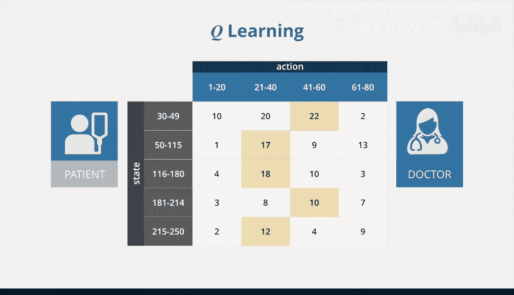

So again， I'm showing you the Q learning equation。This is really very foundational。

 so let's spend a little bit of time talking about it。

 this gamma is what we call a discount factor R sub T is the immediate reward of taking action a sub T in state S sub T。

And then， the second term。Max over a of our old Q， so this is now the reward of the expected reward of taking an optimal action after the patient has transitioned into the new state。

 so the new state ST plus1。And so this term in brackets is the immediate reward plus a discounted version of the future reward。

The reason we discount it is because the immediate situation。

 the immediate reward RT is typically more important to us than subsequent rewards。

 the parameter gamma which is our discount factor is a number between zero and one and it just tells us how much we care about the future relative to the past or to the immediate situation。

 and that gamma is something that can be selected， so if we think about in the context of our patient。

And we think about our young woman。We can ask that young woman。

 how important is it that you have children in the future？

And if it's very important to that that patient， then gamma is going to be large。

 is's going to be near near one because future rewards are important to that patient。

 if if the young woman says I'm not so concerned about having children in the future。

 the thing that's most important to me is that I get healthy right now， than that gamma。

 that discount factor might be rather small， which would mean that the reward to the immediate reward to the patient is far more important than that subsequent reward。

so the thing to notice is that we will get a different policy。

For every selection of gamma and so in some sense or in every sense。

 the doctor has the capacity to build a policy which is tailored to the desires or the needs of the patient from the standpoint of how much they value immediate reward versus subsequent reward and so this discount factor is something that is very important and is selected depending upon the preferences of the person or the situation of immediate reward versus subsequent reward this alpha。

Is our learning rate。And it basically guides how quickly the Q function changes over time。

 and so remember， we're observing the world， the way we observe the world is we have a state。

 we take an action， we have a new state and we have a reward。

We are are experiencing the world and then as we experience the world。

 we're taking our old representation of the Q function， Q old。

 and we're mapping it into a new representation Q new the question is how quickly should we change that how quickly should we let every new measurement change the value of the Q function if alpha is large。

 which means that the learning rate is high， then you could have a situation where the Q function is changing dramatically from new situation to new situation and perhaps that's not a a good idea so in that case you might want the learning rate to be small alpha to be near zero。

 which would mean that the rate at which the Q function changes as a function of time is smooth and so this again the learning rate is something that one can。

Conset。And so Q old is our previous representation。Of the value of taking action A in state s。

 this term R plus the discount factor times the max of Q old is our non myopic representation that we get to observe of the reward of taking action AT in state。

S sub T and so this is what we call Q learning， this is at the heart of reinforcement learning and as I said earlier and as we will show subsequently this was at the heart of the breakthrough technology that we talked about at the beginning。

 the alphago and the ability of the machine to play the game go at the capacity of the best humans in the world。

 this is at the heart of reinforcement learning as applied to many other applications。

 including as we discussed monitoring of equipment in other applications。Okay， so if we look at this。

 this， this expression， this equation。That we're using acute learning。

 which hopefully while it looks， perhaps if you just glance at it， it looks complicated。

 but hopefully through the way in which we have derived it， it is relatively intuitive。

Whenever we evaluate this thing， we do not actually have to set the next action8 plus 1 equal to that that maximizes the Q old。

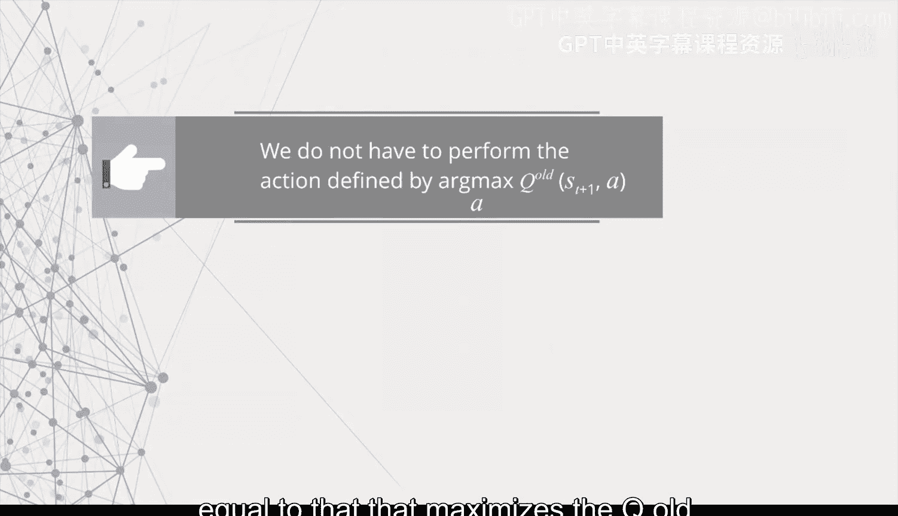

What we can do is we can just evaluate， we can just evaluate it because we we have the old table so we just choose the action a that maximizes Q old。

 and then we can update our our。Our table， our Q table into Q new。

 and then we can choose the next action A T plus1 to optimize or maximize the new Q function and so therefore whenever we actually implement this when we observe state action reward。

 state action reward state action reward what we do is at every step we update the Q function through the observing of the immediate reward and our estimate of the discounted future reward after we update our Q function。

 we can then choose the next action which is optimal as reflected by that Q function。

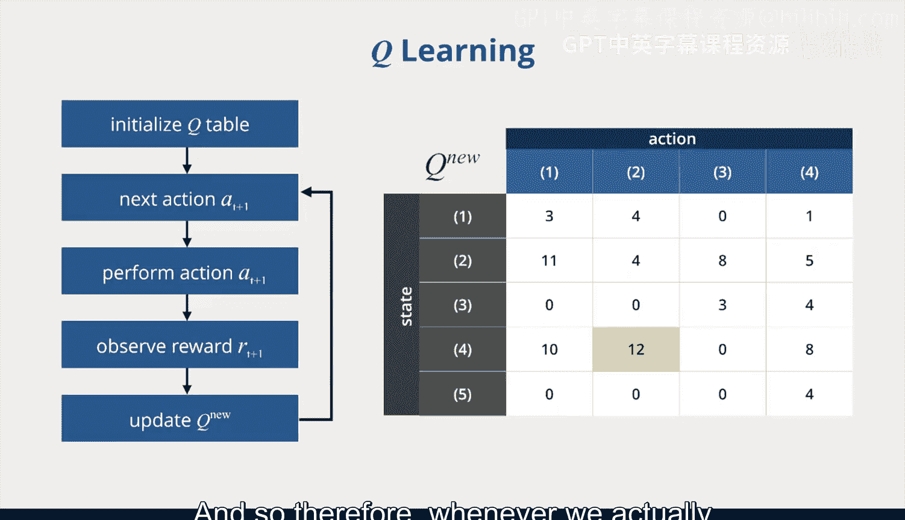

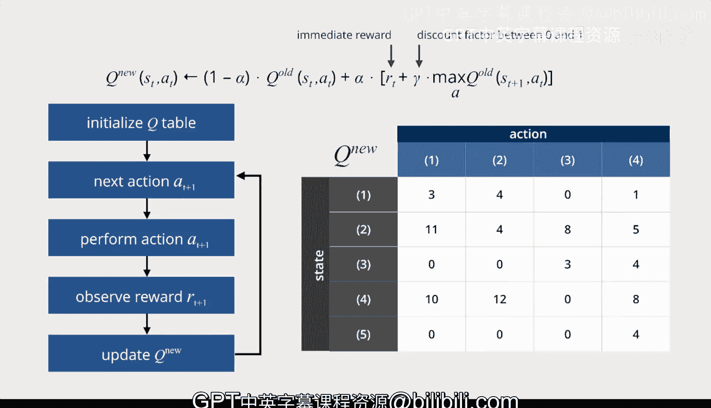