# 机器学习：68：Q学习详解 🧠

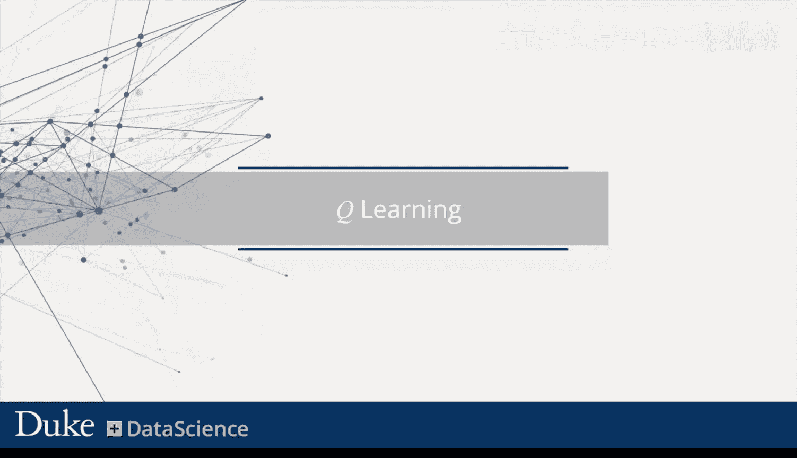

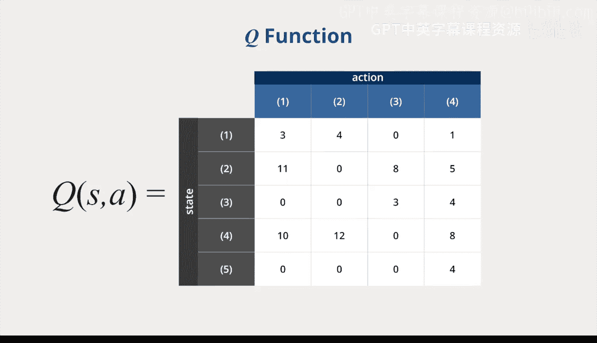

在本节课中，我们将深入探讨强化学习的核心算法——Q学习。我们将学习Q函数的概念、其更新机制，以及如何通过Q学习来制定最优策略。

---

## Q学习概述

我们目前所建立的这个框架被称为Q学习。之所以称为Q学习，是因为我们的目标是学习一个称为Q函数的表格。这个表格描述了在状态S下采取动作A的价值。强化学习的核心，在许多应用中，就是通过一系列状态、动作、新状态和奖励来学习这个Q函数。

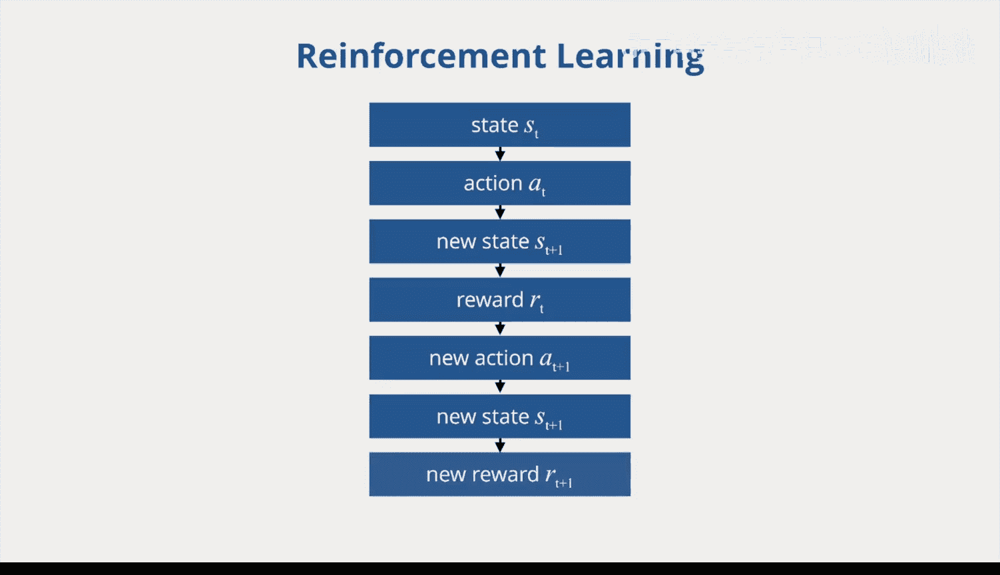

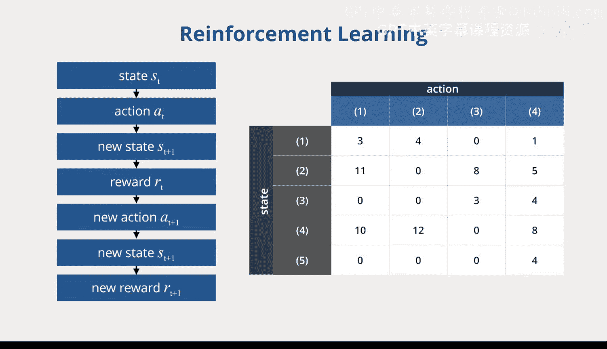

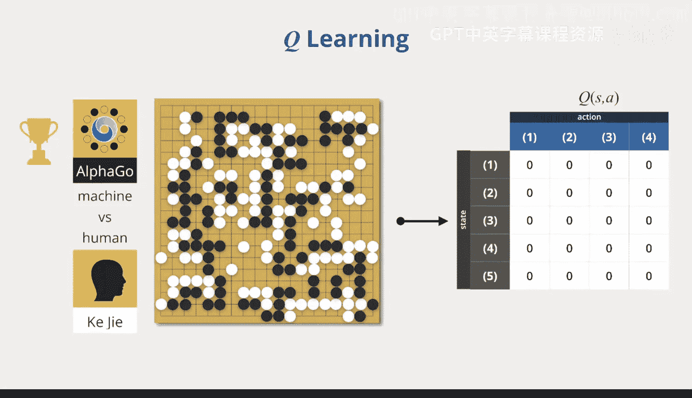

上一节我们介绍了强化学习的基本框架，本节中我们来看看其核心算法——Q学习。理解Q学习的细节至关重要，因为它正是强化学习的心脏。回想我们在强化学习讨论开始时提到的AlphaGo，其解决方案的核心正是基于Q学习。因此，Q学习是一个非常基础的构建模块。

## Q学习的核心方程 🔢

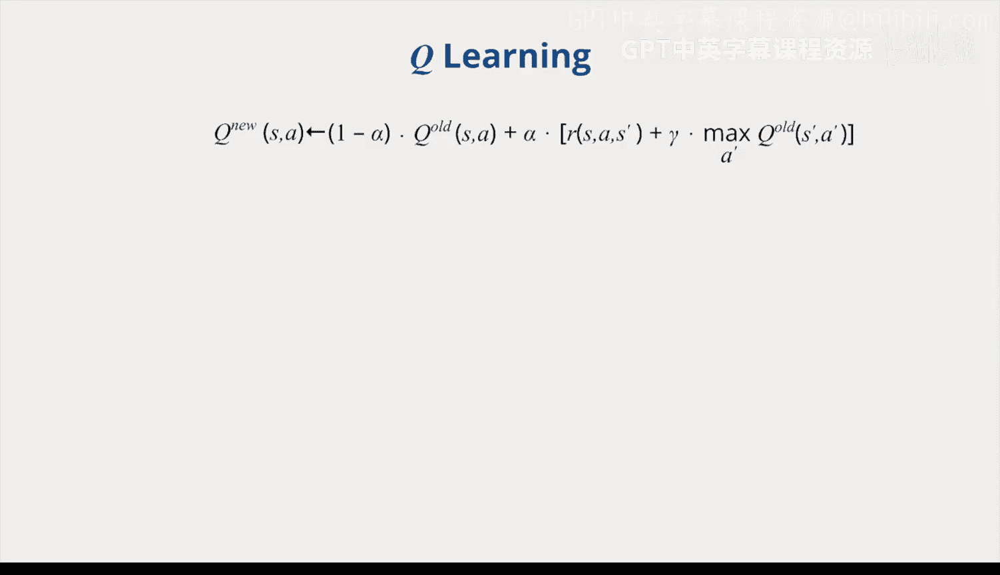

Q学习的特性由以下方程定义：

`Q_new(S_T, A_T) = (1 - α) * Q_old(S_T, A_T) + α * [R_T + γ * max_a Q_old(S_{T+1}, a)]`

我们再次通过观察状态、采取动作、观察新状态、获得奖励，并重复这一过程，来顺序更新Q函数。

## 学习Q函数与制定策略

在我们通过长时间的一系列“状态-动作-状态-奖励”交互学习到这个Q函数之后，我们就得到了一个估计的Q函数。以医疗应用为例，这正是医学实践的本质：医生与患者互动，根据患者的健康状况（状态）采取行动（动作），观察结果，并不断重复。随着时间的推移，医学界就对在状态S下采取动作A的价值有了深刻的理解。

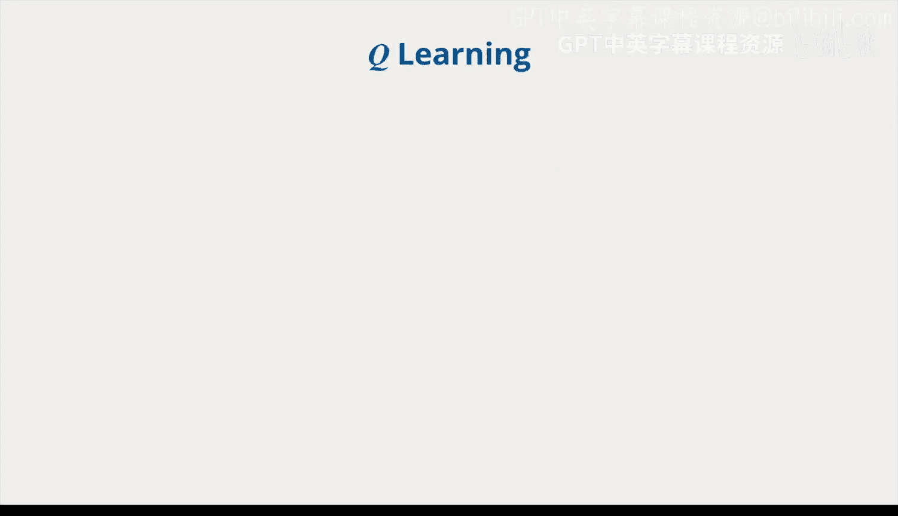

在通过与患者（在医学案例中）的长期交互学习到Q函数之后，我们现在可以制定一个策略。

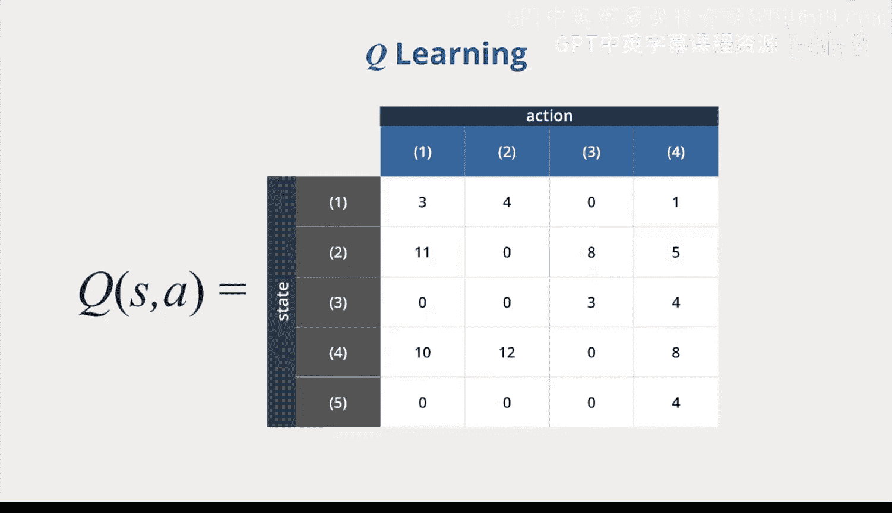

这个策略由一个函数π表示，它告诉我们当患者处于状态S时应该采取哪个动作。

以下是策略制定的过程：

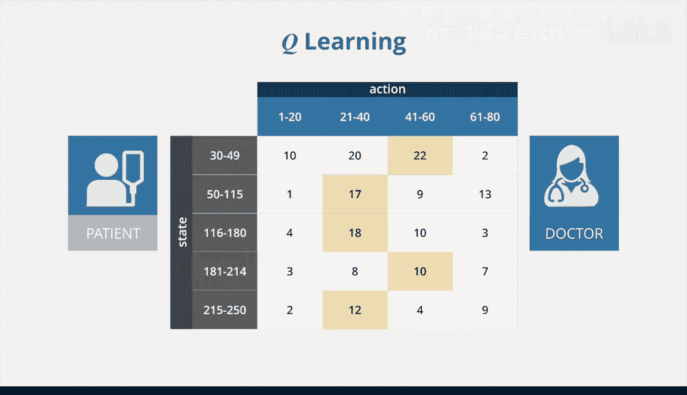

1.  我们拥有Q表格`Q(S, A)`，它反映了在状态S下采取动作A的价值。
2.  作为医生，我们会判断患者的健康状况，即状态S是什么。
3.  然后，我们选择能为患者带来最大价值的动作。

因此，最优策略π(S)就是对于每个状态S，选择那个能最大化患者价值的动作A。请记住，我们这里使用的基础奖励综合考虑了从健康改善角度对患者的价值，以及提供该护理的成本。

## 深入理解Q学习方程

让我们花点时间详细讨论一下这个方程。这个方程是Q学习的基础。

*   **γ（Gamma）**： 这被称为**折扣因子**。`R_T`是在状态`S_T`下采取动作`a_T`所获得的**即时奖励**。
*   **第二项**： `max_a Q_old(...)` 这部分代表了在患者转移到新状态`S_{T+1}`后，采取最优动作所能获得的**预期未来奖励**。

因此，方括号内的项 `[R_T + γ * max_a Q_old(S_{T+1}, a)]` 代表了**即时奖励**加上**未来奖励的折现值**。

我们进行折现的原因是，通常即时情况下的奖励`R_T`比后续的奖励对我们更重要。参数γ（折扣因子）是一个介于0和1之间的数，它告诉我们相对于当前情况，我们有多关心未来。γ是可以选择的参数。

以我们的年轻女性患者为例，我们可以询问她：“未来拥有孩子对你有多重要？”如果这对患者非常重要，那么γ值会较大（接近1），因为未来奖励对她很重要。如果这位年轻女性说：“我不太关心未来是否有孩子，对我来说最重要的是现在恢复健康。”那么折扣因子γ可能会较小，这意味着患者的即时奖励远比后续奖励重要。

需要注意的是，对于每一个γ的选择，我们都会得到一个不同的策略。因此，从某种意义上说，医生有能力制定一个根据患者对即时奖励与后续奖励的重视程度而定制的策略。这个折扣因子非常重要，它根据个人偏好或即时奖励与后续奖励的情况来选择。

*   **α（Alpha）**： 这是我们的**学习率**。它基本上指导着Q函数随时间变化的速度。

请记住，我们通过“状态-动作-新状态-奖励”来观察世界。当我们体验世界时，我们获取旧的Q函数表示`Q_old`，并将其映射到新的表示`Q_new`。问题是，我们应该以多快的速度改变它？我们应该让每个新的测量值以多快的速度改变Q函数的值？

如果α很大（即学习率高），那么可能会出现Q函数随着新情况而剧烈变化的情况，这可能不是一个好主意。因此，在这种情况下，你可能希望学习率较小（α接近0），这意味着Q函数随时间变化的速率是平滑的。同样，学习率也是一个可以设定的参数。

*   **`Q_old`**： 这是我们对在状态S下采取动作A的价值的**先前表示**。
*   **`R + γ * max Q_old`**： 这是我们观察到的、在状态`S_T`下采取动作`A_T`所获奖励的**非短视表示**。

这就是我们所说的Q学习，它是强化学习的核心。正如我之前所说，并且我们随后将展示的，这正是我们在开头讨论的突破性技术（AlphaGo以及机器以世界最佳人类水平玩围棋游戏的能力）的核心。这也是强化学习应用于许多其他应用（包括我们讨论过的设备监控等）的核心。

## Q学习的实施步骤 📝

如果我们看这个用于Q学习的表达式（方程），虽然乍一看可能很复杂，但希望通过我们的推导方式，它变得相对直观。

在评估这个方程时，我们实际上不必将下一个动作`A_{T+1}`设置为最大化`Q_old`的那个动作。

以下是实施步骤：

1.  我们可以直接评估它，因为我们有旧的Q表格，所以我们只需选择能最大化`Q_old`的动作a。
2.  然后，我们可以将我们的Q表格更新为`Q_new`。
3.  接着，我们可以选择下一个动作`A_{T+1}`来优化或最大化新的Q函数。

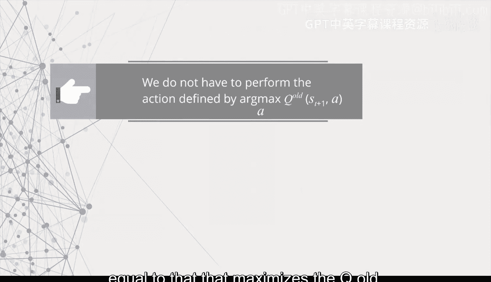

因此，在实际实施时，当我们观察到“状态-动作-奖励”序列时，我们在每一步都通过观察即时奖励和我们估计的折现未来奖励来更新Q函数。在我们更新Q函数之后，我们就可以根据该Q函数选择最优的下一个动作。

---

## 总结

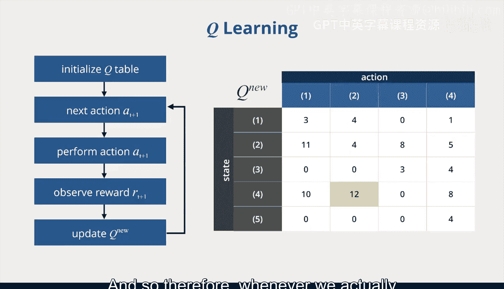

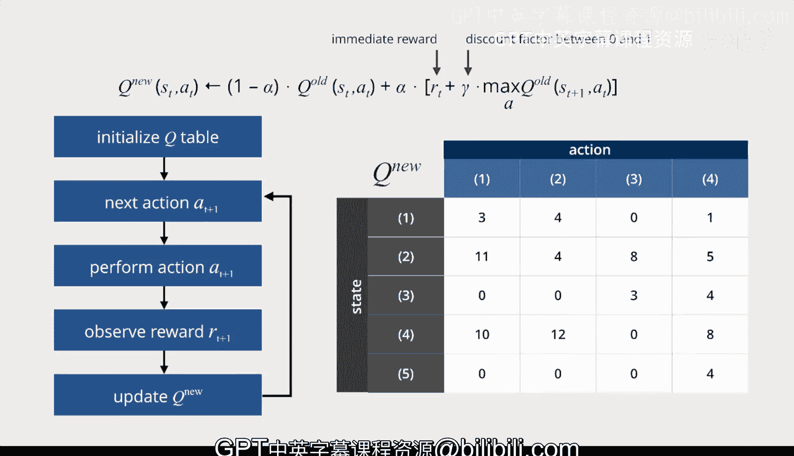

本节课中我们一起学习了强化学习的核心算法——Q学习。我们了解到Q学习的目标是学习一个评估状态-动作价值的Q函数表格。其核心更新方程结合了即时奖励和折现后的未来奖励。通过调整折扣因子γ，我们可以定制策略以反映对即时与未来收益的不同重视程度；通过调整学习率α，我们可以控制学习速度。最终，学习到的Q函数可以直接用于制定最优策略，即在每个状态下选择价值最大的动作。Q学习是许多突破性强化学习应用（如AlphaGo）的基础。