# 杜克大学《机器学习｜Introduction to Machine Learning》中英字幕 p69 69_06_03_Q学习的扩展.zh_en -BV1yjvdBQEaU_p69-

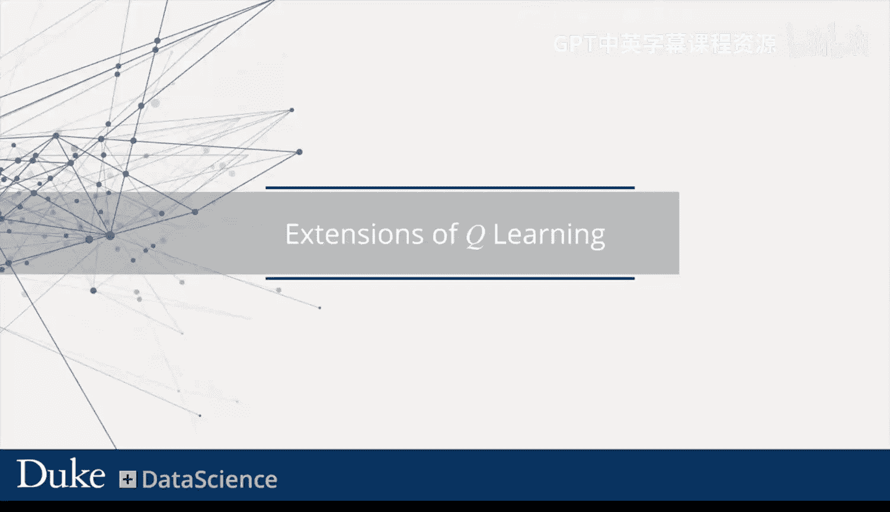

So Q learning。Which is our goal of trying to learn this Q function。

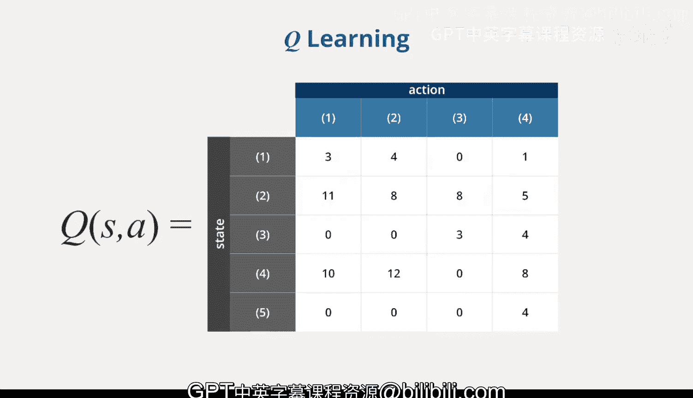

Where again， the Q function。Is an approximation。That we hope to learn。

Of taking action A when the agent or in our example， the patient is in state A。

 so the Q function reflects the value of taking action A in state S。 This is at the heart。

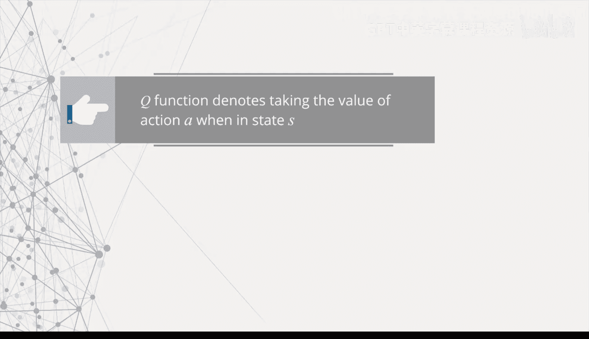

Of reinforcement learning， reinforcement learning is a field that has been studied for decades。

 so it is actually a very well studied field， and there have been many different ways in which the Q function has been learned。

 many different extensions of this basic construct， and so I want to briefly discuss a few of these。

 a few of the extensions and also some of the practical ways in which Q learning is implemented。

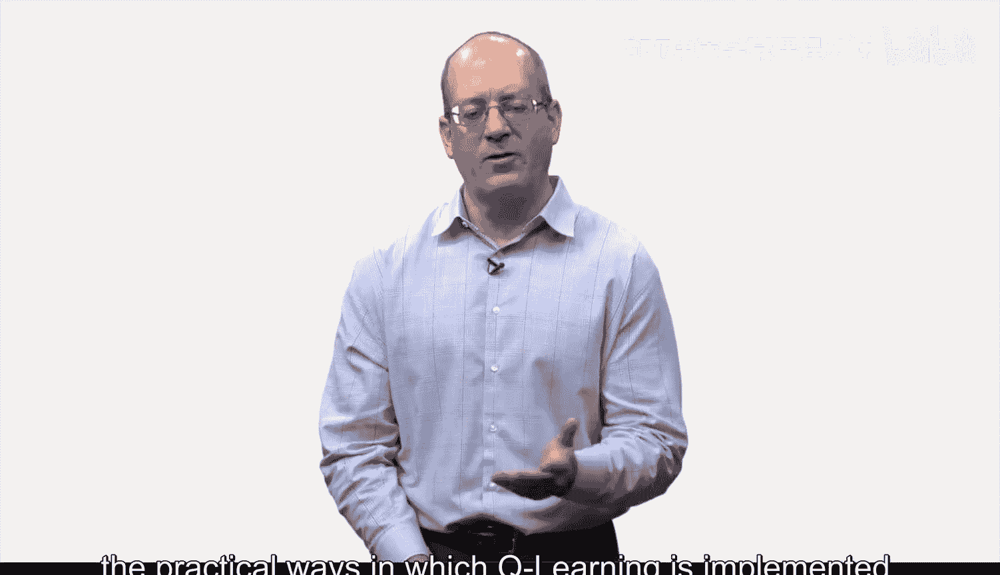

So again， we show this fundamental equation。Of Q learning。

Which is basically updating the old Q function。To a new Q function。Based upon the immediate word RT。

And our estimate of the expected or average future reward。

 which is reflected by max over the actions of the QO for the new state as T+1 with a discount factor gamma。

And as we discussed， the learning rate alpha describes or characterizes。

How how quickly learning is done， how quickly the Q function changes in practice。

 what one finds effective is to set alpha equal to 0。1 or1 over 10。

 so that this is something that has been found to work well in practice。

 Another method that has been studied and reinforcement learning is called SArsa and I just want to briefly talk about this。

 it is a rather simple extension and it has been shown to be effective in subs situationsituations。

 The Q learning which is guided by this equation。Is based upon the assumption。

That we see the patient or agent， we sometimes call the agent in state ST。We take action 80。

We get reward RT。And then we move to the new state ST plus1， so we're in a state， we take an action。

 we get in reward， and then we transition into a new state which we call ST plus1。

 so it's state action reward state， so this is represented as SARS， state action reward state。

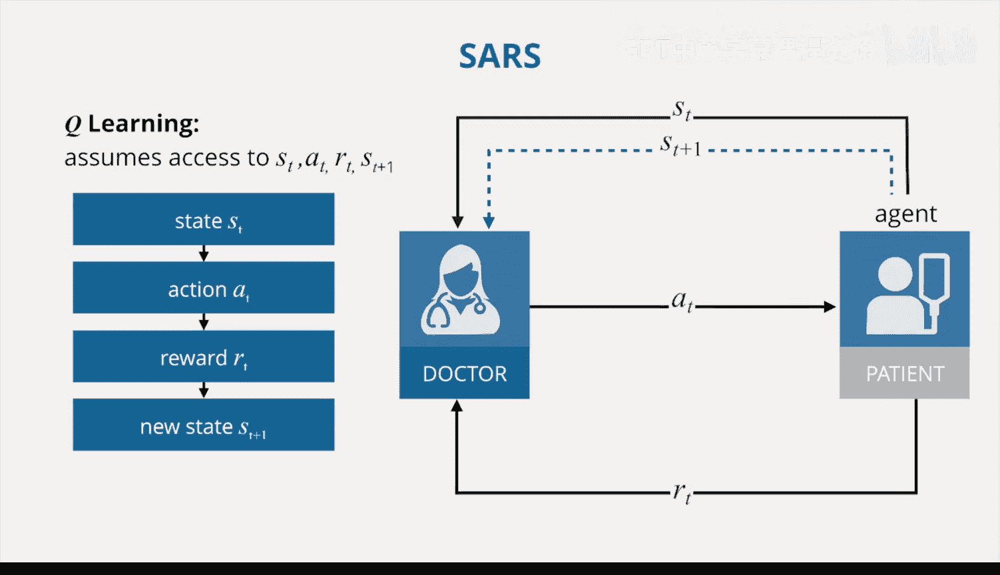

So， Sarssa。Is basically the exact same equation with a rather small modification。 So in SArsa。

 we assume that we have access to。

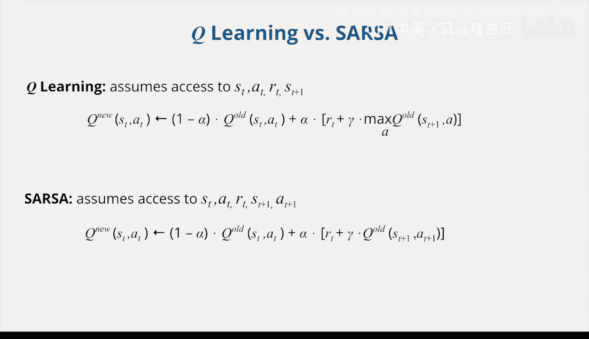

The previous state S T。The previous action， 8。The reward RT。The next state ST plus1。

 so that's the same。Plus， we get to see the next action， A plus1。

 so SArsSA simply means we have a state action reward， state action。

And we're going to learn based upon that。 the second equation is what is used in SArsSa。

 It's actually exactly the same as what is used in Q learning， which is based upon SARS。

 the only difference is instead of taking max over a of the old Q function。

 which is the optimal action for state S plus1 based upon the old Q function。

 we're simply going to instead of taking maximization。

 we're going to take the next state at plus1 and plug it in for a。

 so this is SArsa and the top one is called Q learning or SARS。

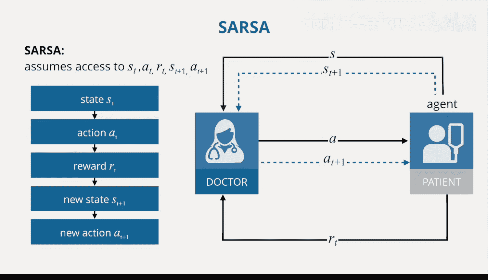

These are two different approaches that one might consider this is just to show that there's not one way to do this and in fact there are many other ways that people have studied over over time。

 but they're all based upon this basic construct Now let's think a little bit more about our learning procedure so the way that reinforcement learning works again is a series of states。

Actionions， rewards in new states， and then based upon those new states， new actions， new rewards。

 new states， it's a sequence of state action rewards states。

And so the question that one might ask is that as you are engaging in this process and as you are updating your estimation of the Q function through Q new。

Through this sequential process represented by this equation。What actions should you take。

 so in other words， when you take state as？Your're in state S， you take action A。

 you get an immediate reward， and then you transition into a new state。

And now you are going to take another action。Which action should you take。

 Which action would be beneficial from the standpoint of learning the policy now。

One way that you might think about this is that we have。

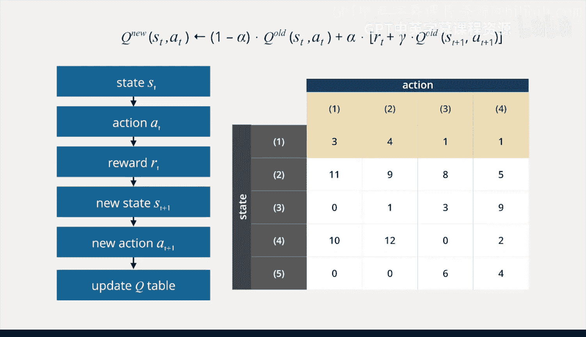

A Q function and that Q function or that Q matrix or Q table is going to be sequentially updated as we do this Q learning and so one thing that is kind of intuitive is that what we might do is always choose the optimal action based upon our current estimate of the Q function。

 In other words， no matter what state we're in S， let's choose the action which maximizes the Q function or the action that will give us the most value based upon our estimation。

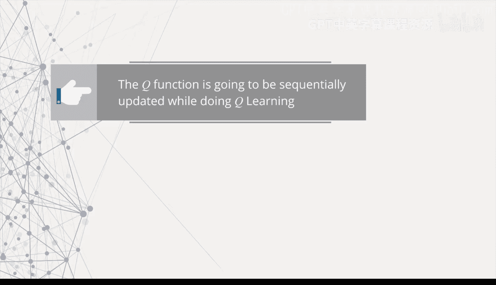

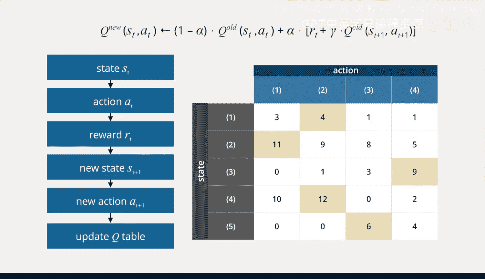

Of the Q function。So the problem with this is that we never have the opportunity through this process。

To just explore。 So one， one of the fundamental constructs of re enforcementment learning is this concept of exploration。

And exploitation。So an exploration， the exploration is the idea of just trying different actions。

 let's just try things， try different actions because we might be surprised。

 we might learn something that we didn't expect。 so if you think about the Q function that we're optimizing or learning in the way that we are it is heavily in fact entirely based upon all of our previous experience。

 and so therefore it might be biased and we might not get to see actions which would be beneficial。

 so exploration， the concept of exploration。

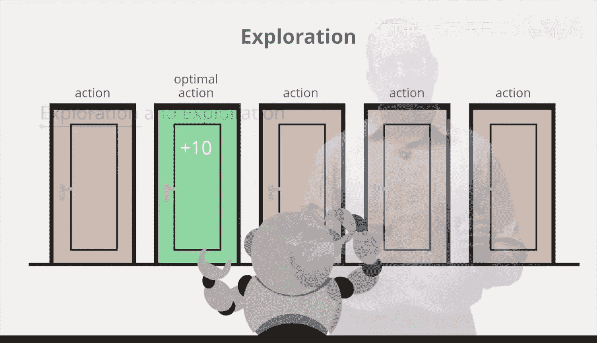

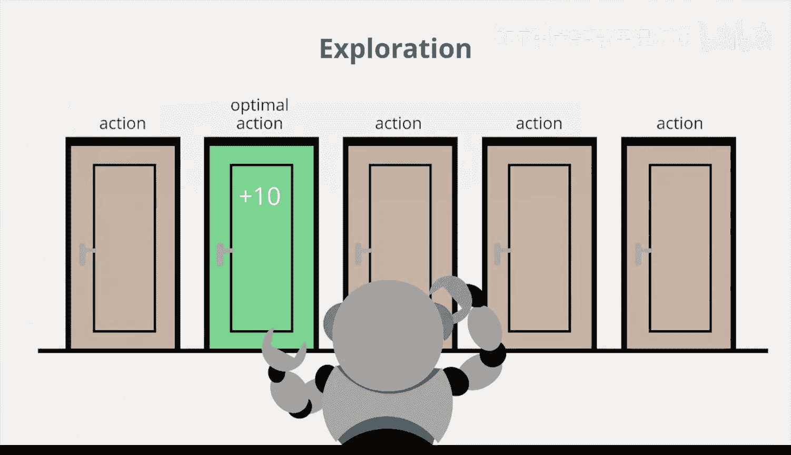

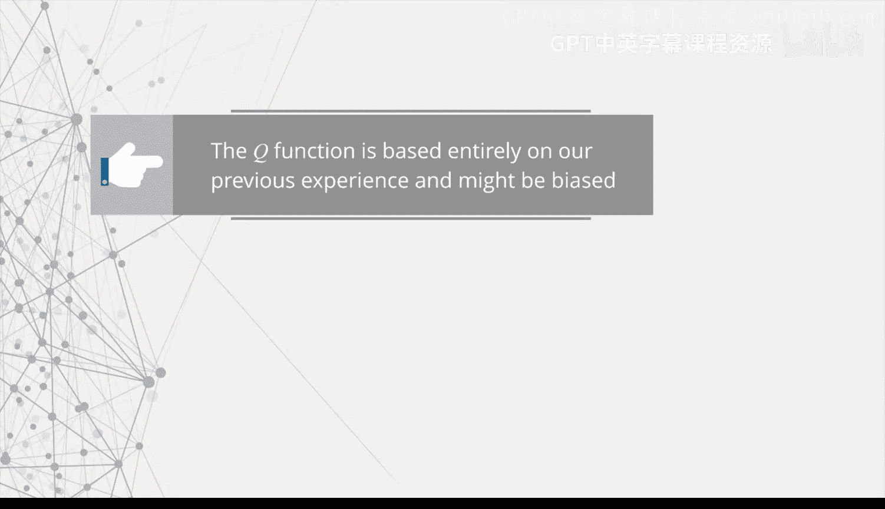

What that means is it's the concept of taking actions which may not be optimal。

 based upon our current estimation of the Q， they may be actions that we may have never taken before but we may be surprised。

 we may be surprised in a very beneficial way， and so therefore there is benefit to exploring。

Exploitation is the concept that we're going to exploit the Q function that we now possess。

 and we're going to choose actions which are optimal。based optimal for a given state。

 and therefore we're going to exploit all of our experience。

 and so therefore in reinforcement learning， there's a kind of a paradox of exploring versus exploitation。

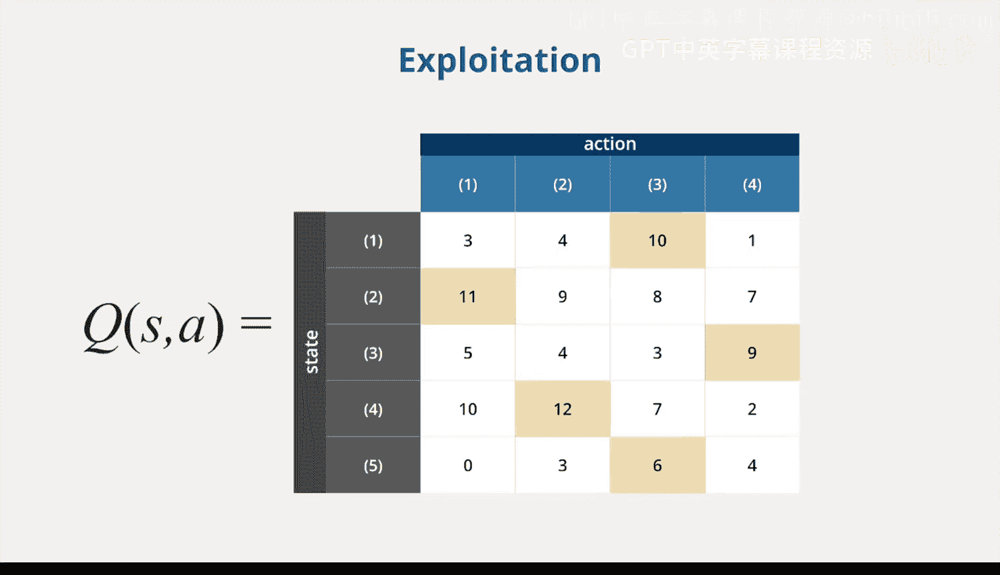

And so what has been found to be effective in reinforcement learning is something called an epsilon greedy approach。

 and so the way that this works is that we choose a probability。

A number epsilon， so epsilon is some small probability， it's a number between zero and one。

 typically small。We have a coin with probability epsilon， we get heads。

 with probability one minus epsilon， we get tails。And so every time when we're about ready to choose our next action。

 we flip our coin。If we get heads， which has probability epsilon。

 then what we're going to do is we're going to choose the next action A plus1 completely at random。

So we're not going to use the Q function at all。 We're just going to choose the next action at random with probability1 minus epsilon。

 which is the probability of us getting tails。 In my example。

 we're going to exploit our previous estimation of the Q function。

 What we're going to do is we're going to choose。The action which maximizes the expected reward or the expected value of take of for a given state st plus1。

 so with probability epsilon， we're going to explore with probability one minus epsilon we're going to exploit and the idea here is is that we're at random with probability epsilon going to take some actions which may seem very unusual but and therefore we'll be not constrained by our understanding of the Q function。

 the value of this is that every now and then we may discover something。

 we may discover an action that we never consider before which is very valuable and so this epsilon greedy framework。

has been found to be a very effective tool to improving the learning in the context of reinforcement learning。

And so as said， this framework allows exploration with the probability Epsilon。

 which is something that one can choose。

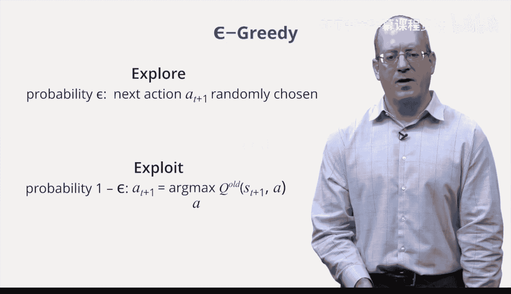