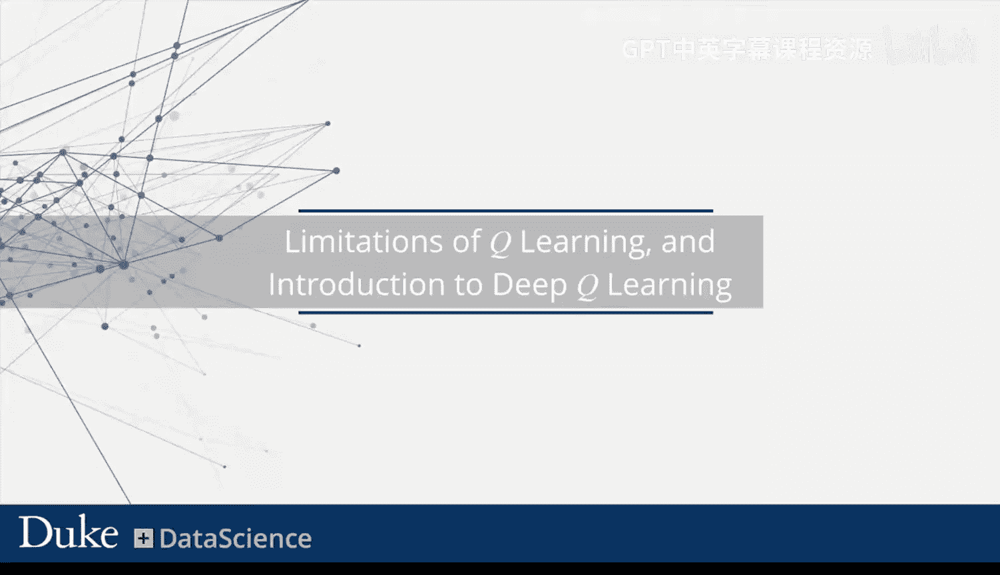
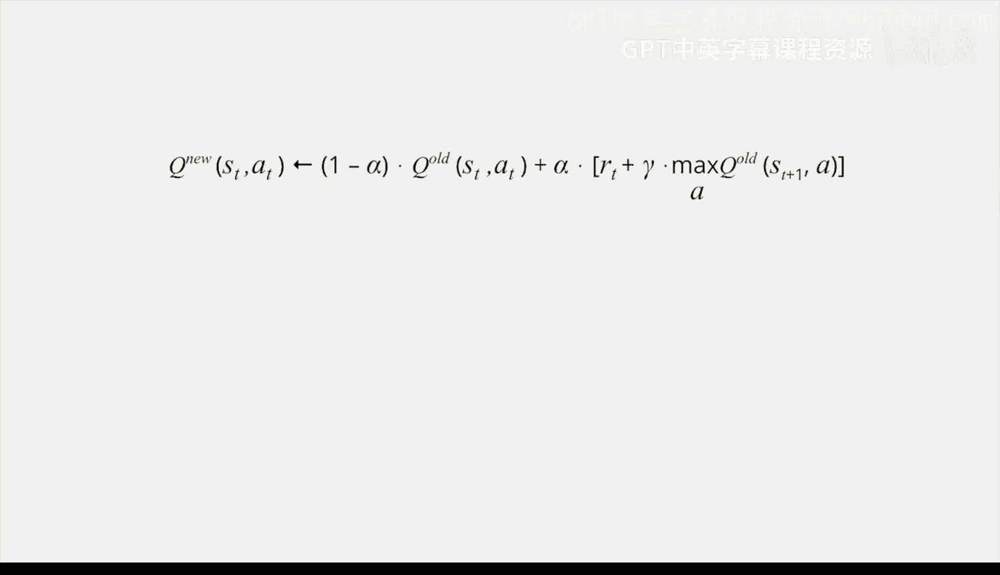
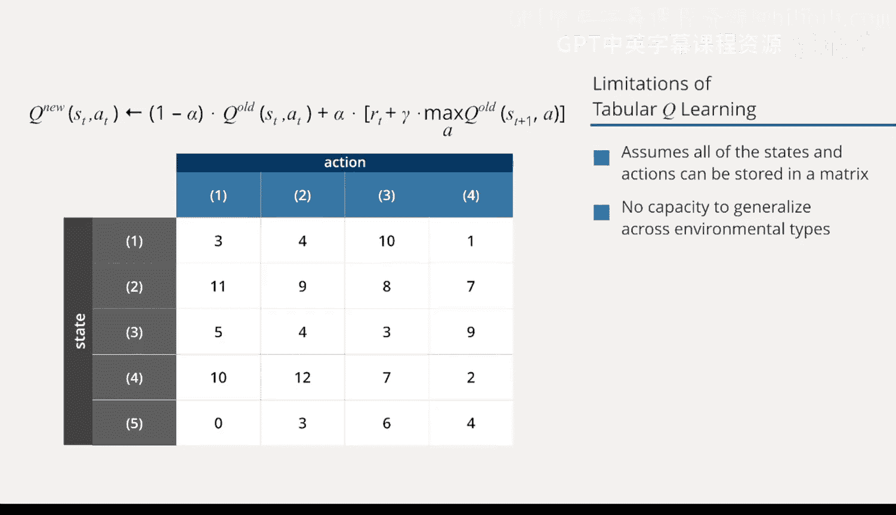
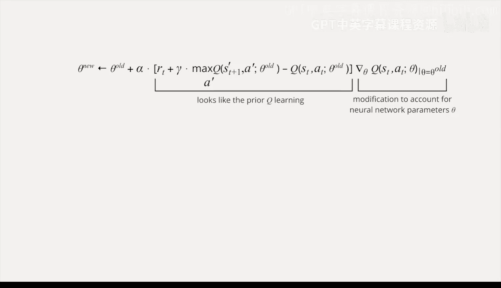

# 杜克大学《机器学习｜Introduction to Machine Learning》中英字幕 p70 70_06_01_Q学习的局限性与深度Q学习介绍.zh_en -BV1yjvdBQEaU_p70-

So thus far， we have introduced the concept of Q learning。

Which is a fundamental technology that underlies reinforcement learning。

While the technique is relatively easy to understand， as we've discussed。

 it has limitations and so now what we're going to do is to discuss something called deep Q learning it's called deep because it's going to be based upon deep learning technology and as we'll see it's very closely related to Q learning so we call it deep Q learning this technology that we're going to now discuss was responsible。

For the breakthrough that we discussed earlier， whereby Alpha go using a reinforcement machine learning technology based upon deep Q learning was able to defeat the finest players of go in the world。

So let's think back to our Q learning， which is characterized by this equation， so again。

 when you look at this equation at first， it looks perhaps a bit daunting。

 but as we've discussed as we've built up our understanding of this。

 basically what we're doing with Q learning is adjusting this Q function which is a representation of the value of taking a given action in a particular state。

 we are sequentially learning this Q function by trying to fit it to a non-myopic representation of the reward of actions in a given state。

 and that non-myopic representation of the reward is represented by the immediate reward R sub T plus a discounted version of expected future rewards。

 which is that max over the action。Of our old representation of the Q function。

So this framework is very powerful， however it has some limitations。

In particular， it assumes that we can represent all of the states and all of the actions in a matrix。

 and we talked about when we looked at our example of diabetic control。

 that the way that we constituted that matrix was by discretizing states and actions。

This becomes practical becomes impractical as the number of states and the number of actions becomes very large。

 which is often the case in practical problems the other thing is is that by using a tabular approach which is what we're doing with Q learning we have no capacity to generalize across different types of environmental types and so while Q learning is a powerful concept it has important limitations this is going to motivate us to introduce this concept of deep Q learning so with deep Q learning we're no longer going to make any assumptions about a tabular representation of the states and actions so in this case the states could be infinite in size in other words they could be essentially arbitrary in their variation and the actions can as well in the way that we're going to do this and the reason we call deep Q learning。

Is that we're going to introduce a deep neural network where the input to the neural network is the state and here the state is characterized by n numbers。

 S and so the I state is S sub i1 through s subi n which are just the n values of that state。

 for example， if the state is an image that we might be looking at。

 the state of the system is characterized by an image in that case n corresponds to the number of pixels in that image and so what happens is is that the state。

S sub I in this case for the I state。Goes through a deep neural network。

 which we've discussed elsewhere in this class and then at the top of that neural network。

 we have actions。 the actions that the agent might take in this case we're assuming three actions so a1 a2 a3 but the number of actions could be could be large could be much larger than three。

 and so the idea is is that this neural network， this deep neural network is a representation of the Q function The input to that deep neural network is the state。

 the output at the top of the neural network is the value of each action for that state and so this is why it's called deep Q learning because this deep neural network is going to represent the Q function so the important thing to notice is that we're no longer going to make any assumption that Q is tabular we're going to represent it by deep neural network that deep neural network is characterized by。

Pameter theta that the neural network parameters are theta and so the Q function representative of that neural network is denoted Q of S comma a so that the s is the input that's the state A is a particular action which is the output and in this case in this figure we have three actions and then theta are the parameters of that neural network and now our goal is to learn the parameters theta the learning challenge that we have is to learn the parameters theta The way we're going to do this in the way deep Q learning is going to work is actually very similar to Q learning so what we're going to do is we're going to introduce what we call a cost function U which is a value function or cost function。

On the parameters theta， and so if you look at this first equation。The second term R subt。

Plus gamma times max over a Q， that is exactly the non-myopic reward that we had previously。

 so that part looks the same What we're going to do is instead of using the old table Q in our previous notation it was Q superscript old for representation of our old table Now what we're going to do is we're going to take the neural network and use the old parameters。

 data superscript old， those are the old parameters and so what we're going to do is we're going to say that。

InIn state F。The value of action A is the immediate reward R subt plus a discounted version of an estimate of the future reward。

 which is ourQ function with the old parameters theta old。

 and then what we're going to do is we're going to update the parameters theta。

 such that ourQ function which is represented by that deep neural network。

Maches the nonmyopic reward and so if we look at this cost function。

 what we're doing is we're taking Q our neural network。

 which is characterized by unknown parameter theta and we're calculating the difference of it to the non-myopic reward and then we're taking the square of it and so what we would like to do is to minimize that function minimize u if we minimize u that means that the Q function。

 characterized by parameters theta， which is our deep neural network is a good model for representing the immediate reward plus the discounted future rewards that's what this equation is doing and so what we would like to do is to minimize u we would like to choose or determine the parameters theta that minimize u and so the way that we do this is by introducing a cost function which is shown in the figure below u of theta is the。

between the neural network with parameters datata the difference between the neural network with parameters datata and the non-myopric reward。

 which is RT plus discounted future reward and what we would like to do is to minimize this and the way that we're going to do this is via gradient descent we're going to take the gradient which is we've talked about elsewhere in previous lectures。

 but basically what we're going to do is we're going to calculate the slope of the line and we're going to move。

 if you see the arrows， the arrows are moving in the negative。

Direction of slope opposite to slope and so the objective here is to try to minimize this cost function。

 so this this type of optimization problem is something that we find often in neural networks and we've talked about elsewhere in this class。

And so to summarize， again， the top equation is the cost function we're basically trying to fit our deep neural network with parameters theta to a nonmyopic representation of the reward at time T and the way that we're going to minimize U is by doing something called gradient descent we're going to move in the opposite direction of the gradient so if we look at the second equation to the bottom equation。

 what we're going to do is we're going to update the model parameters so the new model parameters are the old model parameters。

 minus a scalar alpha alpha is is equivalent to our learning rate and the symbol that triangle symbol corresponds to gradient or slope in a high dimensionsal space where in this case it's the the space in which the parameters theta live and what we're going to do is that negative。

Negative alpha times the gradient what that means is we're going to move in a direction opposite to the slope and so if you look at the arrows。

 the way they're pointed in that figure they're pointed in a direction which is in the negative direction of the slope and so this update equation which is the bottom equation is a standard equation that we've talked about elsewhere fundamental to machine learning and what we're going to do is sequentially update the model parameters via this equation so we have the old parameters we move in a direction that is in negative slope。

 we then update the parameters， those are now theta new and then we repeat so you see multiple arrows three arrows and the figure that corresponds to three steps of gradient descent and so that symbol that triangle symbol it's called mathematically is called a nola or gradient and the way to think about this is。

A multidisional slope， what it means its a slope in multiple dimensions， more than one dimension。

And so now the learning process。Corresponds to taking the gradient that nobla or triangle symbol of that function U。

 which is the first equation， it turns out that that expression for you has a gradient that we can actually write down and so the last equation here。

 what we're doing is we're actually evaluating。That gradient of U。

 it turns out that it has the expression that you see at the bottom， it looks somewhat complicated。

 but as we're going to talk about in a moment it actually looks very much like something that we're familiar with it has a term in brackets which we'll talk about in in detail in a moment and then it has a gradient with respect to the Q function and so that last term is a multidimensional slope and so now if we look at this expression that we've derived for our deep Q network if we look at the first term that the first few terms that we put in brackets here。

 this looks very much like the Q learning that we did previously。

 if you look at it it has the immediate reward Rt plus a discounted version of the future rewards gamma times max of the Q function and then minus the old the old Q function so that。

The temporal difference that we had previously。And then the thing that is different about this is that we now multiply this by a modification which accounts for the neural network parameters data and that corresponds to the gradient of the Q function with respect to the model parameters data and so one may show rigorously which we'll do the next lesson that this is actually almost exactly the same as Q learning we'll get to that in a moment。

So this introduces us to the concept of deep Q learning。

 which as I said was at the heart of what Alpha Go did in our next lesson we're going to dive in and understand it further。

