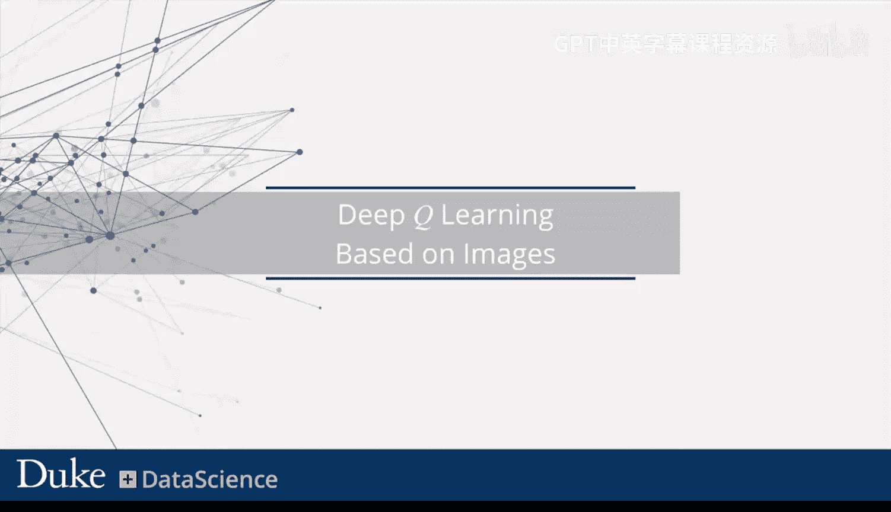
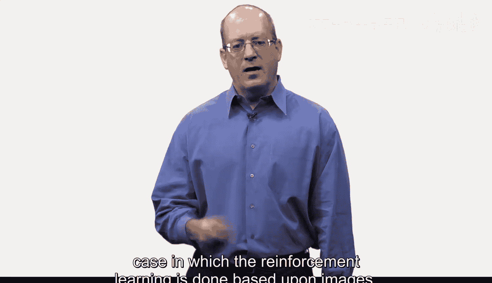
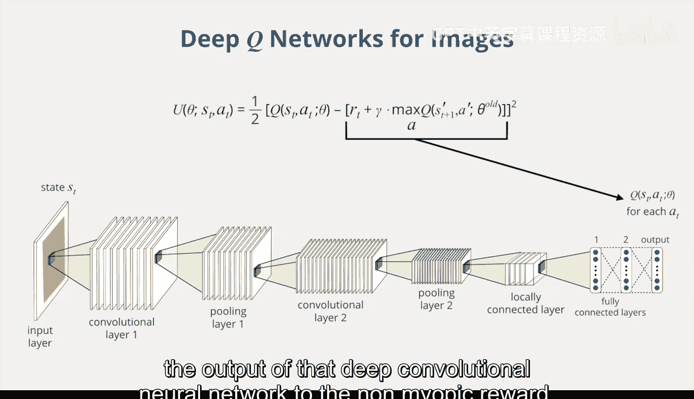
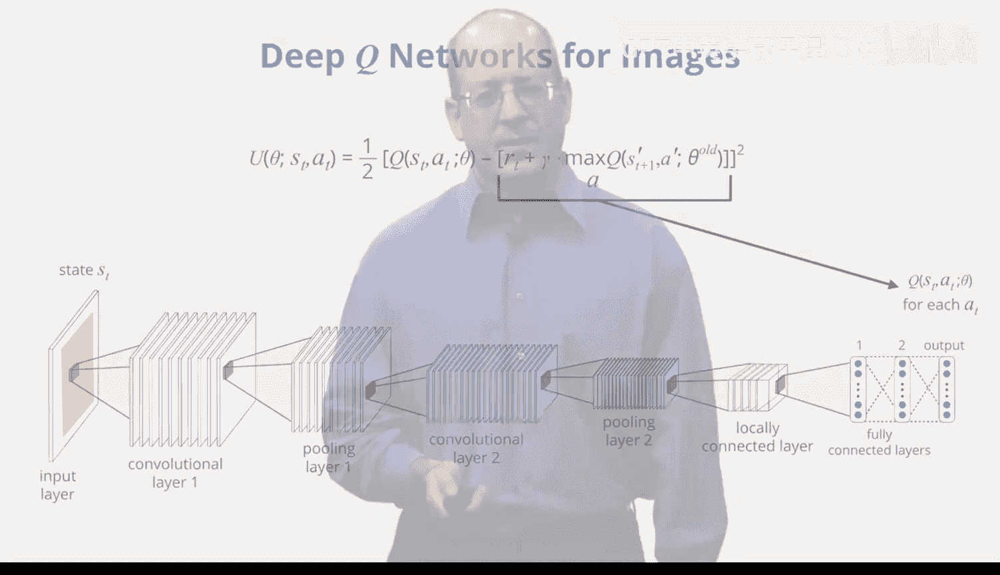

# 杜克大学《机器学习｜Introduction to Machine Learning》中英字幕 p71 71_06_02_基于图像的深度Q学习.zh_en -BV1yjvdBQEaU_p71-

In the previous lesson， we introduced the concept of deep Q learning。Now。

 what I would like to do is to talk more about deep Q learning for the special case in which the reinforcement learning is done based upon images and as we talked about in the AlphaGo scenario。

 the machine was able to learn how to play a board game， the way that that was done。

wa a picture was taken of the board of the go board at any point in time， and then that image。

 that picture of the go board was then given to a reinforcement learning algorithm analyzed via a deep Q learning。

And then it decided the next optimal action to take in playing the board game and so therefore this concept of doing deepQ learning based upon images is fundamental。

 it's in fact you could also imagine that this would be used in medicine where for example a radiologist might have access to an image of a patient and then based upon that image the goal is to determine what's the next best course of action for that patient and so this analysis of reinforcement learning based upon images is very fundamental it's at the heart of deep Q learning and so we'd like to look at this in some more detail。

So if we look at the function that we're trying to optimize， again， Q。

Is going to be represented by a deep neural network with parameters theta。

The input to that network is the state here the state is going to be an image。

 it's actually a picture， so it might be the picture of a goboard and then the action is the next action you're going to take in the game what you would like to do is to have that Q function be good at estimating the immediate reward Rt plus a discounted version of the future reward and so this cost function。

 this U is trying to make Q match the nonmyopic reward。And so as we've talked about。

 what we're going to do is we're going to represent that cu in terms of a deep neural network whereas the state。

 which in this case is going to be an image， is input to the neural network。

 and then at the top of the neural network， the output is the value of that state as reflected by the different actions and so here we are showing it for three actions。

And so again， the goal is to try to fit that deep neural network too。The non Myathic reward。

 which is characterized by the next me reward， as well as a discounted future reward。

If you think about this， this can be viewed as supervised learning。

The reason that that is true is that we in the context of experiencing the world。

 so remember that the way that reinforcement learning works is we are in a state， we take an action。

 we transition to a new state and we see a new reward and so we see the immediate reward which is represented by RT。

 we have access， we get to see in learning that immediate reward RT。

 we also get to see which state we transition into， which is state ST plus1。

 and so then we can evaluate the value of that new state based upon maximizing over actions and so therefore the immediate reward RT and the previous model parameters theta old and the new state ST plus1 are available to us。

 and therefore the second term the non-myopic reward is observable。

For this can be viewed as supervised learning where we're trying to teach a machine。

Through the supervision to match the Q function， which is a deep neural network to the observed non myopic reward。

In the context of imaging， the way that that Q function is going to be represented is in terms of a deep convolutional neural network and so we've talked about this elsewhere in this class so I won't dwell on that too much。

 but I just want to point out that this deep convolutional network which we have introduced elsewhere in this class now makes an appearance in the context of Q learning and so if we look at this figure。

 the Q neural network is represented by from left to right a deep neural network where the input is the image。

 and then we have a sequence of convolutional layers。

 and then at the end we have a sequence of so-cal fully connected layers。

 so the input is the state and then the output is the value。

Of each action for the particular state or particular image as input。

 so this is a very nice use of deep convolutional neural networks。

 and then what we would like to do is to take this deep convolutional neural network and we're going to learn the parameters theta by trying to match the output of that deep convolutional network to the nonmyopic reward which is shown in the bracketed forms。

 bracketed part of this equation。

And so interestingly， this basic construct， which is relatively easy to understand with the tools that we have。

 so the deepconvolutional network is something that we've talked about elsewhere in this class。

 we now have the tools to actually developed an Algo algorithm and it turns out that the original alphago technology which subsequently has been improved significantly over time。

 but the basic construct was based upon this deep Q network that we've talked about here。

 and so it's interesting that even in a relatively introductory class to deep learning which we've shown here in the context of reinforcement learning。

 we basically have introduced the underlying technology that was responsible for one of the most significant breakthroughs in machine learning in recent decades。

that in addition to playing the go game， this same technology has been used to automatically play many different digital games here。

 these are different types of Atari games and again the machine based upon this deep Q learning framework has been able to play these games with a proficiency which is better than the finest players of Atari games in the world。

 so this is a very， very important technology， the use of these games。

 the go game or these Atari games， of course these are not very practical applications in the real world。

 but if you can play a game like go。Well， very well。

 if a machine can play a game like go very well or if a machine can play a game these Atari games very well。

 these are basically adaptive algorithms to choose the best next course of action and so these games are ways in which we develop the technology but where it will ultimately be used where it can make an impact on people's lives is to。

 for example， augment clinicians and we talked about at the beginning of this of these lessons about how these reinforcement learning could be used for automatic control of medication for diabetic patients to perhaps help clinicians with that task so this technology which has been demonstrated know using games has very profound potential applications that is likely to impact people's lives across the globe。

