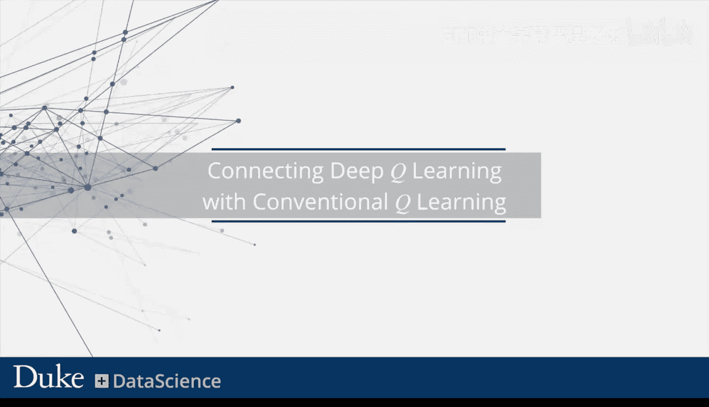
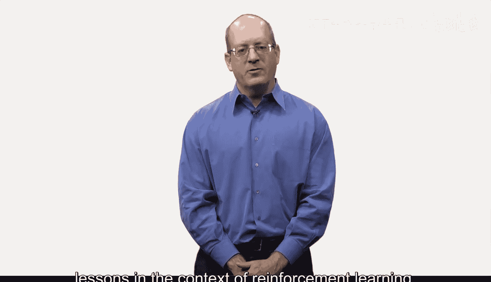
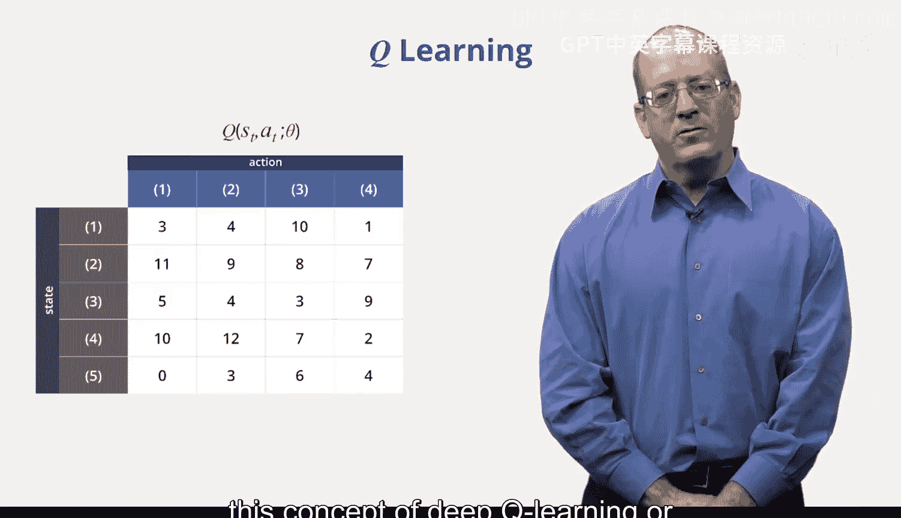
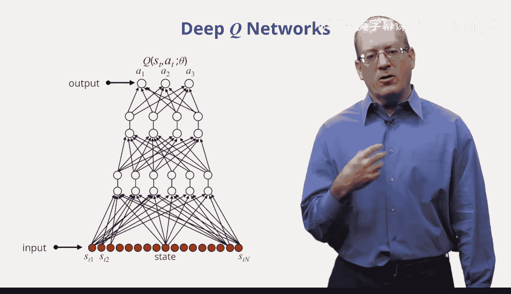
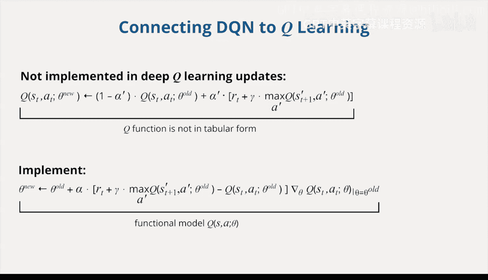

# 杜克大学《机器学习｜Introduction to Machine Learning》中英字幕 p72 72_06_03_深度Q学习与传统Q学习的联系.zh_en -BV1yjvdBQEaU_p72-

So this is our last lesson in the context of reinforcement learning。

This lesson is are by far the most technical and mathematical and consequently it may not be for everybody。

 so this is perhaps a bonus lesson for those people who have a deeper mathematical and technical background if you don't have that background it's okay。

 you don't really have to watch this， but for those who would like to get a deeper understanding of reinforcement learning。

 this last lesson is meant to achieve that。So if we think about what we've done in the last series of lessons in the context of reinforcement learning。

 we basically have done two things， we've done something called Q learning。

 and when we introduced Q learning， we assumed that we could represent the states。

And the actions in a quantized form or discretized form。

 which meant that we could represent the Q function， Q， which was a function of the state in action。

 we can represent that as a table as a matrix。So the first thing that we did in our early lessons was to introduce this concept of Q learning。

 which is to assume that we had a discrete and finite set of states and actions。

We then talked about the fact that there's some serious limitations to that because the number of states that one might have could be enormous。

 so if you think about the go game， if you had to quantize all of the different states of the go board it could be just absolutely enormous and so therefore Q learning is really not going to be a good solution so the next thing that we talked about to generalize Q learning was this concept of deep Q learning where or deep Q network where we instead of representing the Q function as a matrix or as a table we represented it as a deep neural network and then our goal was to learn the parameters of that deep neural network so we've done two things。

Q learning where we had a quantized tabular representation of the Q function and deep Q networks where the Q function was represented by a deep neural network when we looked at the equations for the deep Q learning setup there was some hints that this might be kind of similar to Q learning so what we're going to do in this last lesson is to dig in a little bit deeper to the mathematics and show that indeed deep networks have a very intimate relationship to Q learning and in fact you could argue that deep Q networks are a form of Q learning。

So recall that when we developed our deep Q network， so deep DQN is a deep Q network。

 which is a representation of that Q function， the update equation is shown as the first equation and so this equation was the result of doing gradient descent and remember that the Q function is a function of the parameters theta in the bottom equation we take the new parameters。

 theta nu。And we explicitly plug them into the Q function。

 so in the top equation we have our update rule for the parameters theta theta nu and then on the bottom what we're going to do is we're going to take those parameters theta new and we're going to plug them in to the Q function so that's what the bottom equation reflects and again I mentioned that this session or this lesson is definitely the most technically involved。

 but hopefully I expect a fairly substantial group of you will be able to follow along。

So in any case， the bottom equation reflects the Q function with our new representation of the model parameters。

 which are based upon the gradient descent rule， which is the first equation。

AndSo to continue what I've done here is I have repeated that Q function with the representation of theta nu。

 so that's exactly the equation that we had at the bottom of the previous expression that bottom of the previous slide and what we're going to do is we're going to define something which I call delta theta。

 which is the change in theta so if you look at the first equation you could see that the Q function is represented in terms of parameters theta which are equal to the old parameters theta sub old plus some change to the parameters which we call delta theta and that expression delta theta directly comes from the first equation and so from this we can write the first equation which is relatively complicated。

 we can write it simply as the third。Equation here where the Q function。

At parameter theta nu is equal to the Q function at theta parameters old plus delta theta and delta theta are defined in the equation above。

 so this representation is just a compact way of representing this。Now。

 for those of you with a little bit of background in calculus and in mathematics。

You'll recall something called the Taylor series expansion。

 so again this is for people with a little bit more mathematical detail。

 some understanding of calculus， but this last equation is a mathematical fact and it' is called a first order Taylor series expansion。

And what this says is that if the change in parameters date deelta theum。Is relatively small。

 then we can approximate the Q function。At parameters theta old plus delta theta。

 we can approximate that in terms of a sum of two terms。

 the first term is the Q function evaluated at the old parameters。

 and then the second term is the delta theta， which is the change in the parameters that we defined in the second equation。

That we take the transpose of that and multiply it by the gradient of the Q function。

 so this expression is a fundamental expression of calculus。

 it is accurate as long as the change in parameters delta theta is relatively small。

And so if we now look at this bottom equation。And we plug in the expression for delta theta。

 which is the second equation， so we're going to take the bottom equation。

 we're going to plug in the definition of deellta theta and what we see is that the Q function。

Evaluated at the new parameters， theta old plus delta theta is equal to the Q function at the old parameters plus alpha。

 which is analogous to a learning rate times an expression in brackets。

 which is the immediate reward plus discounted future rewards minus the old value of the Q function。

 and then that is multiplied by something called the L2 norm of the gradient， which is the last term。

And so now if we define a new parameter， alpha prime。Which is equal to alpha。

Times the L2 norm of the gradient of the Q function evaluated at the O parameters and we now plug that definition of alpha prime。

 the first equation now becomes the bottom equation so now alpha prime is defined in the way that we had and what we see is that the new expression for the Q function。

Is a weighted combination of the old Q function and a weighted version of the immediate reward plus a discounted version of the expected future rewards。

 and so this bottom equation is exactly Q learning。

And so what this tells us is that in the regime in which the change of the model。

 when the change of the deep Q network parameters， deelta theta， when that is small。

 what we're effectively doing is what this bottom equation reflects， which is essentially。

Q learning and so what we have seen is that at least in the context of a first order Taylor series expansion。

Deep Q learning is intimately connected to Q learning。

So this summarizes this is so we effectively are manifesting something exactly like Q learning when we are doing deep Q learning。

 particularly in the regime in which the change of the parameters deelta theta is small。

So now this top equation， which is Q learning， we don't actually implement this because we don't have the Q function in tabular form when we do the update。

And DQ and the deepQ network。We we don't update the Q function directly as we do and we do not actually implement this top equation。

 which is Q learning， what we do is we implement the bottom equation。

 which is the update of the model parameters， but what we've shown is that doing the bottom。

which is the update of the model parameters and the regime in which the change in which the change in the model parameters is small。

 this is effectively exactly Q learning， and so what this shows is that this deep network which we adopted in the latter part of these lessons is intimately connected to what we talked about at the beginning of these lessons。

 the Q learning。

