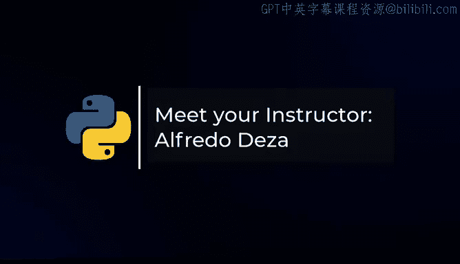

# 1：认识你的课程导师 👨‍🏫

在本节课中，我们将认识本课程的导师，并了解课程的整体目标与内容结构。

欢迎来到这门关于MLOps的Python课程。我们将学习Python中最基础的内容，包括变量、赋值、循环、以及像`if`和`else`这样的逻辑条件。

接着，我们会稍微深入函数，然后是类。之后，我们将进行一些数据探索，使用`pandas`和`NumPy`进行数据分析。

最后，我们将进入构建命令行工具的环节，并将所有这些Python基础知识整合起来，用于构建强大的命令行工具。

那么，为什么要学习Python，为什么要学习所有这些基础知识呢？因为它是至关重要的一环，能为你提供足够的知识去与API交互，完成各种其他与MLOps相关的任务。

在本课程中，我们将学习创建一些命令行工具，以构建自动化流程。你可以自动化那些你或你团队中其他工程师可能正在手动执行的过程、检查、步骤、流水线、部署，甚至是机器学习模型的打包。掌握Python，你可以自动化其中的许多环节。

因此，本质上，在本课程结束时，你将拥有足够的Python知识，可以开始构建强大的自动化工具，这将更好地为你服务。

很高兴你来到这里。让我们来看看你将如何应用所有这些知识来构建这些强大的自动化工具。到课程结束时，你应该有信心在日常运维工作中应用这些概念。

---

本节课中我们一起认识了课程导师，并了解了本课程将涵盖从Python基础到构建自动化工具的全路径学习目标。