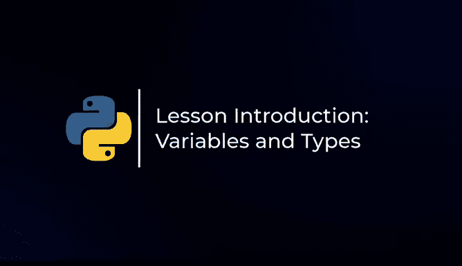

# 2：变量、类型与流程控制 🐍

在本节课中，我们将学习Python编程的基础核心概念。我们将从变量赋值和数据类型开始，逐步深入到如何使用条件语句（如`if`、`elif`、`else`）来处理程序逻辑，最后探讨异常处理机制，学习如何捕获和处理程序运行中的错误。

## 变量赋值与数据类型 📦

上一节我们了解了课程的整体框架，本节中我们来看看编程的基石：变量与类型。变量是存储数据的容器，而类型则定义了数据的种类和可执行的操作。

在Python中，变量赋值非常直接。你只需使用等号（`=`）即可。Python会自动推断变量的类型，这称为动态类型。



以下是变量赋值的基本语法：
```python
variable_name = value
```

例如：
```python
name = "Alice"  # 这是一个字符串（str）类型变量
age = 30        # 这是一个整数（int）类型变量
height = 1.75   # 这是一个浮点数（float）类型变量
is_student = True # 这是一个布尔值（bool）类型变量
```

Python中常见的基本数据类型包括：
*   **整数（int）**： 如 `1`, `-5`, `1000`
*   **浮点数（float）**： 如 `3.14`, `2.0`, `-0.001`
*   **字符串（str）**： 如 `"hello"`, `'Python'`
*   **布尔值（bool）**： 只有 `True` 和 `False` 两个值

## 条件逻辑控制 🚦

掌握了如何存储数据后，我们需要让程序能够根据不同的情况做出决策。这就是条件语句的用武之地。使用 `if`、`elif` 和 `else` 语句，你可以控制代码的执行路径。

条件语句的基本结构如下：
```python
if condition1:
    # 如果condition1为True，执行这里的代码
elif condition2:
    # 如果condition1为False但condition2为True，执行这里的代码
else:
    # 如果以上条件都为False，执行这里的代码
```

以下是使用条件语句的一个简单示例：
```python
temperature = 25

if temperature > 30:
    print("天气很热。")
elif temperature > 20:
    print("天气温暖。")
else:
    print("天气凉爽。")
```

## 异常处理 🛡️

在程序执行过程中，可能会遇到各种意外错误，例如打开不存在的文件，或者进行无效的数学运算。这些错误在Python中被称为“异常”。如果不处理，程序会崩溃。因此，我们需要学会使用 `try`、`except`、`finally` 等语句来优雅地捕获和处理异常。

异常处理的基本结构是：
```python
try:
    # 尝试执行可能会出错的代码
    risky_operation()
except SomeSpecificError:
    # 如果发生了SomeSpecificError类型的错误，执行这里的代码进行处理
    handle_the_error()
finally:
    # 无论是否发生异常，最后都会执行的代码（可选）
    cleanup()
```


让我们看一个处理除零错误的例子：
```python
try:
    result = 10 / 0
    print(f"结果是：{result}")
except ZeroDivisionError:
    print("错误：不能除以零！")
```

在本节课中，我们一起学习了Python编程的三个基础模块。我们了解了如何使用变量存储不同类型的数据，如何通过条件语句 `if`/`elif`/`else` 让程序具备基本的逻辑判断能力，以及如何使用 `try`/`except` 块来捕获和处理运行时异常，使程序更加健壮。这些是构建更复杂程序不可或缺的基石。