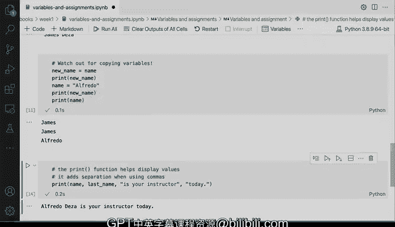

# 3：03_01_03_变量与赋值 📝


在本节课中，我们将学习 Python 中的变量与赋值操作。变量是存储数据的基本单元，而赋值则是将数据与变量名关联起来的过程。我们将通过简单的示例来理解这些概念，并注意一些常见的注意事项。

---

## 概述

在本节中，我们将介绍如何创建变量、为变量赋值，以及如何操作这些变量。我们还会探讨 Python 作为非强类型语言的特点，以及这在实际编程中可能带来的影响。

---

## 变量赋值

在 Python 中，变量赋值使用等号 `=` 完成。等号左边是变量名，右边是要赋的值。例如：

```python
name = "Alre"
```

这里，我们创建了一个名为 `name` 的变量，并将其赋值为字符串 `"Alre"`。Python 不要求预先声明变量类型，因此我们可以直接赋值。

---

## 数据类型

Python 支持多种数据类型，包括字符串、整数和浮点数。赋值时无需指定类型，解释器会自动推断。例如：

```python
distance = 10.5  # 浮点数
height = 10000   # 整数
```

需要注意的是，虽然 Python 不强制类型，但赋值时仍需确保值的类型符合后续操作的要求。例如，将字符串赋值给本应进行数值运算的变量可能导致错误。

---

## 变量重赋值

变量可以被重新赋值，新值会覆盖旧值。例如：

```python
name = "Alre"
name = "James"
```

执行上述代码后，变量 `name` 的值将从 `"Alre"` 变为 `"James"`。

---

## 使用 `print` 输出变量

`print` 函数用于输出变量的值。可以通过逗号分隔多个变量，输出时会自动添加空格。例如：

```python
name = "James"
last_name = "Dea"
print(name, last_name)  # 输出: James Dea
```

如果不使用逗号，而是使用加号连接字符串，则不会自动添加空格：

```python
print(name + last_name)  # 输出: JamesDea
```

---

## 从现有变量创建新变量

我们可以基于现有变量创建新变量。例如，结合 `name` 和 `last_name` 创建 `full_name`：

```python
name = "James"
last_name = "Dea"
full_name = f"{name} {last_name}"
print(full_name)  # 输出: James Dea
```

这里使用了 f-string 来格式化字符串，我们将在后续课程中详细介绍。

---

## 变量复制与引用

在 Python 中，将变量赋值给另一个变量时，实际复制的是值的引用，而不是值本身。这意味着修改原变量不会影响新变量，除非重新赋值。例如：

```python
name = "James"
new_name = name
name = "Alfredo"
print(new_name)  # 输出: James
print(name)      # 输出: Alfredo
```

这里，`new_name` 在赋值时保存了 `name` 的当前值（`"James"`），后续对 `name` 的修改不会影响 `new_name`。

---

## 总结

本节课中，我们一起学习了 Python 中变量的创建、赋值、重赋值以及输出方法。我们还探讨了如何从现有变量创建新变量，并理解了变量复制与引用的行为。掌握这些基础概念是进一步学习 Python 和机器学习运维的重要一步。

---



