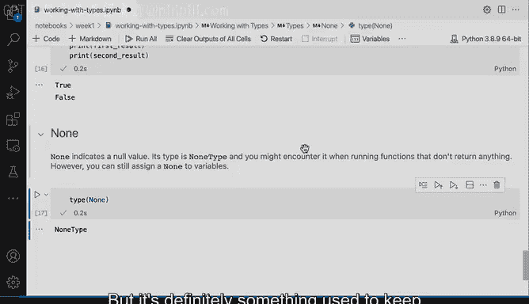

# 4：04_01_04_处理不同数据类型 📚


在本节课中，我们将要学习Python中几种最常见的数据类型。我们将了解字符串、整数、浮点数、布尔值和None类型的基本概念、用法以及它们之间的区别和交互方式。

---

## 字符串（Strings）🔤

上一节我们介绍了课程概述，本节中我们来看看第一种数据类型：字符串。字符串本质上就是文本值，在Python中非常常见。

字符串可以用单引号、双引号或三引号来定义。使用三引号的主要好处是，当字符串内部包含单引号或双引号时，可以避免使用转义字符。

```python
# 使用三引号避免转义问题
text = """这是一个'包含'单引号和"双引号"的字符串。"""
```

以下是字符串的一些基本操作：

*   **字符串拼接**：你可以使用加号 `+` 将多个字符串组合成一个新的字符串。
*   **f-string格式化**：在字符串前加上前缀 `f` 或 `F`，可以在字符串内部直接使用变量，这是一种便捷的字符串格式化方法。

```python
name = "Alfredo"
# 字符串拼接
greeting = "Hello, " + name + "!"
# f-string格式化
greeting_f = f"Hello, {name}!"
```

---

## 整数（Integers）🔢

字符串允许我们处理文本，本节中我们来看看用于处理数字的整数类型。整数（int）代表没有小数部分的整数。

你可以使用内置的 `type()` 函数来检查任何值或变量的数据类型。

```python
# 检查数据类型
number = 15
print(type(number))  # 输出: <class 'int'>
```

整数支持标准的数学运算，如加、减、乘、除。但需要注意，某些操作可能导致错误。

以下是使用整数时需要注意的几点：

*   **数学运算**：整数可以进行加减乘除等运算。
*   **类型错误**：不能直接将整数与字符串相加，否则会引发 `TypeError`。
*   **运算导致类型变化**：两个整数相除，即使能整除，结果也会变成浮点数（float）。

```python
# 整数除法得到浮点数
result = 3 / 2  # 结果是 1.5
print(type(result))  # 输出: <class 'float'>
```

---

## 浮点数（Floats）⚖️

我们刚刚看到整数除法可能产生浮点数，本节我们来专门了解浮点数。浮点数（float）代表带有小数点的数字。

任何包含小数点的数字在Python中都会被识别为浮点数。

```python
pi_approx = 3.14159
print(type(pi_approx))  # 输出: <class 'float'>
```

---

## 布尔值（Booleans）✅❌

除了数字和文本，编程中经常需要表示“是”或“否”的逻辑状态，这就是布尔值。布尔类型（bool）只有两个值：`True` 和 `False`（注意首字母大写）。

`bool()` 函数可以将其它类型的值转换为布尔值。在Python中，通常 `0`、空字符串、空列表等会被视为 `False`，而非零值、非空序列等被视为 `True`。

```python
# 布尔值本身
is_active = True
is_complete = False

# 使用bool()函数进行转换
print(bool(1))   # 输出: True
print(bool(0))   # 输出: False
print(bool("Hello"))  # 输出: True
print(bool(""))       # 输出: False
```

---

## 空值（None）🚫

最后，我们来认识一个特殊的类型：`None`。`None` 在Python中表示“空”或“无”，它是一个独立的数据类型（NoneType）。

它通常用于表示函数没有返回值，或者变量尚未被赋予任何有效值。

```python
# 将None赋值给变量
result = None
print(type(result))  # 输出: <class 'NoneType'>

# 函数默认返回None
def do_nothing():
    pass

print(do_nothing())  # 输出: None
```

---



本节课中我们一起学习了Python的五种基本数据类型：用于处理文本的**字符串**、代表整数的**int**、代表小数的**float**、表示真假的**布尔值**以及表示空值的**None**。理解这些类型的特性和它们之间的区别，是编写正确、高效Python代码的基础。在后续课程中，我们将学习如何更灵活地运用这些类型进行数据操作和逻辑判断。