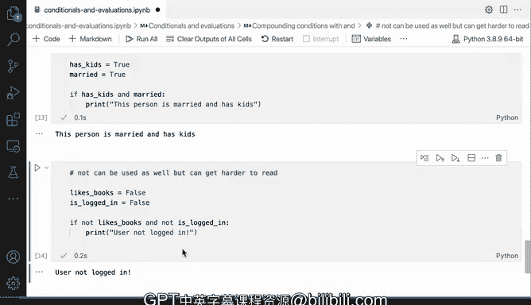

# 5：05_01_05_条件判断与求值 🐍


在本节课中，我们将要学习Python中条件判断的基础知识。条件判断是编程中实现逻辑控制的核心，它允许程序根据不同的情况执行不同的代码块。我们将从最简单的`if`语句开始，逐步介绍`else`、`elif`以及如何组合多个条件。

## 概述

条件判断是编程的基石。它让程序能够“做决定”，根据数据的状态执行相应的操作。本节将详细介绍Python中`if`、`else`、`elif`关键字的使用，以及如何利用逻辑运算符构建复杂的条件。

## `if` 语句

`if`是Python中的一个关键字，它允许我们设置一个条件，评估该条件，并根据结果执行相应的操作。其基本逻辑是：如果条件成立（评估为`True`），则执行紧随其后的代码块。

以下是`if`语句的基本结构：

```python
if condition:
    # 如果条件为真，则执行这里的代码
```

例如，在下面的代码中，变量`condition`被设置为`True`。当条件满足时，程序会打印出“condition was met”。

```python
condition = True
if condition:
    print("condition was met")
```

运行这段代码，它会正确执行打印语句。这就是Python中逻辑处理的基础：条件需要评估为`True`，其后的代码块才会被执行。

## 条件为 `False` 的情况

如果条件评估为`False`，会发生什么？答案是：什么也不会发生。Python看到条件为`False`，就会跳过`if`块内的代码，继续执行后面的程序。

```python
condition = False
if condition:
    print("This will not print.")
```

## 数据结构的真值评估

之前我们提到过，某些数据结构在“空”的状态下会评估为`False`，而在包含元素时评估为`True`。这一点对于Python中几乎所有内置数据结构都适用。

例如，一个空列表评估为`False`，有元素的列表评估为`True`。

```python
groceries = []  # 空列表，评估为 False
if groceries:
    print("We have some groceries.")

invites = ["Alice", "Bob"]  # 非空列表，评估为 True
if invites:
    print("We have some invites.")
```

运行上述代码，只会打印“We have some invites.”，因为`groceries`是空的。

其他数据类型也是如此：
*   整数`0`评估为`False`。
*   任何非零整数（正数或负数）评估为`True`。

```python
properties = 0  # 评估为 False
if properties:
    print("We have properties.")

parents = 2  # 评估为 True
if parents:
    print("We have parents.")
```

## 比较运算符

在条件判断中，我们经常需要比较值。Python支持所有常见的比较运算符。

以下是常用的比较运算符示例：

```python
properties = 0
parents = 2

if properties == 0:
    print("I have no properties.")  # 会执行

if parents > 1:
    print("There is more than one parent.")  # 会执行
```

## `else` 语句

`if`语句处理了条件为真的情况。那么条件为假时，我们想执行另一段代码该怎么办？这时就需要`else`语句。`else`就像一个“否则”，当`if`条件不满足时，程序会执行`else`块中的代码。

```python
properties = 0
if properties:
    print("We have properties.")
else:
    print("We don‘t have any properties.")  # 会执行
```

## `elif` 语句

有时我们不止有两种情况。`elif`（是“else if”的缩写）允许我们在`if`条件不满足后，继续检查另一个条件。你可以将其理解为“否则，如果...”。

```python
properties = 0
parents = 2

if properties:
    print("We have properties.")
elif parents:  # 如果 properties 为 False，则检查 parents 是否为 True
    print("We don‘t have properties, but we have parents.")  # 会执行
```

## 否定条件 (`not`)

我们也可以检查条件的反面，即“如果不满足某条件”。这通过`not`关键字实现，它会将评估结果取反。

```python
name = None  # None 在条件判断中评估为 False
if not name:  # not False 即为 True
    print("Didn‘t get a name.")  # 会执行
```

`not`也可以和`elif`一起使用：

```python
first_name = "Alfredo"
last_name = None

if not first_name:
    print("No first name.")
elif not last_name:  # 检查 last_name 是否为 False
    print("No last name.")  # 会执行
```

## 组合条件 (`and`, `or`)

我们可以使用`and`（与）和`or`（或）来组合多个条件，构建更复杂的逻辑。但要注意，过度组合会让代码难以阅读。

*   **`and`**：所有条件都为`True`时，整个表达式才为`True`。
*   **`or`**：至少一个条件为`True`时，整个表达式就为`True`。

以下是使用`and`的例子：

```python
has_kids = True
is_married = True

if has_kids and is_married:
    print("This person is married and has kids.")  # 会执行
```

以下是使用`or`和`not`的例子：

```python
likes_books = False
is_logged_in = False

if not likes_books or not is_logged_in:
    print("User not logged in or doesn‘t like books.")  # 会执行
# 注意：`not False` 是 `True`，所以 `not likes_books` 为 True，整个条件为 True。
```

## 总结



本节课我们一起学习了Python中条件判断的核心知识。我们从基础的`if`语句开始，了解了如何根据条件的真值执行代码。接着，我们探讨了当条件不满足时如何使用`else`，以及如何通过`elif`处理多个分支条件。我们还学习了如何使用`not`关键字来检查否定条件，以及如何用`and`和`or`组合多个条件来构建复杂逻辑。掌握这些基础，你将能够处理Python中大量的基础逻辑控制任务。