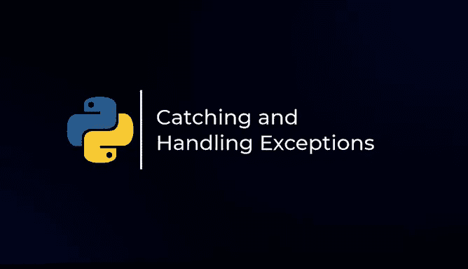
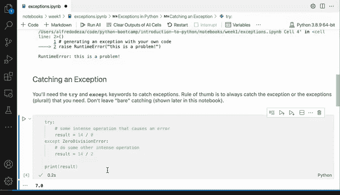
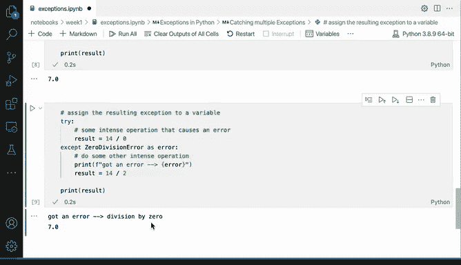

# 6：捕获与处理异常 🐍



在本节课中，我们将要学习Python中异常（Exceptions）的工作原理。异常是Python程序中传播或报告错误的主要机制。我们将了解如何触发异常、如何捕获并处理它们，以及如何利用异常信息进行调试。

---

## 异常是什么？🚨

上一节我们介绍了课程概述，本节中我们来看看异常的基本概念。

异常是Python用来“冒泡”或通告程序中错误的方式。在之前的视频中，我们已经见过一两个异常的例子，这里我们将进行更详细的探讨。

例如，运行以下代码会导致一个描述清晰的错误，这实际上就是一个名为 `ZeroDivisionError` 的异常。

```python
14 / 0
```

你必须注意所执行的操作，因为它们有时可能会通过引发异常来报告或显示错误。异常通常包含一条消息，例如本例中的“division by zero”，而 `ZeroDivisionError` 是异常的名称。这非常有用，我们稍后会看到原因，因为你也可以处理这些异常。

---

## 如何触发异常？🎯

现在，你也可以自己触发异常。在下面的例子中，我明确地使用 `raise` 关键字来引发一个内置的 `RuntimeError` 异常。

```python
raise RuntimeError("This is a problem")
```

这会正确地引发问题，将其“冒泡”并显示为 `RuntimeError: This is a problem`。这就是你生成异常的方式。你可能有一个函数或其他代码片段，想要中断并“冒泡”一个问题，那么你就可以使用 `raise` 关键字来实现。

---

## 如何捕获异常？🛡️

现在，你也可以捕获异常。但请注意一个警告：**只捕获你打算处理、并且你知道在某些情况下能够处理的异常**。

对于Python初学者来说，尝试忽略并丢弃异常是很常见的做法。但异常是有用的，因此有充分的理由去处理它们。

以下是捕获异常的基本结构：



```python
try:
    result = 14 / 0
except ZeroDivisionError:
    result = 14 / 2
    print(result)
```


运行这段代码会得到 `7.0`。那么这里发生了什么？

`try` 块会执行下一行的操作：`result = 14 / 0`。`try` 块会尝试执行这个操作，但正如我们所见，`14 / 0` 会导致 `ZeroDivisionError`。接下来，我使用了一个 `except` 块。`try...except` 结构就是用来捕获异常的方式：你尝试（try）做某事，如果发生与你捕获的异常类型匹配的异常，你就会进入 `except` 块。在本例中，我捕获的是 `ZeroDivisionError`，并执行了备用操作：`result = 14 / 2`，然后打印结果，最终得到 `7.0`。

---

## 避免捕获所有异常 ⚠️

不要被诱惑去捕获所有异常。你可以看到我在这里使用了 `except Exception:`，这是一种非常通用、非常宽泛的异常捕获方式。这意味着捕获Python中几乎所有的异常。

```python
try:
    result = 14 / 0
    raise RuntimeError("Another problem")
except Exception:
    result = 14 / 2
    print(result)
```

运行这段代码也会得到 `7.0`。但问题在于，这里 `result` 的除零问题和 `RuntimeError` 是两个可能引发异常的不同源头。由于我使用了 `except Exception:`，我无法区分异常的具体来源和类型。因此，正确的方法是捕获多个特定的异常。

---

## 捕获多个异常 🎭

以下是捕获多个异常的方法。这里我有两个操作：`14 / 2` 和一个可能导致 `TypeError` 的字符串加法。

```python
try:
    result = 14 / 2
    result = result + "string"  # 这将导致 TypeError
except (ZeroDivisionError, TypeError):
    print("Caught either a division by zero or a type error!")
```

我通过将异常类型放在一个元组中来添加它们：`(ZeroDivisionError, TypeError)`。你可以添加任意多种异常类型。如果我这样做，我就能同时防范除零错误和类型错误这两种问题。如果我运行这段代码，它会完美工作，因为我现在防范了这两个问题。同样，如果我尝试 `14 / 0`，它也会被捕获。

---

## 将异常赋值给变量 📝

最后，你还可以将引发的异常赋值给一个变量，以便进一步检查或记录。

```python
try:
    result = 14 / 0
except ZeroDivisionError as error:
    print(f"Got an error: {error}")
```

在这里，`except ZeroDivisionError as error:` 语句将捕获的 `ZeroDivisionError` 异常对象赋值给变量 `error`。然后，我可以在 `print` 语句中使用这个变量来输出异常信息。运行这段代码会打印出 `Got an error: division by zero`，这正是我们之前看到的 `ZeroDivisionError` 所携带的消息。

---

## 总结 📚



本节课中我们一起学习了Python异常处理的核心知识。我们了解了异常是程序错误传播的机制，学习了如何使用 `raise` 关键字主动触发异常。更重要的是，我们掌握了使用 `try...except` 结构来捕获和处理异常，包括如何捕获多个特定异常以及如何将异常对象赋值给变量以获取详细信息。请记住，良好的异常处理实践是只捕获你预期并能处理的异常，这有助于编写更健壮、更易调试的代码。