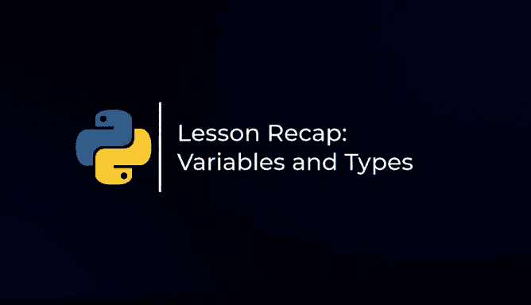

# 7：07_01_07_课程回顾-变量与类型 📚



在本节课中，我们将回顾关于变量、数据类型、逻辑运算以及异常处理的核心概念。这些是构建任何Python程序的基础。

## 变量与赋值 🔢


上一节我们介绍了Python的基本语法，本节中我们来看看如何存储和操作数据。变量是存储数据的容器，你可以通过赋值操作符 `=` 来为变量赋值。

以下是变量赋值的基本语法：
```python
variable_name = value
```
例如，`x = 5` 将整数值 `5` 存储在名为 `x` 的变量中。

## 数据类型 📊

变量可以存储不同类型的数据。Python有几种内置的基本数据类型。

以下是几种常见的数据类型：
*   **整数（int）**：表示没有小数部分的数字，如 `10`。
*   **浮点数（float）**：表示带有小数部分的数字，如 `3.14`。
*   **字符串（str）**：表示文本，需要用引号括起来，如 `"Hello"`。
*   **布尔值（bool）**：表示逻辑值，只有 `True` 或 `False`。

## 逻辑运算与条件判断 ⚖️

了解了如何存储数据后，我们来看看如何根据数据做出决策。逻辑运算和条件判断允许程序根据特定条件执行不同的代码路径。

以下是逻辑运算的关键部分：
*   **比较运算符**：如 `==`（等于）、`!=`（不等于）、`>`（大于）、`<`（小于），用于比较两个值。
*   **逻辑运算符**：如 `and`、`or`、`not`，用于组合多个条件。
*   **条件语句**：使用 `if`、`elif`、`else` 关键字来构建分支逻辑。

## 异常处理 🛡️

程序在运行时可能会遇到意外错误，例如尝试打开一个不存在的文件。异常处理机制允许我们优雅地捕获和处理这些错误，防止程序崩溃。

以下是异常处理的核心概念：
*   **异常（Exception）**：程序执行过程中发生的错误。
*   **try-except 块**：用于捕获和处理异常的代码结构。将可能出错的代码放在 `try` 块中，将处理错误的代码放在 `except` 块中。
*   **基本语法**：
    ```python
    try:
        # 可能引发异常的代码
        result = 10 / 0
    except ZeroDivisionError:
        # 处理特定异常
        print("不能除以零")
    ```


---

本节课中我们一起学习了Python编程的几个基础但至关重要的部分：如何通过变量存储数据，认识了不同的数据类型，掌握了使用逻辑运算进行条件判断的方法，并了解了如何使用 `try-except` 结构来捕获和处理程序运行中的异常。这些是编写健壮、可读Python代码的基石。