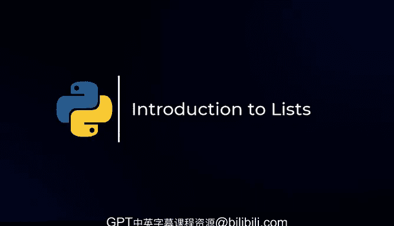
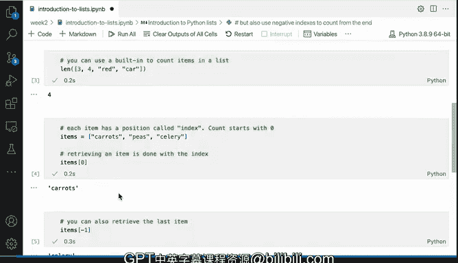

# 9：09_01_03_列表简介 📚



在本节课中，我们将要学习Python中一种最常用的数据结构——列表。我们将了解列表是什么、如何创建列表、如何访问列表中的元素，以及列表的一些基本特性。

---


列表是Python中最常见的数据结构之一。本质上，列表就是一个项目的容器。如下图所示，列表由方括号定义，其中可以包含各种项目。

列表可以包含任何数据类型。例如，一个列表中可以同时包含整数、字符串、布尔值和浮点数。这意味着对可以放入这种容器中的内容没有限制。

虽然它被称为列表，但我更倾向于将其视为一个可以存放数据并对其进行操作的“容器”。

---

## 列表的创建与查看 🛠️

上一节我们介绍了列表的基本概念，本节中我们来看看如何创建和查看一个列表。

你可以通过将列表赋值给一个变量来定义它。我们之前已经学习过如何将项目赋值给变量。

```python
# 定义一个包含字符串的列表
items = [“carrot”, “piece”, “salary”]
```

要了解列表的更多信息，你可以随时调用内置的 `len()` 函数。例如，将一个字典传递给 `len()` 函数，你可以看到其中包含四个项目。

---

## 通过索引访问列表元素 🔢

列表中的每个项目都有一个索引（即位置）。在Python中，第一个索引从数字0开始。因此，索引0对应列表中的第一个项目。

当你想要检索列表中的某个项目时，需要使用方括号和索引整数。例如，`items[0]` 将获取列表中的第一个项目。

```python
# 获取列表中的第一个元素
first_item = items[0]  # 结果为 “carrot”
```

列表会保持项目的顺序，这一点非常重要。索引是访问元素的关键。如果想获取第一个项目，就使用 `items[0]`。如果将索引改为1，则会得到第二个项目。

---

## 使用负索引 📍

除了正索引，列表还支持负整数索引，这将从列表末尾开始访问项目。

例如，索引 `-1` 会获取列表中的最后一个项目。如果想获取倒数第二个项目，则使用索引 `-2`。

```python
# 获取列表中的最后一个元素
last_item = items[-1]  # 结果为 “salary”
# 获取倒数第二个元素
second_last_item = items[-2]  # 结果为 “piece”
```

这种索引表示法起初可能令人困惑，特别是因为它从0开始计数，而有些人可能期望从1开始。但只要记住这个规则，你就能很好地与列表交互，提取所需的项目。

---



---

## 总结 ✨


本节课中我们一起学习了Python列表的基础知识。我们了解到列表是一种有序的、可以容纳各种数据类型的容器。我们学习了如何使用方括号创建列表，如何通过正索引（从0开始）和负索引（从-1开始）来访问列表中的元素。掌握列表的索引是有效使用这种数据结构的关键第一步。