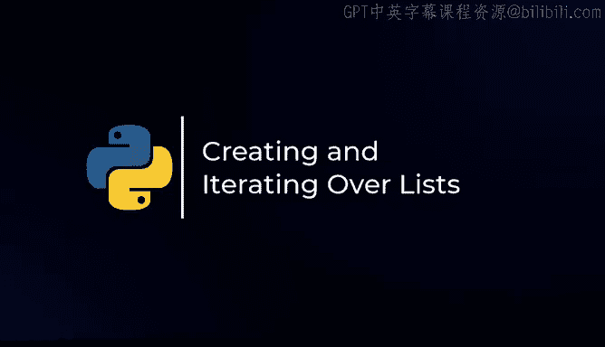
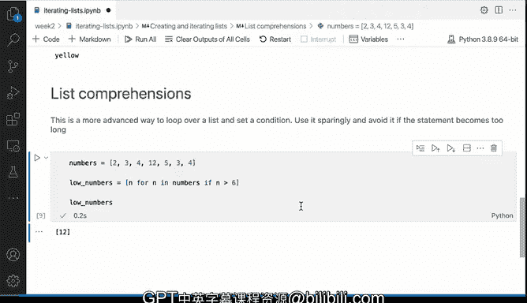

# 10：Python基础 - 列表的创建与遍历 📝



在本节课中，我们将学习如何在Python中创建列表，以及如何遍历（即循环访问）列表中的每一个元素。列表是Python中最基本且最常用的数据结构之一，掌握其创建和遍历方法是后续学习的基础。

---

## 列表的创建

上一节我们介绍了列表的基本概念，本节中我们来看看如何具体创建一个列表。

创建列表主要有两种方式：
1.  使用方括号 `[]`。
2.  使用内置的 `list()` 函数。

以下是一个创建列表的示例：
```python
# 使用方括号创建列表
colors = ['red', 'blue', 'brown']
print(colors)

# 使用list()函数创建列表
numbers = list((1, 2, 3, 4, 5))
print(numbers)
```
执行以上代码，两种方式输出的结果相同。列表中可以包含任意数量、任意类型的元素，例如数字、字符串等。

---

## 列表的遍历

创建列表后，最常见的操作就是遍历其中的所有元素。遍历意味着循环访问列表中的每一项。

以下是遍历列表的两种常用方法，它们使用 `for` 和 `in` 关键字。

### 方法一：使用临时变量遍历

在这种方法中，我们为列表中的每个元素指定一个临时变量名。
```python
colors = ['red', 'blue', 'brown']
for color in colors:
    print(color)
```
运行这段代码，会依次输出：`red`、`blue`、`brown`。列表的顺序总是被保留的，这也是之前我们可以使用索引访问元素的原因。

### 方法二：直接遍历列表

你也可以不通过临时变量，直接遍历列表本身。
```python
for item in ['red', 'blue', 'brown']:
    print(item)
```
这种方法的结果与第一种完全相同。通常，为列表和临时变量起有意义的名称（如 `colors` 和 `color`）会使代码更易读。

---

## 列表推导式

接下来，让我们看看列表推导式。这是一种强大但需要谨慎使用的语法，它允许你在一行代码内创建并筛选列表。

列表推导式本质上是一个写在方括号 `[]` 内的循环。以下是它的基本结构：
```python
[expression for item in iterable if condition]
```

请看下面的例子：
```python
numbers = [1, 3, 5, 7, 9, 12]
low_numbers = [n for n in numbers if n < 6]
print(low_numbers)  # 输出: [1, 3, 5]
```
这段代码会遍历 `numbers` 列表，只将小于6的数字添加到新的 `low_numbers` 列表中。你也可以修改条件，例如 `if n > 6`，那么结果就会只包含数字 `12`。

列表推导式非常简洁高效，但如果逻辑过于复杂或代码行过长，会降低代码的可读性。编写易于阅读和维护的代码至关重要。

---

## 总结

本节课中我们一起学习了Python列表的核心操作：
1.  **创建列表**：可以使用方括号 `[]` 或 `list()` 函数。
2.  **遍历列表**：使用 `for item in list:` 循环结构，可以方便地访问每个元素。
3.  **列表推导式**：这是一种紧凑的创建新列表的方法，语法为 `[表达式 for 变量 in 列表 if 条件]`，但需注意保持代码的简洁与可读性。



掌握这些基础操作，是高效使用Python进行数据处理和机器学习运维的重要一步。