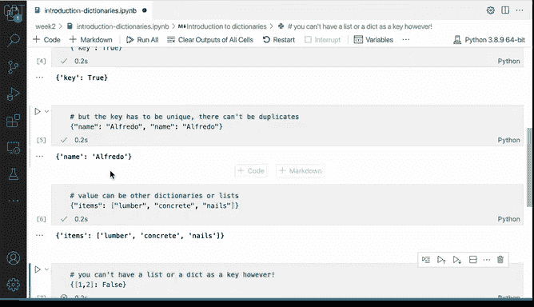
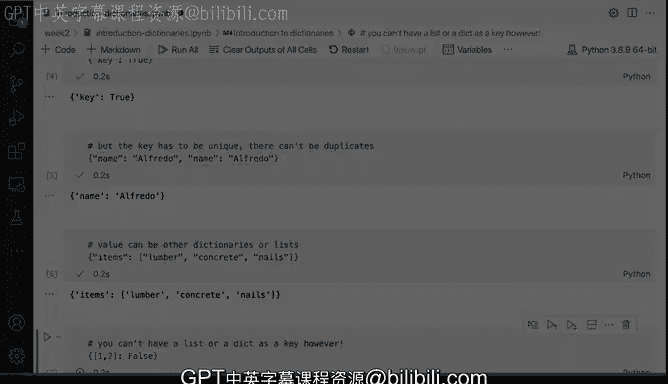

# 11：Python 字典简介 📚


在本节课中，我们将要学习 Python 中一个非常重要的数据结构——字典。我们将了解字典的基本概念、如何创建字典，以及使用字典时需要注意的一些关键规则。

---

## 字典是什么？🗺️

上一节我们介绍了列表，它是一种存储多个项目的容器。本节中我们来看看字典。字典与列表不同，它是一种映射结构。你可以把字典想象成一个电话簿：每个名字（键）都对应一个电话号码（值）。字典就是这种键值对的集合。

创建字典需要使用花括号 `{}`。键和值之间用冒号 `:` 分隔。以下是一个简单的例子：

```python
phone_book = {"Alfredo": "555-1234"}
```

运行这段代码，你会得到一个包含一个键值对的字典。键 `"Alfredo"` 和值 `"555-1234"` 都是字符串，但字典也支持其他数据类型。

---

## 字典的键与值 🔑

字典的核心是键值对映射。键必须是唯一的，而值可以是任何数据类型，包括其他数据结构。

以下是创建字典时的一些要点：

*   **键值对**：每个条目由一个键和一个值组成，格式为 `key: value`。
*   **多个条目**：如果需要多个键值对，使用逗号 `,` 分隔，就像在列表中分隔多个项目一样。
*   **键的唯一性**：字典中的键必须是唯一的。如果出现重复的键，后面的键值对会覆盖前面的。

例如，下面的字典中，第二个 `"name"` 键会覆盖第一个：

```python
my_dict = {"name": "Alfredo", "name": "Another Name"}
# 运行后，my_dict 将是 {"name": "Another Name"}
```

---

## 字典值的多样性 📦

字典的值可以是多种类型，这为存储复杂数据提供了便利。

以下是值类型的一些示例：

*   **布尔值**：值可以是 `True` 或 `False`。
    ```python
    {"is_student": True}
    ```
*   **列表**：值可以是一个列表，用于存储多个相关项目。
    ```python
    {"items": ["lumber", "concrete", "nails"]}
    ```

**重要限制**：虽然值可以是列表，但**键不能是列表**。尝试使用列表作为键会导致 `TypeError`，提示列表是“不可哈希的”类型。这是因为 Python 字典内部需要快速定位键，而列表是可变的，无法满足这一要求。

```python
# 这将导致错误！
# wrong_dict = {["a", "list"]: "value"}  # TypeError: unhashable type: 'list'
```

---

## 总结 📝



本节课中我们一起学习了 Python 字典的基础知识。我们了解到字典是一种通过键来映射值的数据结构，非常适合用于表示像电话簿这样的关系。我们学会了如何使用花括号和冒号创建字典，明白了键必须是唯一的，并且键不能使用列表等可变类型。字典就像是一个内存中的微型数据库，能够高效地存储和检索数据。



掌握了这些基础后，你就可以开始在你的 Python 程序中使用字典来组织和管理更复杂的数据了。