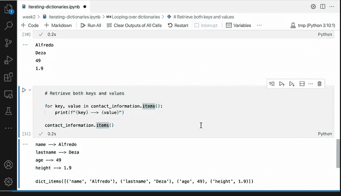

# 12：创建与遍历字典 📚


在本节课中，我们将要学习 Python 中字典的创建与遍历。字典是一种非常实用的数据结构，它允许我们以键值对的形式存储和访问数据。我们将探讨创建字典的多种方法，并详细讲解如何遍历字典以获取其中的键、值或两者。

---

## 创建字典的多种方式 🔧

上一节我们介绍了字典的基本概念，本节中我们来看看创建字典的几种不同方法。

首先，我们可以使用花括号 `{}` 直接创建字典。

```python
contact_information = {'name': 'Alfredo', 'last_name': 'Deza'}
```

其次，我们可以使用内置的 `dict()` 函数来创建字典。

```python
contact_information = dict()
```

此外，还有两种更灵活的方式。以下是其他创建字典的方法：

*   **传递键值对列表**：你可以向 `dict()` 函数传递一个包含元组的列表，每个元组是一个键值对。
    ```python
    contact_information = dict([('name', 'Alfredo'), ('last_name', 'Deza')])
    ```
*   **使用关键字参数**：你可以直接使用关键字参数来创建字典。
    ```python
    contact_information = dict(name='Alfredo', last_name='Deza')
    ```

---

## 遍历字典 🔄

现在我们已经知道如何创建字典，接下来让我们看看如何遍历字典中的数据。我们将使用一个包含更多信息的字典作为示例。

```python
contact_information = {'name': 'Alfredo', 'last_name': 'Deza', 'age': 49, 'height': 190}
```

### 遍历字典的键

如果你只想获取字典中的所有键，可以使用 `.keys()` 方法。

```python
for key in contact_information.keys():
    print(key)
```

实际上，Python 默认就会遍历字典的键。因此，以下代码会产生相同的结果：

```python
for key in contact_information:
    print(key)
```

### 遍历字典的值

如果你想获取字典中的所有值，可以使用 `.values()` 方法。

```python
for value in contact_information.values():
    print(value)
```

### 同时遍历键和值

如果你想同时获取字典的键和值，需要使用 `.items()` 方法，并结合 Python 的解包功能。

```python
for key, value in contact_information.items():
    print(f"{key}: {value}")
```

`.items()` 方法返回一个类似列表的对象，其中每个元素都是一个包含键和值的元组。在循环中，我们使用两个变量（`key` 和 `value`）来接收每个元组中的两个值。

---

## 总结 📝



本节课中我们一起学习了 Python 字典的创建与遍历。我们掌握了四种创建字典的方法：使用花括号、`dict()` 函数、传递键值对列表以及使用关键字参数。更重要的是，我们学会了如何通过 `.keys()`、`.values()` 和 `.items()` 方法来遍历字典，从而灵活地访问其中的键、值或两者。这些操作是处理字典数据的基础，在未来的数据管理和机器学习任务中会经常用到。