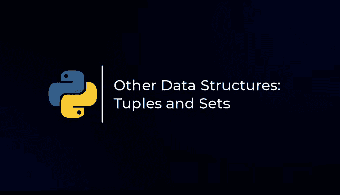
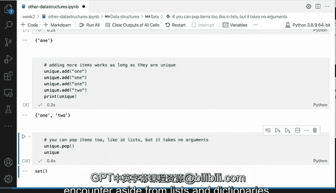

# 13：其他数据结构-元组与集合 📚



在本节课中，我们将要学习Python中两种重要的数据结构：元组（Tuple）和集合（Set）。这两种结构虽然不如列表和字典常用，但在特定场景下非常有用。我们将分别介绍它们的特点、创建方式、基本操作以及它们与列表和字典的主要区别。

---

## 元组：不可变的序列 📦

上一节我们介绍了列表，它是一种可变的有序集合。本节中我们来看看元组。元组与列表非常相似，但关键区别在于元组是**不可变**的，你可以将其视为一个“只读”列表。

创建一个元组使用圆括号 `()`，元素之间用逗号分隔。

```python
ro_items = ('first', 'second', 'third')
```

访问元组元素的方式与列表完全相同，使用索引。

```python
print(ro_items[0])  # 输出：first
print(ro_items[-1]) # 输出：third
```

以下是元组的一些基本操作示例：

*   **遍历元组**：可以像遍历列表一样使用 `for` 循环。
*   **查找索引**：使用 `.index()` 方法查找元素的索引位置。
*   **统计次数**：使用 `.count()` 方法统计某个元素出现的次数。

尝试修改元组（例如添加或删除元素）会导致错误，因为元组对象没有 `append` 或 `pop` 等方法。

```python
# 以下操作会引发 AttributeError 错误
# ro_items.append('fourth')
# ro_items.pop()
```

总之，元组适用于存储不应被程序修改的数据集合，例如配置项、常量集合或函数返回多个值时。

---

## 集合：无序的唯一元素集 🧮

接下来，我们探讨集合。集合也是一种存储多个元素的数据结构，但其核心特性是**元素唯一**且**无序**。

创建一个集合可以使用花括号 `{}` 或 `set()` 函数。

```python
my_set = {'one'}
```

以下是集合的核心操作：

*   **添加元素**：使用 `.add()` 方法向集合中添加元素。如果添加已存在的元素，集合不会有任何变化。
    ```python
    my_set.add('one')  # 集合不变
    my_set.add('two')  # 集合变为 {'one', 'two'}
    ```
*   **移除元素**：使用 `.pop()` 方法会随机移除并返回一个元素。注意，集合的 `.pop()` 方法不接受参数。
    ```python
    popped_item = my_set.pop() # 随机移除一个元素，例如 ‘one’
    ```
*   **元素唯一性**：这是集合最重要的特性。无论你添加多少次重复元素，集合中只会保留一个。
    ```python
    unique_set = set()
    unique_set.add(1)
    unique_set.add(1)
    unique_set.add(2)
    print(unique_set) # 输出：{1, 2}， 重复的1只出现一次
    ```

集合的语法 `{}` 与字典相似，但集合内部没有键值对映射关系，只有独立的值。

---

## 总结 🎯

本节课中我们一起学习了Python中两种重要的数据结构。

*   **元组** 是一种**不可变**的有序序列，类似于只读列表，适用于存储不应更改的数据。
*   **集合** 是一种**无序**的容器，其核心是保证元素的**唯一性**，常用于去重或成员关系测试。



理解元组和集合的特性，能帮助你在未来编写Python程序时，根据数据是否可变、是否需要唯一性等需求，选择最合适的数据结构。