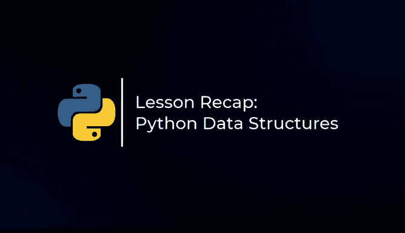

# 14：Python数据结构回顾 🐍

在本节课中，我们将回顾Python中的核心数据结构。我们将学习如何识别它们，理解不同数据结构之间的语法差异，并探讨在何种场景下应选择何种数据结构来存储数据。最后，我们也会了解一些虽不常用但依然有用的数据结构及其独特之处。

## 数据结构概述 📊

上一节我们介绍了Python编程的基础概念，本节中我们来看看Python中用于组织和存储数据的核心工具——数据结构。



数据结构是存储、组织和管理数据的特定方式。Python内置了多种数据结构，每种都有其独特的特性和适用场景。

## 常见数据结构及其识别 🔍

Python中几种常见的数据结构在语法上略有不同。识别它们的关键在于观察其定义时使用的符号。

以下是几种主要数据结构的定义示例：

*   **列表**：使用方括号 `[]` 定义，元素可重复，有序。
    ```python
    my_list = [1, 2, 3, 'hello']
    ```
*   **元组**：使用圆括号 `()` 定义，元素不可修改，有序。
    ```python
    my_tuple = (1, 2, 'world')
    ```
*   **集合**：使用花括号 `{}` 定义，元素唯一且无序。
    ```python
    my_set = {1, 2, 3, 3}  # 实际存储为 {1, 2, 3}
    ```
*   **字典**：使用花括号 `{}` 定义，包含键值对，键唯一。
    ```python
    my_dict = {'name': 'Alice', 'age': 25}
    ```

## 数据结构的选择与应用 ⚖️

理解了不同数据结构的语法后，我们需要掌握如何根据需求选择合适的数据结构。选择的关键在于考虑数据的性质（是否需要有序、是否允许重复）以及需要执行的操作（查找、添加、删除的频率和方式）。

以下是选择数据结构时的一些指导原则：

*   需要维护元素顺序时，使用**列表**或**元组**。
*   需要快速检查一个元素是否存在，且不关心顺序和重复时，使用**集合**。
*   需要将信息（值）与唯一标识符（键）关联时，使用**字典**。
*   当数据在程序运行过程中不应被改变时，使用**元组**而非列表。

## 其他有用的数据结构 🧰

除了上述四种最常用的数据结构，Python还提供了一些其他有用的数据结构，它们在某些特定场景下能提供更优的性能或更方便的接口。

以下是一些值得了解的数据结构：

*   **`collections.deque`**：一种双向队列，从两端添加或删除元素的速度很快。
*   **`collections.defaultdict`**：一种字典，当访问不存在的键时会返回一个默认值。
*   **`collections.Counter`**：用于计数可哈希对象的字典子类。


## 总结 📝

本节课中我们一起学习了Python的核心数据结构。我们首先学会了如何通过语法识别列表、元组、集合和字典。然后，我们探讨了如何根据数据存储和操作的需求来选择最合适的数据结构。最后，我们简要了解了一些标准库中提供的、用于特殊场景的实用数据结构。掌握这些知识是有效进行数据组织和后续机器学习运维工作的基础。