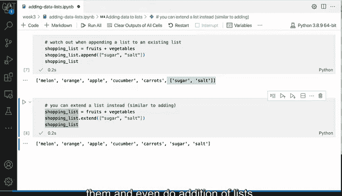

# 16：向列表添加数据 📝


在本节课中，我们将学习如何向Python列表中添加数据。我们将探讨多种方法，包括`append`、`insert`、列表相加以及`extend`，并理解它们之间的区别。

---

## 列表基础回顾

上一节我们介绍了如何定义列表。列表使用方括号 `[]` 来创建。

```python
fruits = ['apple', 'orange']
```

## 使用 `append` 方法添加数据

我们可以使用 `append` 方法向列表末尾添加新的项目。列表会保持项目的顺序。

以下是向 `fruits` 列表添加项目的示例：

```python
fruits.append('banana')
# 现在 fruits 是 ['apple', 'orange', 'banana']
```

## 使用 `insert` 方法在指定位置添加数据

`append` 只能在末尾添加。如果我们想在特定位置插入数据，可以使用 `insert` 方法。这个方法需要两个参数：索引位置和要插入的值。

例如，我们想在索引 `0` 的位置（即列表开头）插入 `'melon'`：

```python
fruits.insert(0, 'melon')
# 现在 fruits 是 ['melon', 'apple', 'orange', 'banana']
```

**注意**：`insert` 方法的索引参数是必需的。如果省略，会导致 `TypeError`。

## 使用加法运算符合并列表

两个列表可以使用加法运算符 `+` 合并，生成一个包含两个列表所有元素的新列表。

假设我们有两个列表：

```python
vegetables = ['cucumber', 'carrots']
```

我们可以将 `fruits` 和 `vegetables` 相加：

```python
shopping_list = fruits + vegetables
# shopping_list 是 ['melon', 'apple', 'orange', 'banana', 'cucumber', 'carrots']
```

## `append` 与 `extend` 的区别

如果我们想将一个列表添加到另一个现有列表的末尾，直接使用 `append` 会产生嵌套列表，这可能不是我们想要的结果。

例如：

```python
shopping_list.append(['sugar', 'salt'])
# 现在 shopping_list 末尾是一个嵌套列表: [..., ['sugar', 'salt']]
```

为了避免嵌套，我们应该使用 `extend` 方法。`extend` 会将另一个列表中的所有元素逐个添加到当前列表的末尾。

以下是使用 `extend` 的正确方式：

```python
shopping_list.extend(['sugar', 'salt'])
# 现在 shopping_list 是平铺的: [..., 'cucumber', 'carrots', 'sugar', 'salt']
```

---

## 总结

本节课中我们一起学习了向Python列表添加数据的几种方法：
1.  **`append(item)`**：在列表末尾添加单个元素。
2.  **`insert(index, item)`**：在指定索引位置插入单个元素。
3.  **列表相加 (`list1 + list2`)**：合并两个列表，生成一个新列表。
4.  **`extend(another_list)`**：将另一个列表的所有元素添加到当前列表末尾，避免产生嵌套。



理解这些方法的区别，能帮助你在处理数据时更灵活地操作列表。