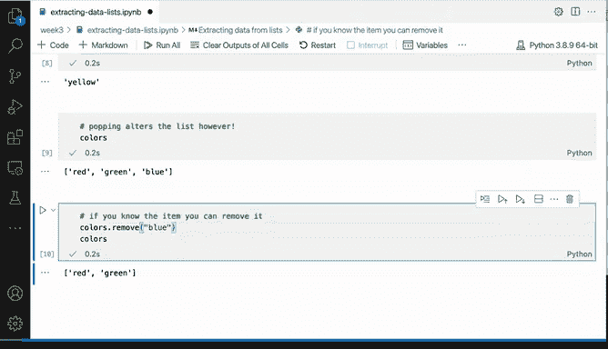

# 17：从列表提取数据 📋


在本节课中，我们将学习如何从Python列表中提取数据。我们将介绍几种不同的方法，包括使用索引、切片操作、`pop`方法和`remove`方法，来获取或移除列表中的元素。

---

## 从列表提取数据

在前几节课中，我们已经看到可以通过索引从列表中检索值。例如，我们有一个颜色列表：`['red', 'yellow', 'green', 'blue']`。我们可以使用索引来获取特定项，例如使用索引`0`会得到`'red'`。

但是，如果我们想获取一个范围或一个子集，仅使用索引就无法实现了。这时，切片操作就派上了用场。

---

## 使用切片操作提取子集

切片操作使用冒号`:`在方括号内进行。例如，`colors[:3]`会返回列表的前三个元素：`'red'`、`'yellow'`和`'green'`。

**代码示例：**
```python
colors = ['red', 'yellow', 'green', 'blue']
subset = colors[:3]
print(subset)  # 输出: ['red', 'yellow', 'green']
```

如果想获取前两个元素，可以将参数改为`2`，即`colors[:2]`，这会得到`['red', 'yellow']`。这是一种非常方便的方法，用于获取已知范围的列表子集。

---

## 提取列表末尾的元素

提取列表末尾的元素有时会让人困惑。一个常见的错误是使用`-2`这样的负数作为起始索引，但这通常不会得到预期的结果。

正确的方法是使用负索引作为起始点。例如，`colors[-3:]`会返回最后三个元素：`'yellow'`、`'green'`和`'blue'`。

**代码示例：**
```python
last_three = colors[-3:]
print(last_three)  # 输出: ['yellow', 'green', 'blue']
```

---

## 提取特定范围的元素

切片操作还可以用于提取列表中的特定范围。例如，要提取`'yellow'`和`'green'`，可以使用索引`1`和`3`（注意结束索引不包含在内）。

**代码示例：**
```python
range_subset = colors[1:3]
print(range_subset)  # 输出: ['yellow', 'green']
```

---

## 使用`pop`方法移除并返回元素

`pop`方法用于移除列表中指定索引的元素，并返回该元素的值。需要注意的是，指定的索引必须存在于列表中。

**代码示例：**
```python
popped_item = colors.pop(1)
print(popped_item)  # 输出: 'yellow'
print(colors)       # 输出: ['red', 'green', 'blue']
```

如果尝试弹出不存在的索引（例如`100`），Python会引发`IndexError`异常。

---

## 使用`remove`方法移除元素

如果只是想移除列表中的某个元素，而不关心其返回值，可以使用`remove`方法。该方法会查找并移除第一个匹配的元素。

**代码示例：**
```python
colors.remove('blue')
print(colors)  # 输出: ['red', 'green']
```

`remove`方法会执行两个步骤：首先查找元素的位置，然后将其从列表中移除。

---

## 总结

本节课中，我们一起学习了从Python列表提取数据的几种方法：

1.  **使用索引**：直接通过位置获取单个元素。
2.  **使用切片操作**：提取列表的子集，包括前N个元素、后N个元素或特定范围的元素。
3.  **使用`pop`方法**：移除并返回指定索引的元素。
4.  **使用`remove`方法**：移除列表中第一个匹配的元素。



掌握这些方法将帮助您更灵活地处理和操作列表数据。