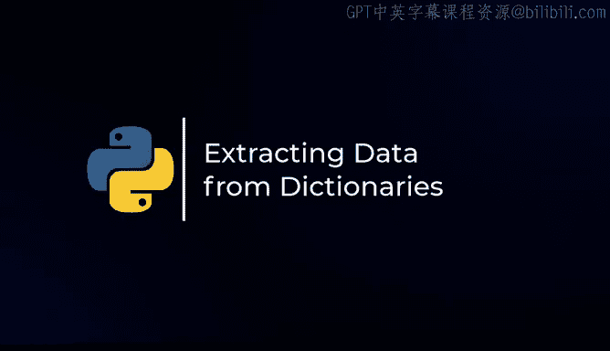
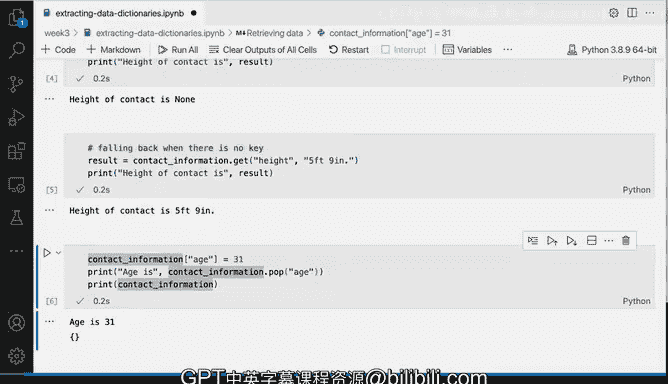

# 18：从字典中提取数据 📖



在本节课中，我们将学习从 Python 字典中检索和提取数据的几种方法。我们将探讨如何安全地访问可能不存在的键，以及如何从字典中移除元素。

---

## 字典数据提取基础

上一节我们介绍了字典的基本概念和创建方法。本节中，我们来看看如何从字典中获取数据。

我们已经见过几种从字典提取数据的方式。首先，实例化一个名为 `contact_information` 的空字典。

```python
contact_information = {}
```

尝试检索一个不存在的键会发生什么？例如，检索 `height` 键。

```python
contact_information['height']
```

执行上述代码会引发 `KeyError`。当你尝试检索字典中不存在的键时，就会发生这种错误。字典可能是空的，也可能已包含大量键值对，但只要没有 `height` 这个键，就会引发键错误。

---

## 处理键错误的两种方法

以下是两种处理键错误的方法。

### 方法一：使用 try-except 块

第一种方法是使用 `try-except` 块。我们尚未详细讲解异常处理，这将在后续课程中介绍，但这是处理键错误的一种方式。

```python
try:
    height = contact_information['height']
except KeyError:
    height = '6 feet'
print(height)
```

运行这段代码，会输出 `6 feet`。因为键错误被捕获，我们转而执行了其他操作。如果你知道在 `height` 键不存在时想做什么，这是一种处理方式。

### 方法二：使用 `.get()` 方法

我更喜欢另一种方法，即使用 `.get()` 方法。`.get()` 方法允许你传入想要提取的键，并返回一个特定值。在 Python 中，如果未找到键，默认会返回一个特殊类型 `None`。

```python
height = contact_information.get('height')
print(f"The height of contact is {height}.")
```

运行这段代码，输出为 `The height of contact is None.`。这样就不会再引发键错误，而是产生一个 `None` 值。

如果你不想要 `None`，而希望返回其他值，`.get()` 方法也允许你指定一个备用值。

```python
height = contact_information.get('height', '5 feet 9 inches')
print(f"The height of contact is {height}.")
```

这里，`.get()` 方法的第二个参数是备用值。运行代码，输出为 `The height of contact is 5 feet 9 inches.`。这就是 `.get()` 方法的使用方式。

---

## 使用 `.pop()` 方法操作字典

与列表和集合类似，字典也可以使用 `.pop()` 方法。`.pop()` 方法会移除指定键及其对应的值，并返回该值。

```python
contact_information['H'] = 31
h_value = contact_information.pop('H')
print(f"H is {h_value}.")
print(f"Contact information: {contact_information}")
```

在这段代码中，我们先将键 `'H'` 和值 `31` 添加到字典中。然后使用 `.pop('H')` 移除该键值对，并将值 `31` 赋给变量 `h_value`。最后打印结果。

运行代码，第一行输出 `H is 31.`，第二行输出 `Contact information: {}`。因为 `.pop()` 操作移除了该条目，所以字典变空了。

---

## 总结

本节课中，我们一起学习了从 Python 字典中提取和操作数据的几种方法：
1.  直接通过键访问可能引发 `KeyError`。
2.  使用 `try-except` 块可以优雅地处理键不存在的情况。
3.  使用 `.get(key, default)` 方法可以安全地获取值，并指定备用值。
4.  使用 `.pop(key)` 方法可以移除键值对并获取其值。



掌握这些方法能让你更安全、灵活地使用字典数据结构。