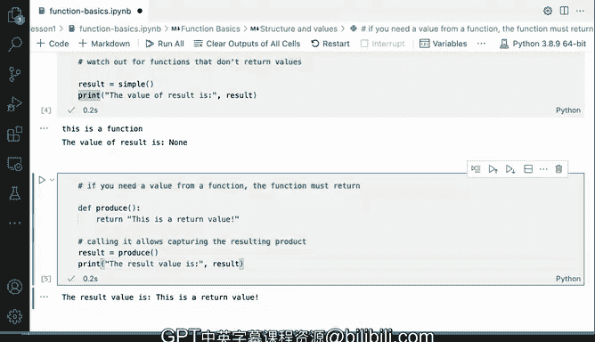

# 21：函数结构与返回值 📘


在本节课中，我们将要学习Python中函数的基本结构，以及函数如何通过返回值与程序的其他部分进行交互。理解函数的定义、执行以及返回值的概念，是编写模块化和可重用代码的第一步。

---

## 函数的基本结构

上一节我们介绍了代码块和缩进的概念，本节中我们来看看如何定义一个函数。函数是组织可重用代码的基本单元。

定义一个函数，你需要使用 `def` 关键字。这标志着函数定义的开始。紧接着是函数名（不能有空格），后面跟着一对圆括号，最后以冒号结束。从下一行开始，所有属于该函数的代码行都必须缩进（通常是四个空格），这向Python表明这些代码是函数体的一部分。

```python
def simple():
    print("this is a function")
```

运行上述代码会创建一个名为 `simple` 的函数。当我们调用它时，它会执行函数体内的代码，打印出“this is a function”。

---

## 函数的“执行”与“返回值”

在开始使用Python函数时，有一个概念可能会让人困惑：有些函数执行操作，而有些函数则返回值。并非所有执行操作的函数都会返回一个值。

我们上面定义的 `simple` 函数就是一个例子：它执行了打印操作，但**没有**返回值。在Python中，如果一个函数没有明确使用 `return` 语句返回值，它会隐式地返回一个特殊值 `None`。

为了理解这一点，我们可以尝试将调用 `simple` 函数的结果赋值给一个变量，然后打印这个变量。

```python
result = simple()
print(result)
```

运行这段代码，你会先看到打印出的“this is a function”，然后看到 `result` 的值是 `None`。这是因为 `simple` 函数执行了打印操作，但它的返回值是隐式的 `None`。

---

## 如何让函数返回值

如果你希望函数计算一个结果并将其传递出去，就需要使用 `return` 语句。以下是一个返回值的函数示例：

```python
def produce():
    return "this is a return value"
```

`produce` 函数使用 `return` 关键字明确地返回了一个字符串。现在，当我们调用这个函数并将其结果赋值给变量时，变量将保存返回的值，而不是 `None`。

```python
result = produce()
print(result)
```

执行这段代码，`result` 的值将是字符串“this is a return value”。

---

## 核心要点总结

以下是关于函数结构与返回值的关键点：

*   **定义函数**：使用 `def` 关键字，后接函数名、括号和冒号。函数体必须缩进。
*   **函数行为**：函数可以执行操作（如打印），也可以返回值，或者两者兼有。
*   **隐式返回值**：如果函数没有 `return` 语句，它会自动返回 `None`。
*   **显式返回值**：使用 `return` 语句可以指定函数要返回的值。

---



本节课中我们一起学习了Python函数的基本定义方法，区分了仅执行操作的函数与返回值的函数，并理解了 `None` 作为隐式返回值的作用。掌握这些基础是后续学习函数参数、作用域以及构建复杂程序的关键。