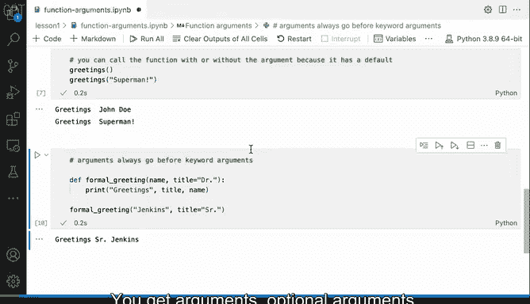

# 22：Python 函数参数详解 📘


在本节课中，我们将学习 Python 函数参数的不同类型及其使用方法。理解函数参数是编写灵活且强大函数的关键。

---

## 🎯 函数参数概述

函数可以接收参数，这些参数允许我们向函数传递数据。本节将介绍参数的工作原理。

---

## 🔧 必需参数

函数定义中的必需参数位于括号内。以下是一个示例函数 `squared`，它返回传入数字的平方值。

```python
def squared(number):
    return number ** 2
```

如果传入参数 `4`，函数将返回 `16`，因为 `4` 的平方是 `16`。该函数执行数学运算并需要一个输入值。

如果未传递任何参数，Python 将引发 `TypeError`，提示缺少必需的位置参数 `number`。传入的参数将使用函数定义中指定的变量名。

---

## 🔄 可选参数

某些函数具有可选参数。例如，Python 内置的 `int` 函数。

```python
result = int()  # 返回 0
result = int("10")  # 返回整数 10
```

`int` 函数无需导入即可使用。如果不传递任何参数，它默认返回 `0`。它还可以将字符串转换为整数值，这使其非常灵活。有时我们可能需要这种灵活性，有时则不需要。

---

## 🗝️ 关键字参数

关键字参数允许我们为参数设置默认值，使其成为可选参数。以下是一个示例函数 `greetings`。

```python
def greetings(full_name="John Doe"):
    print(f"Greetings, {full_name}!")
```

调用 `greetings()` 将输出 `Greetings, John Doe!`，因为未传递参数，使用了默认值。调用 `greetings("Superman")` 将输出 `Greetings, Superman!`。

Python 在幕后检查是否提供了 `full_name` 参数。如果未提供，则使用默认值 `"John Doe"`。这种键值对映射的参数称为关键字参数。

---

## ⚠️ 参数顺序注意事项

混合使用必需参数和关键字参数时，必须遵循特定的顺序：必需参数在前，关键字参数在后。否则，Python 将引发语法错误。

以下示例函数 `formal_greet` 演示了正确的参数顺序。

```python
def formal_greet(name, title="Doctor"):
    print(f"Greetings, {title} {name}!")
```

调用 `formal_greet("Jenkins")` 将输出 `Greetings, Doctor Jenkins!`，因为未提供 `title` 参数，使用了默认值。

如果想传递不同的 `title`，有两种方式：
1. 按位置传递：`formal_greet("Jenkins", "Senior")`
2. 使用关键字指定：`formal_greet("Jenkins", title="Senior")`

两种方式效果相同。

---

## 📝 总结



本节课我们一起学习了 Python 函数参数的不同类型：必需参数、可选参数和关键字参数。我们还了解了混合使用这些参数时必须遵循的顺序规则。掌握这些概念将帮助你编写更灵活、更强大的函数。