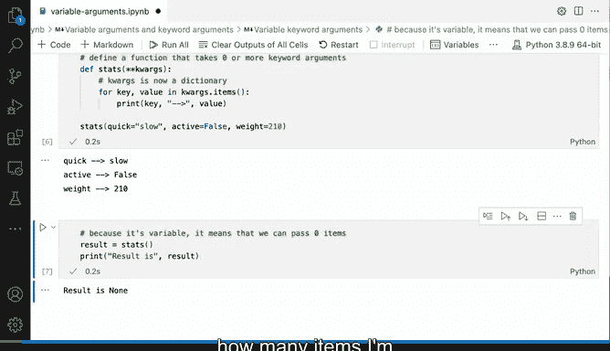

# 23：可变参数与关键字参数 📘


在本节课中，我们将要学习Python函数中的两个高级概念：**可变参数**与**关键字参数**。这些功能允许函数接受任意数量的参数，使代码更加灵活和通用。

---

## 🎯 概述：什么是可变参数与关键字参数？

在编写函数时，有时我们无法预先知道需要接收多少个参数。Python提供了两种机制来处理这种情况：**可变参数**（使用`*args`）和**可变关键字参数**（使用`**kwargs`）。它们允许函数接受零个到任意多个普通参数或键值对参数。

---

## 🔧 可变参数（*args）

上一节我们介绍了函数的基本参数传递，本节中我们来看看如何使用可变参数。可变参数允许函数接收任意数量的位置参数，这些参数在函数内部被组织成一个元组（tuple）。

以下是定义和使用可变参数的步骤：

1.  **定义函数时使用`*args`**：在参数前添加一个星号（`*`），例如`def function_name(*args):`。
2.  **传递任意数量的参数**：调用函数时，可以传入任意数量的参数，包括零个。
3.  **在函数内部访问参数**：`args`变量在函数内部是一个元组，包含了所有传入的位置参数。

```python
def family_members(*args):
    for name in args:
        print(name)

# 调用函数，传入三个参数
family_members('Lucy', 'Matt', 'Bob')
```
运行上述代码，函数会依次打印出：`Lucy`、`Matt`、`Bob`。

如果调用时不传入任何参数，函数也不会出错，只是不会执行循环体内的打印操作。这体现了其灵活性。

---

## 🔑 参数名称的灵活性

需要记住的是，`*args`中的`args`只是一个约定俗成的变量名，并非关键字。你可以使用任何有效的变量名。

以下是更改参数名称的示例：

```python
def family_members(*names):
    for name in names:
        print(name)

family_members('John', 'Sam')
```
这段代码的功能与之前完全相同，只是将内部的循环变量从`args`改为了`names`。

---

## 🗂️ 可变关键字参数（**kwargs）

除了可变的位置参数，Python还支持可变的关键字参数。这允许函数接收任意数量的键值对参数，这些参数在函数内部被组织成一个字典（dictionary）。

以下是定义和使用可变关键字参数的步骤：

1.  **定义函数时使用`**kwargs`**：在参数前添加两个星号（`**`），例如`def function_name(**kwargs):`。
2.  **传递任意数量的键值对**：调用函数时，可以传入任意数量的`key=value`形式的参数。
3.  **在函数内部访问参数**：`kwargs`变量在函数内部是一个字典，你可以像操作字典一样访问这些键值对。

```python
def stats(**kwargs):
    for key, value in kwargs.items():
        print(f"{key}: {value}")

# 调用函数，传入多个关键字参数
stats(speed='slow', active=False, weight=210)
```
运行代码，输出结果为：
```
speed: slow
active: False
weight: 210
```

你可以传入任意不同的键值对组合，函数都能灵活处理。同样，调用时不传入任何参数也是允许的。

---

## 💎 总结

本节课中我们一起学习了Python函数中两个强大的特性：**可变参数（*args）** 和 **可变关键字参数（**kwargs）**。

*   **可变参数**将传入的所有位置参数打包成一个**元组**，适用于参数数量不确定但无需命名的场景。
*   **可变关键字参数**将传入的所有键值对参数打包成一个**字典**，适用于需要接收任意数量命名参数的场景。



这两种机制极大地增强了函数的灵活性，在你无法预知函数将接收多少参数时（这在数据处理和机器学习任务中很常见）尤其有用。希望你能在实践中熟练运用它们。