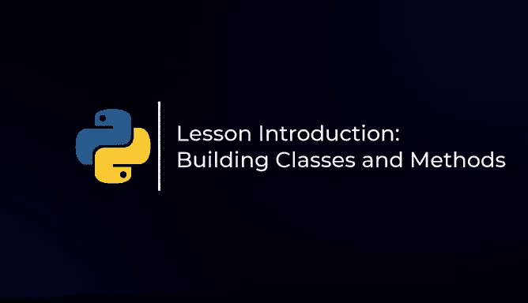

# 25：构建类与方法 🏗️

在本节课中，我们将更深入地探讨Python中的类。我们将学习如何创建类，理解构造函数和`__init__`方法，了解类属性，并解释在类中无处不在的`self`参数。最后，我们还会简要介绍听起来复杂但实际并不难的类继承。通过这几节课，你将学会如何高效地使用类。

## 类的创建与构造函数


上一节我们介绍了类的基本概念，本节中我们来看看如何具体构建一个类。类的创建始于`class`关键字。



以下是创建一个简单类的语法：
```python
class ClassName:
    # 类的主体
    pass
```

## 理解 `__init__` 方法与 `self`

在定义类之后，我们通常需要初始化对象。这是通过一个特殊的方法——构造函数——来完成的。

在Python中，构造函数就是`__init__`方法。当创建一个类的新实例时，这个方法会自动被调用。`self`参数是一个指向实例本身的引用，它必须是类中每个方法的第一个参数。

以下是`__init__`方法的一个示例：
```python
class Dog:
    def __init__(self, name, age):
        self.name = name  # 实例属性
        self.age = age    # 实例属性
```

## 类属性与实例属性

理解了构造函数后，我们需要区分两种属性：类属性和实例属性。

*   **类属性**：属于类本身，所有实例共享同一个值。
*   **实例属性**：属于具体的对象实例，每个实例可以有不同的值。

以下是定义类属性和实例属性的示例：
```python
class Dog:
    species = "Canis familiaris"  # 类属性

    def __init__(self, name, age):
        self.name = name  # 实例属性
        self.age = age    # 实例属性
```

## 类继承简介

最后，我们来探讨一下类继承。继承允许我们定义一个类（子类）来继承另一个类（父类）的属性和方法。这有助于代码重用和建立清晰的层次关系。

以下是类继承的基本语法：
```python
class ParentClass:
    # 父类的属性和方法
    pass


class ChildClass(ParentClass):
    # 子类可以拥有自己独有的属性和方法，也可以重写父类的方法
    pass
```

本节课中我们一起学习了Python中类的核心构建块：如何创建类，如何使用`__init__`构造函数和`self`参数初始化对象，如何区分类属性与实例属性，并初步了解了类继承的概念。掌握这些知识是进行面向对象编程和构建复杂MLOps项目的基础。