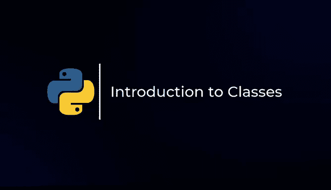
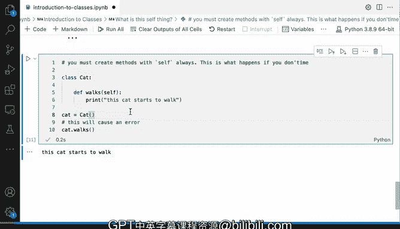

# 26：Python类简介 🐍



在本节课中，我们将要学习Python中一个非常重要的概念：**类**。类是面向对象编程的核心，它允许我们创建自定义的数据类型，将数据（属性）和操作数据的方法（函数）捆绑在一起。理解类是编写复杂、模块化Python程序的关键一步。

除了函数，类是你在Python中会经常遇到的东西之一。我倾向于偏爱函数，但类绝对有其存在的价值和位置，它们被用来实现强大的程序功能。我将通过这个笔记本来展示一些基础知识。

## 最基本的类

你可以创建的最基本的类会使用Python中的 `class` 关键字。然后你会给它一个名字，类似于在函数中使用 `def` 关键字后跟名字和冒号。这就是你创建或定义一个新类的方式。

```python
class BasicClass:
    pass
```

我在这里使用 `pass` 是因为这个类是空的，意味着它没有实际功能。第4行代码不执行任何操作。然后在第6行，我进行**实例化**。一旦我调用这个类，它就变成了一个**实例**，它被创建、被构造。可以把第3到4行看作是描述这个东西将是什么的**蓝图**。而第6行则是它启动、运行、被创建、存在的时候。

这就是你能拥有的最基本的类。现在让我们看看，当我们尝试探索这个实例拥有的属性时，我们能发现什么。

```python
my_instance = BasicClass()
print(dir(my_instance))
```

这里肯定有很多不同的东西，它们都以双下划线开头。我们至少会看到其中一个，即 `__init__`，在Python中我们也常称之为 `Dunder init`（双下划线init）。所有这些都属于类的**特殊方法**。在日常使用中，你可能不会用到它们中的大多数，但知道它们存在是有用的。一旦你创建了一个类的实例，即使它像上面那个两行代码的类一样基础且什么都不做，你也会有很多东西可以使用。

## 旧式类语法

现在让我们看另一种你可能会看到的类构造方式，它可能看起来有点奇怪。

```python
class OldStyleClass(object):
    pass
```

在第3行，我们再次有这个基本的类，但我们使用了 `object`。这是什么 `object`？在非常旧的Python版本中，在定义类时习惯将 `object` 作为参数传递给类。在现代Python中，情况已不再如此，所以你通常不会看到它。有些人仍然倾向于使用它，但在现代Python中这不是必需的。无论你是否看到它，类的工作方式都是一样的，有它或没有它真的无关紧要。只是了解一下在旧版本的Python中这是惯例是有用的。

## 类属性与方法

那么，你还能在这里做什么呢？我将创建一个名为 `Dog` 的类，并使用一个叫做**类属性**的东西。现在我将开始解释类的一些组件，然后我们会使用它们并尝试调用它们，看看它们各自的作用。

```python
class Dog:
    # 类属性
    is_animal = True

    # 方法
    def bark():
        print("Woof!")
```

在这个例子中，第5行我使用了 `is_animal = True`，这被称为**类属性**。然后我添加了一个**方法**。但这个方法有一个错误。如果你不熟悉类，你可能看不出这个类有什么问题。但如果你非常熟悉类，你会发现第7行有一个相当严重的问题。

好的，我来运行这个。我在这里定义了 `Dog` 类，定义了一个 `is_animal = True` 的类属性，然后有一个 `bark` 方法。这是一个方法，所以它属于 `Dog` 类。我在第10行实例化了这个对象，创建了 `Dog` 的一个实例。现在让我们让它叫。

```python
my_dog = Dog()
my_dog.bark()
```

当我调用它时，你会看到 `my_dog.bark()`。`bark` 属于 `Dog` 类。我运行这些代码，会得到一个 `TypeError`。为什么我会得到类型错误？因为我漏掉了一个关键字。错误信息显示：`bark() takes 0 positional arguments but 1 was given`。

**隐式地**，Python在幕后传递了一个参数。按照惯例，这个参数被称为 `self`。我们稍后会看到更多关于方法的内容。只需注意，每次创建方法时，都必须有一个参数，并且第一个参数应该是 `self`。

以下是修正后的代码：

```python
class Dog:
    # 类属性
    is_animal = True

    # 方法 - 修正后
    def bark(self):
        print("Woof!")
```

现在，如果我再次运行这个单元格，`my_dog.bark()` 将是一个可调用对象，它会打印 “Woof!”。然后 `my_dog.is_animal` 将是 `True`，这就是那里的属性。

你可以根据需要创建任意多个这些类的实例。这是类的一个强大之处，它允许你创建许多、许多实例，并在任何地方开始生成类和对象。

## 注意类属性

但是，请注意类属性。我向你展示了 `Dog.is_animal` 是一个类属性。这意味着它是一种属于类的属性。但如果你不通过实例访问它，而是直接通过类进行修改，就像我在下面第2行做的那样，那么我将会搞乱已创建的该类的**每一个**实例。

```python
# 直接修改类属性
Dog.is_animal = False

rufus = Dog()
print(rufus.is_animal)  # 输出：False

sparky = Dog()
print(sparky.is_animal)  # 输出：False
```

运行这个，你现在可以看到 `rufus.is_animal` 将是 `False`。所以你只需要注意，这可能会给你带来问题。如果你必须定义一个类属性（如果你知道你在做什么，这完全没问题），那么你必须注意它可能会改变。这个改变也会影响任何未来的实例。你可以看到这里 `sparky` 对象被创建，并且每个实例的 `is_animal` 也将是 `False`，尽管在第5行我们定义了 `is_animal = True`。

## 关于 `self` 的总结

我简要介绍了 `self` 是什么，但你必须创建它。我们已经遇到了一个类型错误。你必须总是传入这个 `self` 参数，否则你会遇到麻烦。目前你只需要知道这些，我们稍后会深入细节。但请注意，你必须传入它。虽然不强制要求参数名必须叫 `self`，但这是一个你几乎在任何地方都能看到的约定。

---



本节课中我们一起学习了Python类的基础知识。我们了解了如何定义最基本的类，什么是实例化，以及蓝图（类定义）和实际对象（实例）之间的区别。我们探讨了类属性和实例方法，并强调了在定义方法时 `self` 参数的重要性。我们还看到了直接修改类属性会如何影响所有实例。掌握这些概念是迈向面向对象编程和构建更复杂Python应用的重要一步。