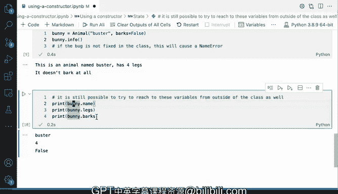

# 27：Python 类与构造函数 🐍


在本节课中，我们将学习 Python 类中一个非常重要的概念：构造函数。我们将了解构造函数的作用、如何定义它，以及如何使用它来初始化对象的属性。

---

## 概述

上一节我们快速介绍了 Python 类的基本概念。本节中，我们将深入探讨构造函数的使用。构造函数允许我们在创建类的实例时设置一些初始状态或执行一些操作。

---

## 构造函数简介

构造函数是一个特殊的方法，它在创建类的新实例时自动调用。在 Python 中，构造函数的名称是 `__init__`。

以下是如何定义一个带有构造函数的类：

```python
class Dog:
    def __init__(self):
        self.is_animal = True
```

在这个例子中，`__init__` 方法在类 `Dog` 被实例化时执行。它使用 `self` 来设置一个实例属性 `is_animal` 为 `True`。

**注意**：`self` 是一个指向实例本身的引用，用于访问实例的属性和方法。

---

## 实例属性与类属性

你可能还记得之前提到的类属性。实例属性与类属性的区别在于，实例属性属于特定的实例，而类属性属于类本身，被所有实例共享。

让我们通过一个例子来理解：

```python
class Dog:
    is_animal = True  # 类属性

    def __init__(self):
        self.is_animal = True  # 实例属性
```

如果我们创建两个 `Dog` 实例并修改其中一个的 `is_animal` 属性，另一个实例不会受到影响。这是因为实例属性是独立的。

---

## 向构造函数传递参数

构造函数可以接受参数，这样我们可以在创建实例时初始化不同的属性。

以下是一个更复杂的例子：

```python
class Animal:
    def __init__(self, name, legs=4, barks=True):
        self.name = name
        self.legs = legs
        self.barks = barks
```

在这个例子中：
- `name` 是一个必需参数。
- `legs` 和 `barks` 是可选参数，带有默认值。

---

## 在方法中使用实例属性

在类的方法中，我们需要使用 `self` 来访问实例属性。以下是一个常见错误及其修正方法：

**错误示例**：
```python
class Animal:
    def __init__(self, name, legs=4, barks=True):
        self.name = name
        self.legs = legs
        self.barks = barks

    def info(self):
        print(f"This is an animal named {name}, has {legs} legs, and {'barks' if barks else 'does not bark'}.")
```

运行上述代码会导致 `NameError`，因为 `name`、`legs` 和 `barks` 不是局部变量，而是实例属性。

**修正后的示例**：
```python
class Animal:
    def __init__(self, name, legs=4, barks=True):
        self.name = name
        self.legs = legs
        self.barks = barks

    def info(self):
        print(f"This is an animal named {self.name}, has {self.legs} legs, and {'barks' if self.barks else 'does not bark'}.")
```

现在，`info` 方法可以正确访问实例属性。

---

## 从外部访问实例属性

从类的外部访问实例属性非常简单，只需使用实例的名称即可：

```python
bunny = Animal("Buster", legs=4, barks=False)
print(bunny.name)   # 输出: Buster
print(bunny.legs)   # 输出: 4
print(bunny.barks)  # 输出: False
```

---

## 总结

本节课中，我们一起学习了 Python 类的构造函数。我们了解了：
1. 构造函数的作用是在创建实例时初始化属性。
2. 如何使用 `__init__` 方法定义构造函数。
3. 如何向构造函数传递参数并设置实例属性。
4. 如何在类的方法中使用 `self` 访问实例属性。
5. 如何从类的外部访问实例属性。



掌握构造函数是理解面向对象编程的关键一步，它为创建灵活且可重用的代码奠定了基础。