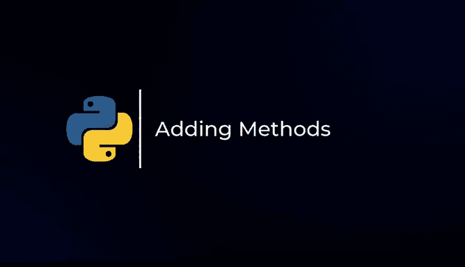
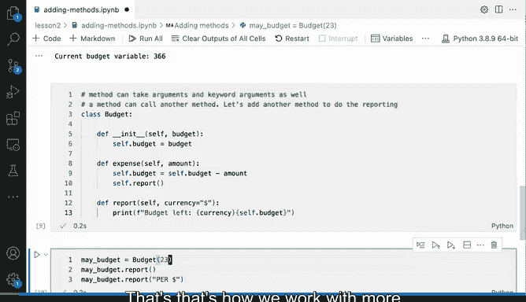

# 28：为类添加方法 🧩



在本节课中，我们将学习如何在Python类中定义和使用多个方法。我们将通过创建一个预算管理类来演示如何添加方法、在方法间调用以及如何为方法设置参数。

---

我们已经简要了解了类中的方法。但关于方法的添加和使用，还有一些细节需要探讨。方法类似于特殊的函数，但它们在类中定义。接下来，我们将通过创建一个包含两个方法的类来深入了解。

首先，我创建一个名为 `Budget` 的类。这个类将包含一个构造方法 `__init__` 和一个名为 `expense` 的方法。

```python
class Budget:
    def __init__(self, budget):
        self.budget = budget

    def expense(self, amount):
        self.budget -= amount
        print(f"预算剩余: {self.budget}")
```

在上面的代码中，`__init__` 是一个构造方法，用于初始化类的实例。`expense` 方法用于从预算中扣除指定金额，并打印剩余预算。

现在，让我们创建一个 `Budget` 类的实例，并调用 `expense` 方法。

```python
b = Budget(100)
b.expense(23)
b.expense(45)
```

运行上述代码，我们将看到输出结果：扣除23后剩余77，再扣除45后剩余32。这表明我们的方法工作正常。

接下来，我们考虑将不同功能分离到不同的方法中。例如，我们可以将打印预算剩余的功能提取到一个单独的 `report` 方法中。

以下是更新后的 `Budget` 类：

```python
class Budget:
    def __init__(self, budget):
        self.budget = budget

    def expense(self, amount):
        self.budget -= amount
        self.report()

    def report(self):
        print(f"预算剩余: {self.budget}")
```

在这个版本中，`expense` 方法在扣除金额后调用 `report` 方法来打印剩余预算。这样，我们可以将不同功能分离到不同方法中，使代码更加清晰。

现在，让我们测试更新后的类：

```python
b = Budget(100)
b.expense(23)
b.expense(45)
```

运行代码，我们将看到与之前相同的输出结果。这表明我们的修改没有影响类的功能。

此外，我们还可以从类的外部访问实例的内部状态。例如，我们可以直接访问 `budget` 属性：

```python
print(b.budget)
```

这将输出当前的预算剩余值。在类内部，我们通过 `self.budget` 来访问这个属性。

接下来，我们看看如何为方法添加参数。例如，我们可以为 `report` 方法添加一个可选的 `currency` 参数，用于指定货币符号。

以下是更新后的 `Budget` 类：

```python
class Budget:
    def __init__(self, budget):
        self.budget = budget

    def expense(self, amount):
        self.budget -= amount
        self.report()

    def report(self, currency="$"):
        print(f"预算剩余: {currency}{self.budget}")
```

在这个版本中，`report` 方法接受一个 `currency` 参数，默认值为 `"$"`。这样，我们可以根据需要指定不同的货币符号。

现在，让我们测试这个新功能：

```python
b = Budget(100)
b.expense(23)
b.report("¥")
```

运行代码，我们将看到输出结果中使用了指定的货币符号。这表明我们可以灵活地为方法添加参数。

需要注意的是，方法的参数规则与函数相同：必须先有位置参数，然后是关键字参数。我们还可以使用可变参数和可变关键字参数，就像在函数中一样。

---



在本节课中，我们一起学习了如何在Python类中添加和使用多个方法。我们通过创建一个预算管理类，演示了如何定义方法、在方法间调用以及为方法添加参数。这些技巧将帮助您编写更加模块化和灵活的代码。