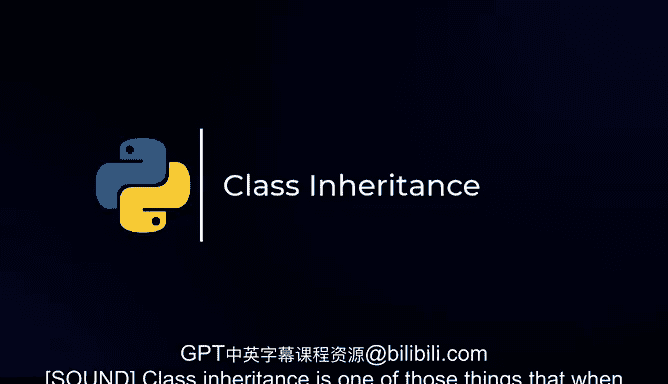
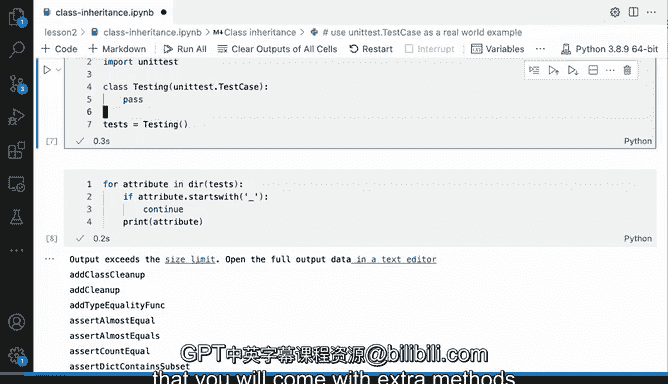

# 29：类继承 🧬



在本节课中，我们将要学习 Python 中一个核心但有时令人困惑的概念：类继承。我们将通过一个简单的宠物管理示例，来理解继承如何工作，以及它如何让代码更高效、更易于管理。

---

## 概述

类继承允许我们创建一个“父类”（或基类），其中定义通用的属性和方法。然后，我们可以创建“子类”，这些子类会自动获得父类的所有功能，同时还可以添加或修改自己特有的行为。这有助于减少代码重复，并建立清晰的类层次结构。

上一节我们介绍了类的基本概念，本节中我们来看看如何通过继承来扩展类的功能。

---

## 父类的定义

首先，我们定义一个基础的 `Pet`（宠物）类。这个类将作为一个通用模板，包含所有宠物都可能有的行为。

```python
class Pet:
    def eat(self):
        self.food = self.food - self.appetite
```

请注意，这个 `eat` 方法依赖于 `self.food` 和 `self.appetite` 这两个属性。但在 `Pet` 类本身，我们并没有定义它们。如果直接实例化 `Pet` 类并调用 `eat` 方法，会导致错误，因为缺少必要的属性。

```python
my_pet = Pet()
my_pet.eat()  # 这会引发 AttributeError: 'Pet' object has no attribute 'food'
```

这正是设计继承的初衷：父类定义通用的行为框架，而具体的属性则由继承它的子类来提供。

---

## 创建子类

现在，我们创建两个具体的宠物子类：`Parakeet`（鹦鹉）和 `Dog`（狗）。它们将继承自 `Pet` 类。

以下是子类的定义方式：

```python
class Parakeet(Pet):
    def __init__(self):
        self.food = 100
        self.appetite = 1

class Dog(Pet):
    def __init__(self):
        self.food = 400
        self.appetite = 7
```

在类名后的括号 `(Pet)` 指明了继承关系。`Parakeet` 和 `Dog` 现在自动拥有了 `Pet` 类中定义的 `eat` 方法。

---

## 使用继承的类

让我们创建这些类的实例，并观察继承是如何起作用的。

```python
perry = Parakeet()
rufus = Dog()

perry.eat()
print(f"Perry 吃完后还剩 {perry.food} 份食物。")
# 输出: Perry 吃完后还剩 99 份食物。

rufus.eat()
print(f"Rufus 吃完后还剩 {rufus.food} 份食物。")
# 输出: Rufus 吃完后还剩 393 份食物。
```

关键点在于：`Parakeet` 和 `Dog` 类本身并没有定义 `eat` 方法，但它们可以调用它，因为该方法是从父类 `Pet` 继承而来的。

---

## 检查对象的属性和方法

为了更清楚地看到子类从父类继承了什么，我们可以使用 Python 内置的 `dir()` 函数。

```python
print(dir(perry))
# 输出会包含: ['__class__', '__delattr__', ..., 'appetite', 'eat', 'food', ...]
```

`dir()` 函数会列出对象的所有属性和方法。在输出中，你可以看到除了子类自己定义的 `appetite` 和 `food` 属性外，还有从 `Pet` 类继承来的 `eat` 方法。

---

## 继承的实际应用场景

继承在现实世界的编程中非常常见。一个典型的例子是使用 Python 标准库中的 `unittest` 模块来编写测试。

以下是其基本用法：

```python
import unittest

class MyTestCase(unittest.TestCase):
    pass

my_test = MyTestCase()
# 使用 dir() 查看 my_test 对象的所有方法
print(dir(my_test))
# 你会看到大量从 unittest.TestCase 继承来的方法，如 assertEqual, assertTrue 等。
```

当你创建一个继承自 `unittest.TestCase` 的类时，你的测试类会自动获得所有用于断言（判断测试结果）的方法。这展示了继承的强大之处：它为你提供了大量现成的、经过测试的功能。

---

## 总结

本节课中我们一起学习了 Python 的类继承。

我们了解到，继承允许子类获取父类的属性和方法，从而促进代码重用和逻辑组织。我们通过定义通用的 `Pet` 父类和具体的 `Parakeet`、`Dog` 子类，演示了继承的基本机制。最后，我们还探讨了如何使用 `dir()` 函数来检查继承关系，并了解了继承在 `unittest` 等实际库中的应用。



理解继承是掌握面向对象编程的关键一步，它能帮助你构建更清晰、更模块化的代码结构。