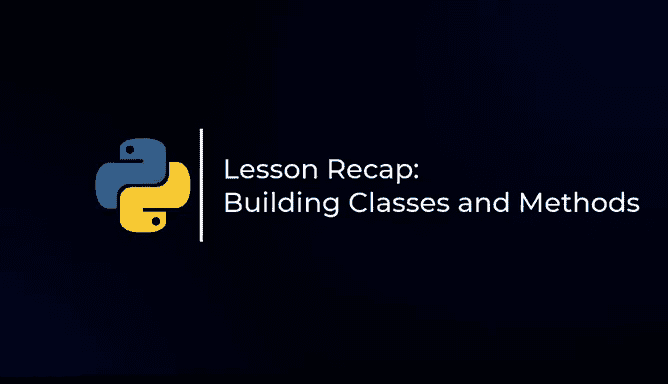

# 30：构建类与方法回顾 🧩

在本节课中，我们将回顾Python中关于类与方法的构建。我们将总结之前视频中介绍的核心概念，包括类、方法、`self`关键字、构造函数以及类属性。这些概念是提升Python编程能力的关键。




## 课程回顾与总结 📝

上一节我们介绍了类的基本概念，本节中我们来回顾并整合关于构建类与方法的核心知识点。


### 理解类与对象

现在你已经了解了如何使用类。掌握类并感到得心应手花费了我很长时间。


### 核心概念解析

希望我在这些视频中的讲解，能为你提供一种更清晰、更直接的理解方式。我们涵盖了一些内容，例如方法、`self`、构造函数，甚至是类属性。


以下是这些核心概念的简要说明：

*   **方法**：定义在类内部的函数，用于描述对象的行为。
*   **`self`**：在类的方法中，用于指代调用该方法的对象实例本身的关键字。
*   **构造函数 (`__init__`)**：一个特殊的方法，在创建类的新实例时自动调用，用于初始化对象的属性。
    ```python
    class MyClass:
        def __init__(self, attribute):
            self.attribute = attribute  # 初始化实例属性
    ```
*   **类属性**：属于类本身的变量，被该类的所有实例共享。
    ```python
    class MyClass:
        class_attribute = "I am shared"  # 这是一个类属性
    ```


这些概念可能相当复杂，但它们能让你提升Python知识水平，并变得更加熟练。


## 总结 🎯


本节课中我们一起回顾了Python中构建类与方法的核心内容。我们总结了方法、`self`关键字、构造函数和类属性的定义与用途。理解这些概念是进行面向对象编程和构建更复杂、模块化代码的基础。