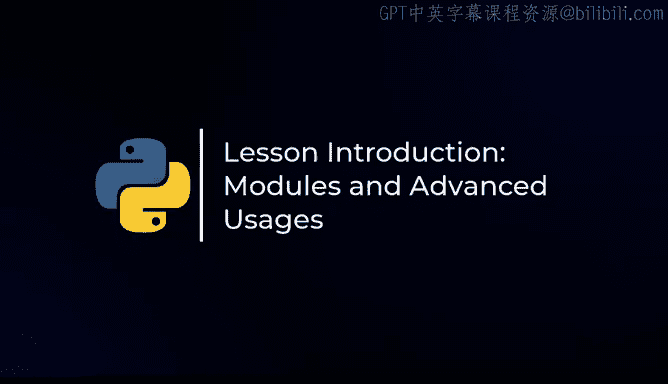

# 31：模块与高级用法 🧩

在本节课中，我们将要学习Python编程的进阶知识，重点是如何组织代码以及管理外部依赖。你已经掌握了Python的基础语法，能够编写一些代码。接下来，我们将提升一个层次，学习如何使用导入、理解模块的概念、如何用Python模块、目录和子目录来组织代码，最后还会学习如何安装外部依赖。Python自带的功能已经非常强大，但有时在项目中，我们仍然需要安装额外的依赖包。我们将学习如何以安全、可重复的方式进行安装。

---

## 理解模块与导入 📦


上一节我们介绍了Python的基础知识。本节中，我们来看看如何将代码组织成可重用的单元。

在Python中，一个模块就是一个包含Python定义和语句的`.py`文件。模块让你能够有逻辑地组织代码，并可以在其他程序中重复使用。



要使用一个模块中的功能，你需要使用`import`语句。以下是导入模块的基本方式：

```python
import math
```

导入后，你可以使用点号`.`来访问模块中的函数或变量：

```python
result = math.sqrt(16)
```

---

## 组织代码：模块、目录与包 🗂️

当你开始编写更复杂的项目时，将所有代码放在一个文件中会变得难以管理。这时，你需要将代码拆分到多个模块中，并用目录结构来组织它们。

一个包含`__init__.py`文件的目录被称为一个“包”（Package）。包可以包含多个模块和子包，形成一个层次结构。

以下是组织代码的常见方式：

*   **模块**：单个`.py`文件。
*   **包**：一个包含`__init__.py`文件的目录。
*   **子包**：包内的另一个包。

你可以使用点号语法来导入包中的模块：

```python
from my_package import my_module
from my_package.sub_package import another_module
```

---

## 管理外部依赖 🔧

Python标准库功能丰富，但并非万能。在实际项目中，你经常需要使用第三方库来实现特定功能，例如数据分析或机器学习。

这些第三方库就是“依赖”。为了以安全、可重复的方式管理它们，我们通常使用一个名为`requirements.txt`的文件来列出所有依赖及其版本。

以下是管理依赖的步骤：

1.  **创建虚拟环境**：这是一个独立的Python环境，用于隔离项目依赖。
    ```bash
    python -m venv myenv
    ```
2.  **激活虚拟环境**：
    *   Windows: `myenv\Scripts\activate`
    *   macOS/Linux: `source myenv/bin/activate`
3.  **安装依赖**：使用`pip`命令并根据`requirements.txt`文件安装。
    ```bash
    pip install -r requirements.txt
    ```
4.  **生成依赖文件**：你可以将当前环境中的依赖列表导出到`requirements.txt`。
    ```bash
    pip freeze > requirements.txt
    ```

这种方法确保了任何人在任何机器上都能用相同的依赖版本复现你的项目环境。

---


## 总结 📝

本节课中我们一起学习了Python的进阶组织与管理技巧。我们首先理解了模块的概念以及如何使用`import`语句。接着，我们探讨了如何通过模块、目录和包来构建清晰的代码结构。最后，我们学习了如何通过虚拟环境和`requirements.txt`文件来安全、可重复地管理项目的外部依赖。掌握这些技能，将使你能够构建和维护更复杂、更专业的Python项目。