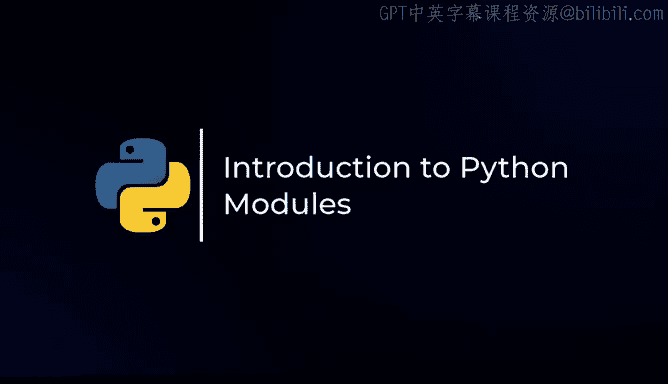
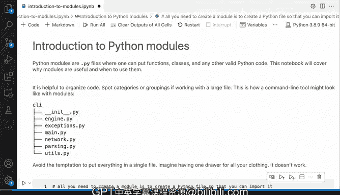

# 32：Python模块简介 📦



在本节课中，我们将要学习Python模块的基本概念。模块是Python中组织代码的核心方式，理解它们对于编写结构清晰、易于维护的程序至关重要。

---

## 什么是Python模块？ 🤔

上一节我们介绍了Python的基础知识，本节中我们来看看如何组织代码。Python模块本质上就是一个以`.py`为扩展名的Python文件。这就是模块的全部定义。

你可以将模块视为组织代码的一种方式。如果你看到一个非常长的Python文件，里面包含多个类、许多函数，并且代码行数超过200行，那么它的组织方式可能不够好。当你需要更好地组织代码时，就需要使用模块。

我通常举的例子是：想象把你所有的衣服都放在一个抽屉里，这很可能行不通。把所有东西放在一个地方不如将它们分开存放，这样能保持整洁和可维护性。

## 模块的组织结构示例 🗂️

以下是一个示例项目结构，可以让你对模块的用途有一个直观的认识：

```
example_project/
├── __init__.py
├── engine.py
├── exceptions.py
├── main.py
└── network.py
```

这个结构让你大致了解代码可以如何分开放置。例如，如果你想处理特定的异常或创建自定义异常，所有这些代码都可以放在`exceptions.py`这个模块文件中。这为你提供了一种整洁、有序的工作方式。

Python本身也拥有大量的内置模块。例如，`os`模块。虽然我们稍后才会详细讲解导入（imports），但如果我在代码中导入`os`，你会发现这一个模块里就包含了许多功能。

## 实际项目中的模块应用 💼

除了上面的例子，我想向你展示我的一个个人项目结构：

```
my_project/
├── decorators.py
├── engine.py
├── exceptions.py
├── utilities.py
└── order.py
```

让我们看看`exceptions.py`模块。在这里，我定义了基础异常类，并运用了一些继承来创建自定义异常。所有自定义异常都可以在这里找到。

`utilities.py`是一个放置你希望复用、并使其对其他模块可用的代码的绝佳位置。这样其他模块就可以导入并使用它。这是一个非常典型的用例。

我们将在后续课程中讨论目录（包）及其工作原理。

## 核心要点总结 ✨



本节课中我们一起学习了Python模块。你需要掌握的核心概念是：**任何以`.py`结尾的文件都是一个模块**。模块可以帮助你更好地组织代码，使其更清晰、更易于维护。