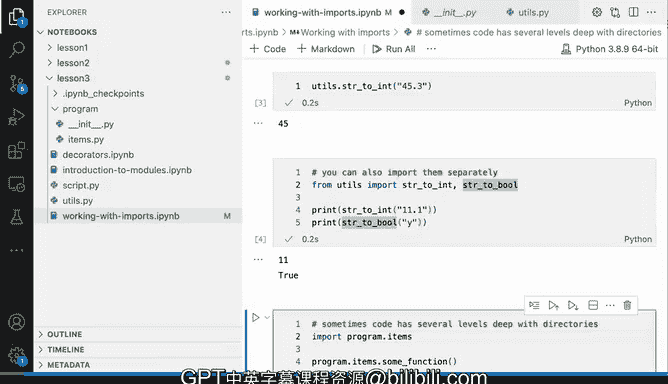

# 33：使用导入语句 🐍


在本节课中，我们将要学习如何在Python中使用导入语句。导入语句是Python中组织和使用代码的核心机制，它允许你将代码分割到不同的文件中，并在需要时引入它们。我们将通过具体的例子来理解如何导入模块、访问其中的函数，以及处理包含多个文件的目录结构。

---

## 模块导入基础

上一节我们介绍了导入语句的基本概念，本节中我们来看看如何导入和使用一个简单的Python模块。

我有一个名为 `utils.py` 的文件，它是一个Python模块。在这个模块中，我定义了两个辅助函数。

以下是 `utils.py` 文件的内容示例：

```python
# utils.py 文件内容
def string_to_int(s):
    """将字符串转换为整数"""
    return int(s)

def string_to_float(s):
    """将字符串转换为浮点数"""
    return float(s)
```

在同一个目录下的Jupyter笔记本中，我可以导入这个模块。Python是一种脚本语言，通过点号 `.` 来访问模块内的内容。

```python
# 导入整个utils模块
import utils

# 查看模块中可用的内容
print(dir(utils))
```

运行 `dir(utils)` 会显示模块中的所有属性和方法。你可以忽略那些以下划线 `_` 开头的方法和名称，重点关注我们定义的 `string_to_int` 和 `string_to_float` 函数。

访问这些函数的方式是使用 `模块名.函数名` 的格式。

```python
# 使用模块中的函数
result_int = utils.string_to_int("123")
result_float = utils.string_to_float("45.67")

print(result_int, result_float)
```

这种方式要求模块文件（如 `utils.py`）位于Python可以找到的路径上。在本例中，因为它在同一个目录下，所以可以直接导入。

---

## 从模块中导入特定内容

除了导入整个模块，你还可以选择只导入需要的特定函数或变量。

以下是使用 `from ... import ...` 语句的方法：

```python
# 从utils模块中只导入特定的函数
from utils import string_to_int, string_to_float

# 现在可以直接使用函数名，无需前缀
result = string_to_int("999")
print(result)
```

这种方式与导入整个模块的主要区别在于，你不需要在函数名前加上 `utils.` 前缀。因为这些函数被显式地导入到了当前的作用域中。

---

## 处理包（目录结构）

在实际项目中，代码通常被组织在多个文件和目录中。在Python中，包含 `__init__.py` 文件的目录被称为“包”。

假设我有一个名为 `program` 的目录，其结构如下：

```
program/
├── __init__.py
└── items.py
```

`items.py` 文件内容如下：

```python
# program/items.py
def some_function():
    return "这是一个模块中的函数"
```

`__init__.py` 文件的存在告诉Python，这个目录应该被视为一个包。

现在，我们可以在笔记本中导入这个包内的模块。

```python
# 导入包内的模块
import program.items

# 使用模块中的函数
message = program.items.some_function()
print(message)
```

如果你想直接导入 `program` 包，然后通过它访问 `items` 模块，你需要确保 `__init__.py` 文件中有相应的导入声明。否则，直接 `import program` 后，`program.items` 可能不可用。

这是处理项目结构时需要记住的一点。

---

## 总结

本节课中我们一起学习了Python导入语句的核心用法。

我们首先介绍了如何导入一个单独的模块并使用其中的函数，语法是 `import module_name` 和 `module_name.function_name`。

接着，我们学习了如何从模块中精确导入所需的部分，使用 `from module_name import function_name` 的格式，这样可以避免冗长的前缀。

最后，我们探讨了如何组织代码到目录（包）中，并通过 `__init__.py` 文件来管理包的导入行为。记住，点号 `.` 是访问嵌套模块和包内元素的关键。



掌握这些导入技巧，对于构建清晰、可维护的Python项目至关重要。