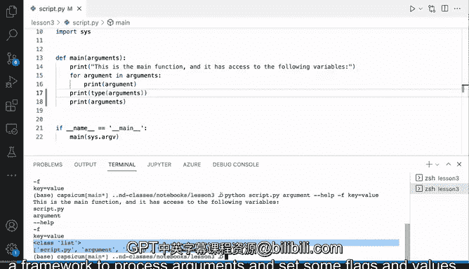

# 34：使用Python脚本的实用技巧 🐍


在本节课中，我们将学习如何编写和运行一个基础的Python脚本，并理解如何通过命令行向其传递参数。这对于自动化任务和构建可复用的工具至关重要。

---

## 脚本结构与文档

首先，我们从一个简单的Python脚本开始。脚本的开头通常包含一个文档字符串（Docstring），用于解释脚本的功能。文档字符串使用三个引号（`"""`）定义，它比普通的注释更规范，常用于生成美观的文档。

```python
"""
这是一个示例Python脚本，用于演示如何接收和处理命令行参数。
"""
```

## 定义主函数

接下来，我们定义一个名为 `main` 的函数。这个函数将负责处理脚本的主要逻辑。目前，它只是打印一条消息，并遍历接收到的所有参数。

```python
def main():
    print("这是主函数")
```

## 处理命令行参数

为了从命令行接收参数，我们需要导入 `sys` 模块并使用 `sys.argv`。`sys.argv` 是一个列表，其中包含了命令行传递给脚本的所有参数。

```python
import sys

def main():
    print("这是主函数")
    for arg in sys.argv:
        print(f"接收到参数: {arg}")
```

## 条件执行与导入保护

在脚本的底部，我们使用一个条件判断来确保 `main` 函数只在脚本被直接运行时执行，而不是在被导入为模块时执行。这是通过检查 `__name__` 变量是否为 `"__main__"` 来实现的。

```python
if __name__ == "__main__":
    main()
```

这种机制允许脚本既可以直接运行，也可以作为模块被其他代码导入，而不会在导入时产生意外的副作用。

---

## 运行脚本与传递参数

现在，让我们在命令行中运行这个脚本，并观察它是如何处理参数的。

### 基本运行

首先，我们不带任何额外参数运行脚本：

```bash
python script.py
```

输出结果将显示脚本的名称（`script.py`）作为第一个参数。

### 传递多个参数

我们可以向脚本传递多个参数，包括标志和键值对：

```bash
python script.py argument help -f key=value
```

脚本将依次打印出所有接收到的参数。

### 查看参数类型

为了更清楚地了解参数的类型，我们可以在脚本中添加一行代码来打印每个参数的类型：

```python
for arg in sys.argv:
    print(f"参数: {arg}, 类型: {type(arg)}")
```

再次运行脚本，你会看到所有参数都是以字符串形式传递的。

---

## 总结



本节课中，我们一起学习了如何编写一个基础的Python脚本，并通过 `sys.argv` 接收和处理命令行参数。我们还了解了如何使用 `if __name__ == "__main__":` 来保护脚本在被导入时不执行主逻辑。这些技巧是构建更复杂命令行工具的基础。如果你需要处理更复杂的参数（如可选标志、默认值等），建议使用专门的库，如 `argparse`。